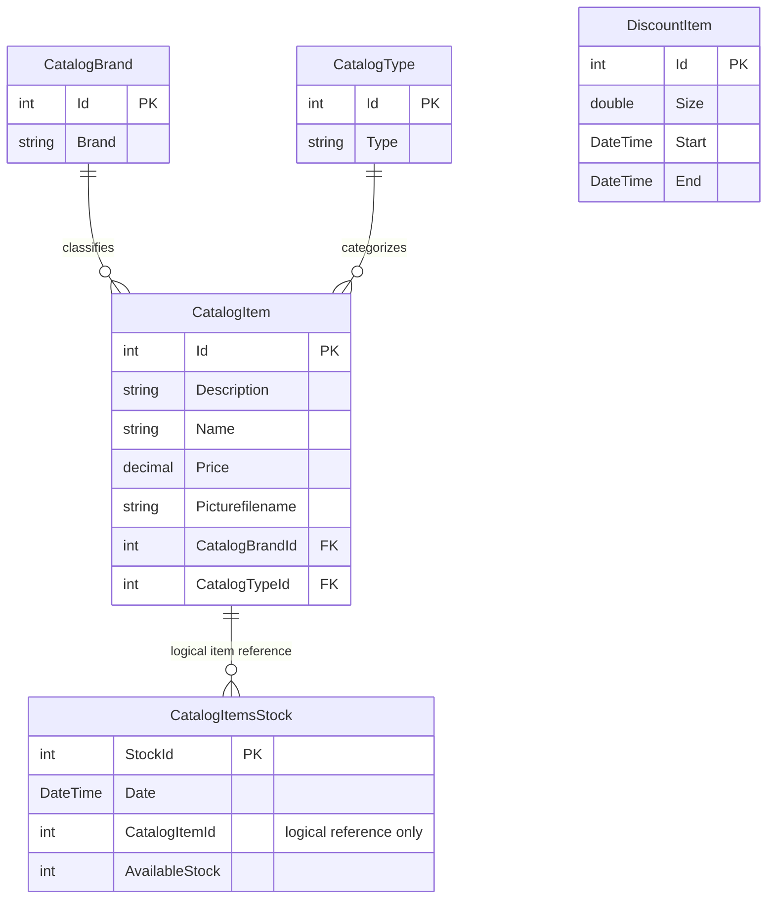

# Data Architecture & Persistence Layer

Five EF6 entity sets persist catalog, brand, type, dated stock and discount data to SQL Server. This is a source-derived model, not a verified live schema.

## Database Configuration

| Service/Module | DB Type | Profile | Driver | Connection | Migration Tool |
|---|---|---|---|---|---|
| eShopWCFService | SQL Server | Local/default | System.Data.SqlClient and EF6 SqlServer provider | Named configuration fallback; full string redacted | CreateDatabaseIfNotExists initializer; no versioned migrations found |
| eShopWCFService | SQL Server Windows Developer container | Compose override | Same provider | Environment override; full string redacted | Same code initializer |

Connection precedence and raw setting names belong to `configuration-inventory.md`. EF registers the initializer when constructing EntityModel [P1, P2]. It creates/seeds absent databases rather than migrating an existing schema. Seed order is types, brands, products, stock, discounts; each helper saves separately [P3]. Seed data includes 12 items, five brands, four types, six stock rows and six date-bounded discounts, with dates in 2017 [P4]. No explicit pool tuning, SQL schema-version scripts or deployed encryption policy was identified.

## Data Ownership per Service

| Service | Tables Owned | ORM Framework | Caching | Notes |
|---|---|---|---|---|
| eShopWCFService | CatalogBrands, CatalogItems, CatalogTypes, DiscountItems inferred by EF conventions; CatalogItemsStock explicitly named | EF6 6.1.3 | No application cache found | Five DbSets [P1]; physical deployed names unverified |
| eShopWinForms | None in active controller/proxy path | EF package declared but not used for active persistence | No application cache found | Uses generated contracts via SOAP [P8] |

## Entity Model

All entities are owned by eShopWCFService. The item-to-stock edge is a **logical** relationship used by service queries, not proof of an EF/database FK: stock has an integer item identifier but no navigation property or explicit relationship configuration [P5, P7]. Product-to-brand/type navigations are unidirectional, with no inverse collections. Required integer references imply required relationships by EF convention; generated schema and cascade behavior were not inspected.

| Entity | Fields / mapping notes | Source |
|---|---|---|
| CatalogBrand | int Id with database generation disabled; string Brand, max length 50, non-Unicode mapping | [P1, P5] |
| CatalogType | int Id with database generation disabled; string Type, max length 50, non-Unicode mapping | [P1, P5] |
| CatalogItem | int Id with generation disabled; strings Description, Name, Picturefilename; decimal Price mapped money and precision 19,4; int brand/type IDs and navigation objects | [P1, P5] |
| CatalogItemsStock | int StockId explicit key with generation disabled; DateTime Date mapped date; int CatalogItemId and AvailableStock; explicit singular table name | [P5] |
| DiscountItem | int Id explicit key; double Size; DateTime Start/End mapped date; no relation to individual items | [P6] |

Data contracts are mutable classes, not immutable snapshots. The model has no explicit concurrency token, soft-delete or audit columns. Field validation and business decisions are documented only in `business-workflows.md`.

## Key Repository Methods

There is no repository interface: CatalogService queries EntityModel directly. No custom inherited repository CRUD surface exists [P7].

| Service | Repository | Notable Methods | Purpose |
|---|---|---|---|
| CatalogService | EntityModel DbSets | `FindCatalogItem(int): CatalogItem` | Item lookup followed by explicit brand/type lookups |
| CatalogService | EntityModel DbSets | `GetCatalogItems(int,int): List<CatalogItem>` | Materializes all items before applying optional filters |
| CatalogService | EntityModel DbSets | `GetDiscount(DateTime): DiscountItem` | Materializes discounts, then date-range matching and first result |
| CatalogService | EntityModel DbSets | `GetAvailableStock(DateTime,int): int` | SQL item predicate, then in-memory date comparison |
| CatalogService | EntityModel DbSets | `CreateAvailableStock(CatalogItemsStock): void` | Query by item/date; update existing row or insert |
| CatalogService | EntityModel DbSets | Create / Update / RemoveCatalogItem | SaveChanges per call; update marks supplied entity Modified |
| Infrastructure | CatalogItemHiLoGenerator | `GetNextSequenceValue(EntityModel): int` | Raw SQL `SELECT NEXT VALUE FOR catalog_hilo`; no active service call site found [P9] |

Each SaveChanges has EF's normal per-save transaction behavior; no explicit multi-operation transaction, saga or transaction propagation is declared. Read-then-write and MAX-plus-one allocation are not enclosed in an application transaction [P7].

## Caching Strategy

No Redis, MemoryCache, distributed cache, explicit query-result cache or configured EF second-level cache was found. DbContext tracking is per context, not an application caching policy. There are no application TTL, eviction or cache-region settings to inventory. Client arrays and controls hold loaded results but do not establish a reusable cache.

## Data Ownership Boundaries

A single service reads and writes the same catalog database: no database-per-domain partition, CQRS store separation, outbox or cross-service database joins were identified. The desktop receives SOAP contracts, not direct database access. Brand/type enrichment occurs inside CatalogService; discount/catalog display composition occurs in the desktop [P7, P8]. The unused HiLo helper does not prove that its sequence is provisioned or used.

### Data Classification & Sensitivity

| Entity | Sensitive Fields | Classification (PII/PHI/PCI/None) | Controls in Place |
|---|---|---|---|
| CatalogBrand, CatalogType | No personal fields identified | None detected | No field-level masking declared |
| CatalogItem | Product names/descriptions/prices/images, not identified as personal records | None detected | No field-level encryption or authorization declared |
| CatalogItemsStock | Stock/date/item reference | None detected; commercially sensitive operational data possible | No field-level controls declared |
| DiscountItem | Promotion fraction and dates | None detected | No field-level controls declared |

No PII, PHI or PCI data was detected in the entity model. Connection credentials are sensitive configuration, not domain data, and are redacted in documentation. Database encryption-at-rest, deployed access policies and external backups cannot be established from these sources.

**Evidence:**

- [P1] `D:\a\eShopModernizing\eShopModernizing\eShopModernizedNTier\src\eShopWCFService\EntityModel.cs:10-40`.
- [P2] `D:\a\eShopModernizing\eShopModernizing\eShopModernizedNTier\src\eShopWCFService\Models\Infrastructure\CatalogConfiguration.cs:10-18`.
- [P3] `D:\a\eShopModernizing\eShopModernizing\eShopModernizedNTier\src\eShopWCFService\Models\Infrastructure\CatalogDBInitializer.cs:11-79`.
- [P4] `D:\a\eShopModernizing\eShopModernizing\eShopModernizedNTier\src\eShopWCFService\Models\Infrastructure\PreconfiguredData.cs:10-74`.
- [P5] `D:\a\eShopModernizing\eShopModernizing\eShopModernizedNTier\src\eShopWCFService\Models\CatalogBrand.cs:10-19`; `D:\a\eShopModernizing\eShopModernizing\eShopModernizedNTier\src\eShopWCFService\Models\CatalogType.cs:10-19`; `D:\a\eShopModernizing\eShopModernizing\eShopModernizedNTier\src\eShopWCFService\Models\CatalogItem.cs:10-35`; `D:\a\eShopModernizing\eShopModernizing\eShopModernizedNTier\src\eShopWCFService\Models\CatalogItemsStock.cs:10-25`.
- [P6] `D:\a\eShopModernizing\eShopModernizing\eShopModernizedNTier\src\eShopWCFService\Models\DiscountItem.cs:11-31`.
- [P7] `D:\a\eShopModernizing\eShopModernizing\eShopModernizedNTier\src\eShopWCFService\CatalogService.svc.cs:28-117`.
- [P8] `D:\a\eShopModernizing\eShopModernizing\eShopModernizedNTier\src\eShopWinForms\Controllers\CatalogController.cs:35-84`.
- [P9] `D:\a\eShopModernizing\eShopModernizing\eShopModernizedNTier\src\eShopWCFService\Models\CatalogItemHiLoGenerator.cs:10-29`.
