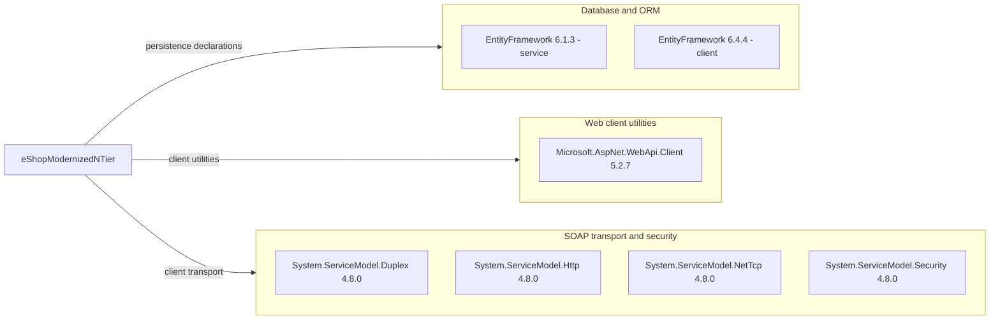

# Dependency Map

The scoped eShopModernizedNTier solution declares six unique NuGet package names, seven active-project package/version pairs (EF appears at two versions), and no test-scoped packages. This inventory uses build/package manifests only; framework assemblies and build tooling are reported separately, not counted as NuGet packages.

## Dependencies

### Dependency Summary

| Category | Count | Key Libraries | Notes |
|---|---|---|---|
| Database / ORM | 1 unique name; 2 version pairs | EntityFramework 6.1.3, 6.4.4 | Server packages.config vs client PackageReference [D1, D2] |
| Web Frameworks / client utilities | 1 | Microsoft.AspNet.WebApi.Client 5.2.7 | Client package, not evidence of an HTTP API host [D1] |
| Messaging / synchronous SOAP transport | 3 | System.ServiceModel.Duplex, Http, NetTcp 4.8.0 | Package presence does not prove every transport is used [D1] |
| Security | 1 | System.ServiceModel.Security 4.8.0 | Declaration does not establish endpoint security [D1] |
| Logging, caching, observability | 0 | None declared as NuGet packages | Framework facilities may exist independently |

All seven active package/version declarations are ordinary application dependencies, not marked test-only or build-only. No lockfile, central package management file or resolved transitive tree was found in scope; transitive counts and versions are therefore unknown.

**Framework/build dependencies, excluded from package count:** server .NET Framework 4.6.1 provides System.Web, System.ServiceModel, System.Runtime.Serialization and System.Data assemblies; EF's SQL Server assembly is part of its package, not an additional package [D3]. The client targets net6.0-windows with Windows Forms and WPF enabled [D1]. The orchestration project declares Microsoft.Docker.Sdk without a pinned SDK version [D5].

### Version & Compatibility Risks

The server targets an out-of-support .NET Framework version (4.6.1), and the active desktop target .NET 6 is also out of support as of this assessment. EF6 is not EF Core; server 6.1.3 and client 6.4.4 should not be treated as one resolved version. Legacy WCF/System.Web server hosting, old package versions and mixed project formats require compatibility review; no vulnerability or current package-support claim is made without advisory validation [D1–D3].

This is a declared-dependency inventory, not an upgrade assessment. The active client is explicitly Windows-targeted [D1]; compatibility findings produced for a non-Windows target cannot establish that its Windows Forms APIs require rewrites. See the coordinator-provided upgrade-report interpretation limitation in `architecture-diagram.md`.

### Notable Observations

- The solution selects `eShopWinForms.csproj`, not the adjacent `.fx.csproj` [D4].
- The alternate `.fx.csproj` targets .NET Framework 4.7.1 and declares EntityFramework 6.1.3 plus Microsoft.AspNet.WebApi.Client 5.2.3. These are alternate-manifest declarations, excluded from the active count [D6].
- PackageReference and packages.config coexist; the server additionally uses assembly HintPaths into a packages directory [D2, D3].
- No external DI, queue, cache, logging or telemetry package is declared. Do not infer runtime absence solely from this manifest-only assessment.

## Test Dependencies

| Framework | Version | Notes |
|---|---|---|
| None detected | Not applicable | No test project in the scoped solution; no test-scoped package declaration in the three project manifests [D1–D4, D6] |

Total test-scope dependencies: **0**. No test-framework or integration-test infrastructure is declared in these manifests.

**Evidence:**

- [D1] `D:\a\eShopModernizing\eShopModernizing\eShopModernizedNTier\src\eShopWinForms\eShopWinForms.csproj:1-8,21-28`.
- [D2] `D:\a\eShopModernizing\eShopModernizing\eShopModernizedNTier\src\eShopWCFService\packages.config:1-4`.
- [D3] `D:\a\eShopModernizing\eShopModernizing\eShopModernizedNTier\src\eShopWCFService\eShopWCFService.csproj:15,45-70`.
- [D4] `D:\a\eShopModernizing\eShopModernizing\eShopModernizedNTier\eShopModernizedNTier.sln:6-11`.
- [D5] `D:\a\eShopModernizing\eShopModernizing\eShopModernizedNTier\docker-compose.dcproj:2-9`.
- [D6] `D:\a\eShopModernizing\eShopModernizing\eShopModernizedNTier\src\eShopWinForms\eShopWinForms.fx.csproj:11,265-270`.
