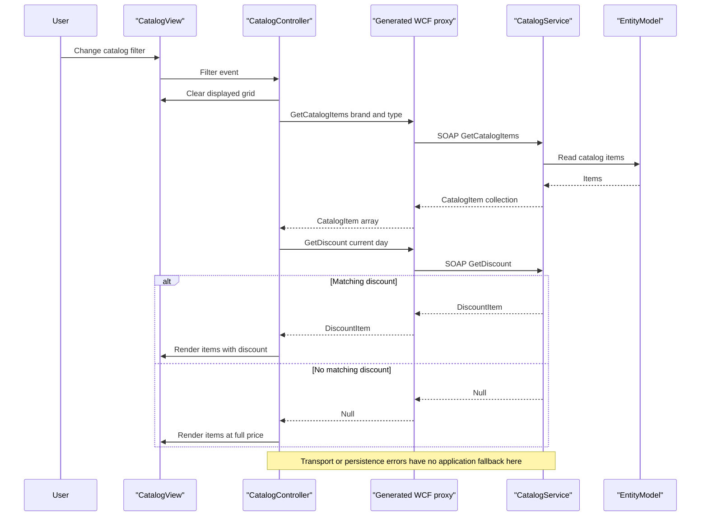

# API & Service Communication Contracts

Scoped source defines **ten SOAP operations at one WCF address**, not ten REST URLs. The desktop uses synchronous request/reply calls, although the generated proxy also offers Task-based variants of the same operations. [S1, S2, S3]

## Service Catalog

| Service | Port | Category | Purpose |
|---|---|---|---|
| eShopWCFService / eshopwcfservice | Compose host 5113 → container 80; development IIS URL uses 5200 | Business | Catalog, discounts and dated availability; WCF with EF 6.1.3. Ports are deployment/development declarations, not live observations. [S4, S5, S6] |
| eShopWinForms | No listener declared | API consumer / desktop presentation | Generated System.ServiceModel 4.8.0 client; no gateway role. [S3, S7] |
| sql.data | Compose host 5433 → 1433 | Infrastructure, third-party container | SQL Server deployment dependency, not a source-built API. [S4, S8] |

Solution membership identifies two application projects and Docker orchestration, not a fleet of microservices. [S9]

## API Endpoints Inventory

All rows below use **POST `/CatalogService.svc`** with a SOAP envelope and operation-specific action. This method/protocol interpretation follows the BasicHttpBinding declaration and generated SOAP actions, not REST annotations. The action prefix is `http://tempuri.org/ICatalogService/`; suffixes are the operation names below and replies append `Response`. No explicit API versioning or typed FaultContract is declared. [S1, S2, S5]

| Service | Method | Path | Request Type | Response Type |
|---|---|---|---|---|
| CatalogService | SOAP POST | `/CatalogService.svc` — FindCatalogItem | `int id` | `CatalogItem`, null when absent. [S1, S10] |
| CatalogService | SOAP POST | Same address — GetCatalogBrands | No arguments | `List<CatalogBrand>`; generated client receives array. [S1, S2] |
| CatalogService | SOAP POST | Same address — GetCatalogItems | `int brandIdFilter, int typeIdFilter` | `List<CatalogItem>` / client array. [S1, S2] |
| CatalogService | SOAP POST | Same address — GetCatalogTypes | No arguments | `List<CatalogType>` / client array. [S1, S2] |
| CatalogService | SOAP POST | Same address — GetAvailableStock | `DateTime date, int catalogItemId` | `int`, zero if no record. [S1, S10] |
| CatalogService | SOAP POST | Same address — CreateAvailableStock | `CatalogItemsStock` | Void SOAP reply after persistence. [S1, S10] |
| CatalogService | SOAP POST | Same address — CreateCatalogItem | `CatalogItem` | Void SOAP reply. [S1, S10] |
| CatalogService | SOAP POST | Same address — UpdateCatalogItem | `CatalogItem` | Void SOAP reply. [S1, S10] |
| CatalogService | SOAP POST | Same address — RemoveCatalogItem | `CatalogItem` | Void SOAP reply. [S1, S10] |
| CatalogService | SOAP POST | Same address — GetDiscount | `DateTime day` | `DiscountItem`, null when no match. [S1, S10] |

No source-level HTTP status mapping, REST-style 201/204/404 handling or validation-to-400 contract is defined. Protocol success/fault status behavior is framework/host-dependent and was not exercised; do not interpret a null item as an implemented HTTP 404. [S1, S5, S10]

## Management & Observability Endpoints

| Service | Endpoint | Custom Metrics (if any) |
|---|---|---|
| CatalogService | `/CatalogService.svc/mex` — explicit HTTP metadata endpoint | No custom metric registration found in inspected service/configuration. [S5, S10] |
| CatalogService | HTTP and HTTPS GET metadata enabled; conventional WSDL retrieval at service metadata address, not a separately coded REST action | HTTPS metadata enablement is not proof of a configured TLS listener. [S5] |
| CatalogService | No application health/Swagger/metrics route identified | SQL container's command healthcheck is deployment-only, not an API endpoint. [S4, S5] |

## DTOs & Contracts

| Class | Contract role | Mutability and ownership |
|---|---|---|
| CatalogItem | Create/update/delete request; item/find/list response | Mutable service-domain entity and generated mutable client copy. [S11, S12] |
| CatalogBrand, CatalogType | Lookup responses; nested item references | Mutable service-domain entities, no gateway DTOs. [S11, S12] |
| CatalogItemsStock | Availability write request | Mutable service-domain entity. [S11, S12] |
| DiscountItem | Discount response | Mutable service-domain entity. [S11, S12] |

Serialization uses WCF DataContract/DataMember annotations and generated schemas in the `http://schemas.datacontract.org/2004/07/` namespaces. The generated namespace mapping separates client copies from service types; no immutable records or gateway composition contract is defined. No OpenAPI, protobuf or GraphQL contract was found in the scoped inventory. [S11–S13] Field/persistence details belong to `D:\a\eShopModernizing\eShopModernizing\eShopModernizedNTier\.github\modernize\assessment\engines\facts\data-architecture.md`.

## Communication Patterns

- **Synchronous:** UI controller calls generated WCF methods on the startup/UI path; server uses direct DbContext calls. Generated Async methods are client alternatives, not queue/event messaging. No broker, gateway, service discovery or client load-balancing configuration is present in the traced path. [S2, S3, S10]
- **Composition:** desktop separately requests catalog items and today's discount, then combines them for display. A failed call is not replaced with cached or empty data: this path has no catch/retry/circuit breaker/fallback. [S3]
- **Resilience:** no explicit operation/open/send/receive timeout values are set in the generated binding or supplied App.config binding; effective framework defaults are unverified. Buffer/receive-size limits are `int.MaxValue` (2147483647); reader quotas are Max; cookies are allowed. No application retry policy is configured. [S14, S15]
- **Address resolution:** Program's parameterless generated client selects a code-defined HTTP localhost:5113 address. App.config contains an equivalent address, but changing it alone does not alter this generated constructor path. [S7, S14, S15]
- **Startup dependency:** client loads data before opening its dialog; server requires database connectivity when queried. Compose declares SQL startup ordering without a health-conditioned dependency. Full deployment details are in `D:\a\eShopModernizing\eShopModernizing\eShopModernizedNTier\.github\modernize\assessment\engines\facts\configuration-inventory.md`. [S7, S8, S10]
- **Security posture:** inspected operation implementation has no identity, role or resource-ownership checks. The active client address and explicit service endpoint use Basic HTTP without configured credentials/transport-security customization. HTTPS protocol mapping and HTTPS metadata are declared, but no concrete TLS listener/certificate is established by these files. Actual IIS/network access restrictions remain unknown; public Internet accessibility is **not** established. Exception details in SOAP faults are disabled. [S5, S10, S14, S15]

## Service Technology Matrix

| Service | Web | Data Access | Discovery | Gateway | Actuator / health | Cache | Metrics |
|---|---|---|---|---|---|---|---|
| CatalogService | WCF SOAP | EF6 DbContext | None in inspected path | None | Metadata only | None in operation path | None identified [S5, S10] |
| WinForms | Desktop WCF consumer | No direct DB access in controller | Hardcoded address | Client-side display composition only | None | None in controller | None identified [S3, S7, S14] |
| sql.data | Not an application HTTP service | SQL Server container | Compose name | None | SQL command healthcheck | Not a cache | Not configured in manifest [S4, S8] |

## Service Communication Sequence

Sequence evidence: [S3, S10]. **Gaps:** contracts were not exercised against a host; actual WSDL, HTTP statuses, TLS, timeout behavior and deployed endpoint availability are unknown.

### Evidence

- [S1] `D:\a\eShopModernizing\eShopModernizing\eShopModernizedNTier\src\eShopWCFService\ICatalogService.cs:12-35`
- [S2] `D:\a\eShopModernizing\eShopModernizing\eShopModernizedNTier\src\eShopWinForms\Connected Services\eShopServiceReference\Reference.cs:366-428`
- [S3] `D:\a\eShopModernizing\eShopModernizing\eShopModernizedNTier\src\eShopWinForms\Controllers\CatalogController.cs:14-158`
- [S4] `D:\a\eShopModernizing\eShopModernizing\eShopModernizedNTier\docker-compose.override.yml:5-20`
- [S5] `D:\a\eShopModernizing\eShopModernizing\eShopModernizedNTier\src\eShopWCFService\Web.config:22-43`
- [S6] `D:\a\eShopModernizing\eShopModernizing\eShopModernizedNTier\src\eShopWCFService\eShopWCFService.csproj:124-127`; `D:\a\eShopModernizing\eShopModernizing\eShopModernizedNTier\src\eShopWCFService\packages.config:3`
- [S7] `D:\a\eShopModernizing\eShopModernizing\eShopModernizedNTier\src\eShopWinForms\Program.cs:17-27`; `D:\a\eShopModernizing\eShopModernizing\eShopModernizedNTier\src\eShopWinForms\eShopWinForms.csproj:21-28`
- [S8] `D:\a\eShopModernizing\eShopModernizing\eShopModernizedNTier\docker-compose.yml:3-13`
- [S9] `D:\a\eShopModernizing\eShopModernizing\eShopModernizedNTier\eShopModernizedNTier.sln:6-11`
- [S10] `D:\a\eShopModernizing\eShopModernizing\eShopModernizedNTier\src\eShopWCFService\CatalogService.svc.cs:18-118`
- [S11] `D:\a\eShopModernizing\eShopModernizing\eShopModernizedNTier\src\eShopWCFService\Models\CatalogItem.cs:10-35`; `D:\a\eShopModernizing\eShopModernizing\eShopModernizedNTier\src\eShopWCFService\Models\CatalogBrand.cs:10-19`; `D:\a\eShopModernizing\eShopModernizing\eShopModernizedNTier\src\eShopWCFService\Models\CatalogType.cs:10-19`; `D:\a\eShopModernizing\eShopModernizing\eShopModernizedNTier\src\eShopWCFService\Models\CatalogItemsStock.cs:10-25`; `D:\a\eShopModernizing\eShopModernizing\eShopModernizedNTier\src\eShopWCFService\Models\DiscountItem.cs:11-31`
- [S12] `D:\a\eShopModernizing\eShopModernizing\eShopModernizedNTier\src\eShopWinForms\Connected Services\eShopServiceReference\Reference.cs:17-364`
- [S13] `D:\a\eShopModernizing\eShopModernizing\eShopModernizedNTier\src\eShopWinForms\Connected Services\eShopServiceReference\ConnectedService.json:8-20`
- [S14] `D:\a\eShopModernizing\eShopModernizing\eShopModernizedNTier\src\eShopWinForms\Connected Services\eShopServiceReference\Reference.cs:448-479`; `D:\a\eShopModernizing\eShopModernizing\eShopModernizedNTier\src\eShopWinForms\Connected Services\eShopServiceReference\Reference.cs:591-621`
- [S15] `D:\a\eShopModernizing\eShopModernizing\eShopModernizedNTier\src\eShopWinForms\App.config:13-30`
