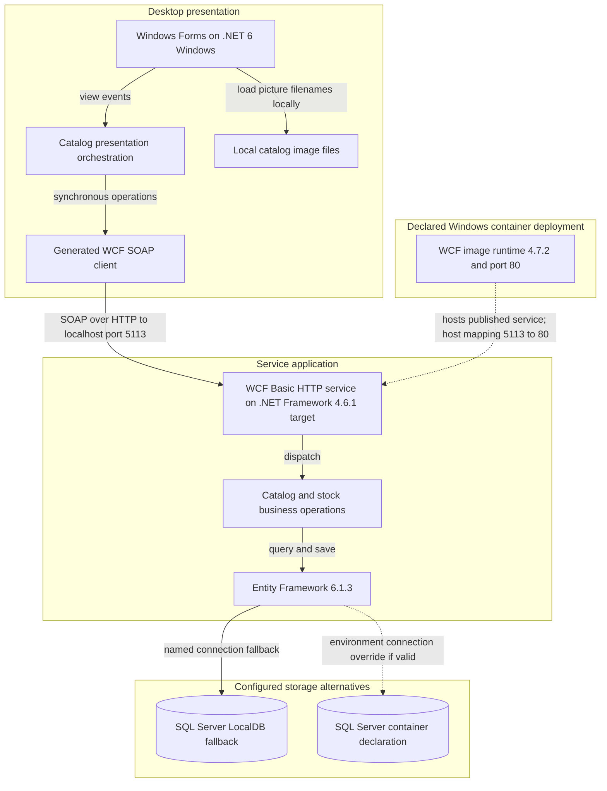
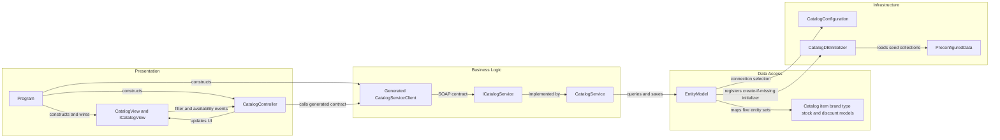

# Architecture Diagram

Static assessment of **only** `D:\a\eShopModernizing\eShopModernizing\eShopModernizedNTier`. The solution connects a desktop catalog client to one WCF service; diagrams describe implemented calls and separately label deployment declarations, not verified running infrastructure. [A1–A6]

## Application Architecture

Diagram evidence: client construction and calls [A2, A3], image access [A4], service/data access [A5, A6], connection selection [A7, A8], container declarations [A9, A10]. SQL container connectivity is **not demonstrated**: the supplied connection override ends in a placeholder rather than a complete credential configuration. [A10]

### Technology Stack Summary

| Layer | Technology | Version | Purpose |
|---|---|---|---|
| Presentation | Windows Forms; WPF enabled in project | `net6.0-windows` | Desktop UI; WPF enablement is a build setting, not proof of WPF screens. [A11] |
| Client communication | System.ServiceModel HTTP client | 4.8.0 package | Generated SOAP proxy; parameterless construction uses a code-defined address and binding. [A2, A12, A13] |
| Service | WCF / System.Web | .NET Framework 4.6.1 target | IIS-hosted service, not ASP.NET Core or a REST controller. [A5, A8, A14] |
| Persistence | Entity Framework | 6.1.3 | DbContext, LINQ queries and SaveChanges. [A6, A15] |
| Storage | SQL Server / LocalDB | Server engine version unpinned | LocalDB fallback or environment-selected server. [A7–A10] |
| Deployment | Windows WCF container | image tag 4.7.2 | Copies previously published files; does not compile source. [A9] |

### Data Storage & External Services

The service owns one context containing five entity sets; SQL Server is the configured provider and LocalDB is the named fallback. Compose declares a separate SQL Server container, not another application service. There is no cache, broker or external API call in the traced service/client path; their existence outside this scope is unknown. [A3, A5–A10]

### Key Architectural Decisions

- View events drive a presentation controller; startup manually supplies the generated proxy and view. There is no active container-based DI in this path; the alternative registration module is commented out. [A2, A3, A16]
- Service operations directly use EntityModel rather than a separate repository layer. Catalog display composes item and discount responses in the desktop controller. [A3, A5]
- Build/runtime settings diverge: desktop target is .NET 6, legacy desktop project and App.config refer to Framework 4.7.1, service targets Framework 4.6.1, and its container tag is 4.7.2. These are declarations, not a verified compatibility result. [A8, A9, A11, A17, A18]

## Component Relationships

Component evidence: [A2, A3, A5–A7, A12, A19]. No middleware, authorization filter or retry interceptor is installed in these inspected paths/configurations; host-level additions are unknown. [A2, A5, A8]

### Component Inventory

| Component | Layer | Type | Responsibility |
|---|---|---|---|
| Program | Presentation | Entry point | Constructs view, generated service client and controller; loads before showing dialog. [A2] |
| CatalogView / ICatalogView | Presentation | Form / view contract | Emits filter/stock events; displays prices, pictures, banners and availability. [A3, A4] |
| CatalogController | Presentation | Orchestrator | Loads filters, combines discount/catalog data, delegates stock calls. [A3] |
| Generated CatalogServiceClient / ICatalogService | Communication | Proxy / SOAP contract | Ten operation pairs with synchronous and Task-based client methods. [A12] |
| CatalogService | Business | WCF implementation | Catalog CRUD, date-based discount and stock operations. [A5] |
| EntityModel | Data access | EF DbContext | Five sets and model configuration. [A6] |
| CatalogConfiguration | Infrastructure | Static configuration | Environment override with named connection fallback. [A7] |
| CatalogDBInitializer / PreconfiguredData | Infrastructure | Initializer / seed factory | Creates missing database and inserts sample data. [A19] |

**Gaps:** no deployment/build execution performed; actual IIS bindings, SQL engine version, deployed schema, availability and external access controls are unknown. An additional service-side `CatalogServiceClient.cs` is not in the service project's explicit Compile list and is not the proxy constructed by Program. Mock support is not selected by startup. [A2, A14, A16]

### Evidence

- [A1] `D:\a\eShopModernizing\eShopModernizing\eShopModernizedNTier\eShopModernizedNTier.sln:6-11`
- [A2] `D:\a\eShopModernizing\eShopModernizing\eShopModernizedNTier\src\eShopWinForms\Program.cs:17-27`
- [A3] `D:\a\eShopModernizing\eShopModernizing\eShopModernizedNTier\src\eShopWinForms\Controllers\CatalogController.cs:14-158`
- [A4] `D:\a\eShopModernizing\eShopModernizing\eShopModernizedNTier\src\eShopWinForms\Views\CatalogView.cs:48-61`
- [A5] `D:\a\eShopModernizing\eShopModernizing\eShopModernizedNTier\src\eShopWCFService\CatalogService.svc.cs:14-118`
- [A6] `D:\a\eShopModernizing\eShopModernizing\eShopModernizedNTier\src\eShopWCFService\EntityModel.cs:10-40`
- [A7] `D:\a\eShopModernizing\eShopModernizing\eShopModernizedNTier\src\eShopWCFService\Models\Infrastructure\CatalogConfiguration.cs:10-17`
- [A8] `D:\a\eShopModernizing\eShopModernizing\eShopModernizedNTier\src\eShopWCFService\Web.config:18-64`
- [A9] `D:\a\eShopModernizing\eShopModernizing\eShopModernizedNTier\src\eShopWCFService\Dockerfile:1-5`
- [A10] `D:\a\eShopModernizing\eShopModernizing\eShopModernizedNTier\docker-compose.yml:3-13`; `D:\a\eShopModernizing\eShopModernizing\eShopModernizedNTier\docker-compose.override.yml:5-25`
- [A11] `D:\a\eShopModernizing\eShopModernizing\eShopModernizedNTier\src\eShopWinForms\eShopWinForms.csproj:1-8`
- [A12] `D:\a\eShopModernizing\eShopModernizing\eShopModernizedNTier\src\eShopWinForms\Connected Services\eShopServiceReference\Reference.cs:366-479`; `D:\a\eShopModernizing\eShopModernizing\eShopModernizedNTier\src\eShopWinForms\Connected Services\eShopServiceReference\Reference.cs:591-621`
- [A13] `D:\a\eShopModernizing\eShopModernizing\eShopModernizedNTier\src\eShopWinForms\eShopWinForms.csproj:21-28`
- [A14] `D:\a\eShopModernizing\eShopModernizing\eShopModernizedNTier\src\eShopWCFService\eShopWCFService.csproj:15-23`; `D:\a\eShopModernizing\eShopModernizing\eShopModernizedNTier\src\eShopWCFService\eShopWCFService.csproj:77-93`
- [A15] `D:\a\eShopModernizing\eShopModernizing\eShopModernizedNTier\src\eShopWCFService\packages.config:3`
- [A16] `D:\a\eShopModernizing\eShopModernizing\eShopModernizedNTier\src\eShopWinForms\Modules\ApplicationModule.cs:6-34`
- [A17] `D:\a\eShopModernizing\eShopModernizing\eShopModernizedNTier\src\eShopWinForms\eShopWinForms.fx.csproj:11`
- [A18] `D:\a\eShopModernizing\eShopModernizing\eShopModernizedNTier\src\eShopWinForms\App.config:7-16`
- [A19] `D:\a\eShopModernizing\eShopModernizing\eShopModernizedNTier\src\eShopWCFService\Models\Infrastructure\CatalogDBInitializer.cs:11-79`
