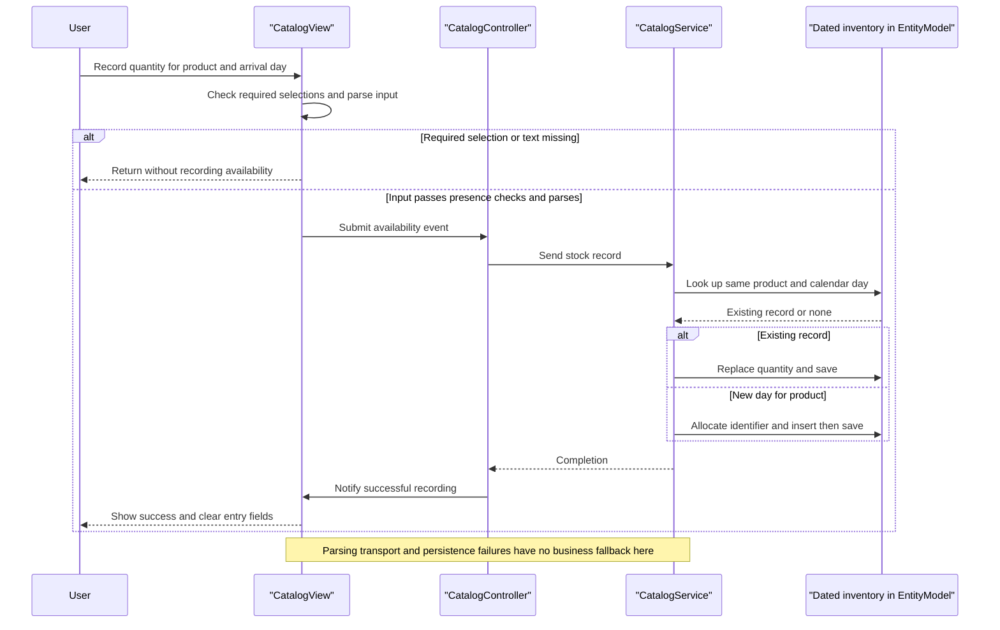

# Core Business Workflows

Users browse and filter a product catalog, see date-based sale prices, query stock availability and record stock for an arrival date. These are the workflows traced in the scoped desktop/service sources; no ordering, payment or shipment-fulfillment lifecycle is established. [B1–B4]

## Domain Entities

| Entity | Service / Bounded Context | Description | Key Relationships |
|---|---|---|---|
| CatalogItem | CatalogService / catalog management | Product offered for browsing | Classified by brand and type; referenced by dated inventory. [B5, B6] |
| CatalogBrand | CatalogService / catalog classification | Product brand lookup | Used by products and UI filters. [B5, B1] |
| CatalogType | CatalogService / catalog classification | Product category lookup | Used by products and UI filters. [B5, B1] |
| CatalogItemsStock | CatalogService / dated inventory | Available quantity for one product/day; UI calls this a shipment | Logical association to product, not a full shipment aggregate. [B2, B3, B6] |
| DiscountItem | CatalogService / promotions | Global date-bounded discount used for catalog display | No product-specific association; client applies selected discount to displayed items. [B1, B2, B5] |

These are descriptive business groupings, not independently deployed bounded contexts or explicit DDD aggregates. Persistence fields/mappings belong to `D:\a\eShopModernizing\eShopModernizing\eShopModernizedNTier\.github\modernize\assessment\engines\facts\data-architecture.md`.

## Service-to-Domain Mapping

| Service | Domain Context | Owned Entities | External Dependencies |
|---|---|---|---|
| CatalogService | Catalog, classification, promotion, dated inventory | All five domain entities | One EntityModel persistence context. [B2, B7] |
| WinForms client | Presentation / user interaction | No authoritative persisted domain records | Consumes generated WCF contract; local images support catalog display. [B1, B3, B4] |

There is one source-built business service; UI composition does not constitute a separate API gateway or domain service. [B4, B8]

## Primary Workflows

### Workflow 1: Browse catalog with current promotion

1. Startup manually constructs client/controller/view and calls LoadView before showing the window. LoadView checks the promotion banner, loads items, loads brand/type filters, then populates inventory-selection lists. [B1, B4]
2. Filter changes emit an event; controller clears the grid and requests matching products using the **All-filter rule**. [B1, B3]
3. Service returns products, then controller independently requests today's discount using **Active-promotion selection**. No matching discount means normal prices, not an outage fallback. [B1, B2]
4. View applies **Displayed-price calculation**, loads each local image and renders the catalog. A separate initial discount lookup builds the sale-end banner. [B1, B3]

The grid is cleared before the remote requests complete. No application-level recovery restores it if communication/image loading fails. Re-evaluation uses client local time, not an authoritative server-supplied business calendar. [B1, B3]

### Workflow 2: Record or replace dated stock availability

1. User chooses a product, quantity and arrival date; the form applies **Availability-entry parsing**. [B3]
2. Controller constructs a stock request and sends it to the service. [B1]
3. Service finds a same-product/calendar-day record and applies **Stock replacement**, otherwise **New-record identity allocation**. [B2]
4. After the remote call returns, the form displays success and clears entry controls. Failure has no compensating action or business fallback in this path. [B1, B3]

Despite the UI's shipment wording, adding availability **replaces** an existing day's number; it does not increment a running stock balance or track delivery status. [B2]

### Workflow 3: Check stock for a selected day

1. User selects a product from the inventory list and a calendar day. The form extracts the product ID from display text and emits a search event. [B3]
2. Controller requests availability. Service chooses the first matching product/day row and applies **Missing-stock result**. [B1, B2]
3. View appends a result row; it does not replace previously displayed results. No cumulative-through-date calculation is performed. [B2, B3]

### Workflow 4: Initialize sample business state

The context registers a create-if-missing initializer. On seed execution it inserts types, brands, products, stock and discounts through separate save calls. Sample promotions and stock use 2017 dates; current-day sale activity cannot be assumed from seed data. [B7, B9] This is initialization, not a scheduled replenishment or promotion job.

Other contract operations provide item create/update/delete/find and lookup retrieval; the traced desktop exposes browsing and stock controls, not a complete catalog maintenance workflow. [B1, B2, B10]

## Cross-Service Data Flows

Only desktop-to-business-service communication is established. The desktop joins catalog and promotion responses in memory for display; brand/type responses build filter choices, and product IDs connect inventory selection to availability requests. There is no cross-microservice aggregation, event choreography, saga, broker or circuit-breaker fallback in this chain. [B1, B2, B4]

The normal absence cases are null promotion → no discount, missing product → null and missing dated stock → zero. These are business-data decisions, **not** substitute responses for an unavailable downstream service. Exceptions are not caught in these controller/service methods, so outage behavior is not a graceful degradation contract. [B1, B2]

## Business Workflow Sequence

Sequence evidence: [B1–B3]. An invalid nonempty quantity/date can throw during parsing; it does not follow the silent missing-input branch.

## Business Rules & Decision Logic

| Rule | Implemented decision | Evidence |
|---|---|---|
| All-filter rule | Zero disables the corresponding brand/type filter; nonzero values must match. Both active filters are combined with AND. | [B1, B2] |
| Active-promotion selection | Inclusive start/end calendar dates; first match after materialization, no explicit ordering or overlap priority. | [B2] |
| Displayed-price calculation | Convert decimal price to double, multiply by `1 - discount.Size`, format with `F` and prepend a dollar symbol; banner rounds size × 100 to zero decimals. No persisted discounted price is written. | [B1, B3] |
| Availability-entry parsing | Missing product selection, empty quantity or empty date returns silently; otherwise uses int.Parse and Convert.ToDateTime. No positive-quantity check or TryParse recovery is implemented here. | [B3] |
| Availability-search parsing | Assumes a selected item and parses the ID prefix from display text; no null-selection guard in this handler. | [B3] |
| Stock replacement | First record for same product/date is assigned submitted quantity rather than increased. Date comparisons ignore time. | [B2] |
| New-record identity allocation | Item and new stock keys use maximum existing key plus one. No empty-set handling or concurrent allocation protection is implemented in these service methods. | [B2] |
| Missing-stock result | No matching record yields zero; no running total across earlier dates. | [B2] |
| Declared model validation | Brand/type strings each have StringLength(50); service operation methods add no explicit validation routine, discount range check or uniqueness check. Enforcement beyond these declarations is not tested. | [B2, B5] |

**State transitions:** records are inserted, overwritten/updated or removed; no order/shipment/promotion lifecycle state machine is modeled in the inspected entities and service. [B2, B5, B6]

**Transactions and integrity:** each mutation explicitly saves; there is no enclosing multi-call transaction, saga or compensation. Stock references a product by identifier without service-level existence validation. Unidirectional item brand/type references do not have reciprocal collection-maintenance logic. [B2, B5–B7]

**Errors, audit and authorization:** the inspected controller/service path has no business exception translation, retry, audit trail or identity/role/ownership checks. This describes source behavior only; deployed database/IIS policies and external audit systems are unknown. [B1, B2, B11]

**Gaps:** workflows were not executed; culture-sensitive parsing/formatting, concurrent writers, actual seed execution and host-side errors remain unverified. The mock is not a proven fallback: live Program constructs the remote client, DI registrations are commented, and mock discount lookup throws NotImplementedException. [B4, B12, B13]

### Evidence

- [B1] `D:\a\eShopModernizing\eShopModernizing\eShopModernizedNTier\src\eShopWinForms\Controllers\CatalogController.cs:14-158`
- [B2] `D:\a\eShopModernizing\eShopModernizing\eShopModernizedNTier\src\eShopWCFService\CatalogService.svc.cs:28-118`
- [B3] `D:\a\eShopModernizing\eShopModernizing\eShopModernizedNTier\src\eShopWinForms\Views\CatalogView.cs:48-195`
- [B4] `D:\a\eShopModernizing\eShopModernizing\eShopModernizedNTier\src\eShopWinForms\Program.cs:17-27`
- [B5] `D:\a\eShopModernizing\eShopModernizing\eShopModernizedNTier\src\eShopWCFService\Models\CatalogItem.cs:10-35`; `D:\a\eShopModernizing\eShopModernizing\eShopModernizedNTier\src\eShopWCFService\Models\CatalogBrand.cs:10-19`; `D:\a\eShopModernizing\eShopModernizing\eShopModernizedNTier\src\eShopWCFService\Models\CatalogType.cs:10-19`; `D:\a\eShopModernizing\eShopModernizing\eShopModernizedNTier\src\eShopWCFService\Models\DiscountItem.cs:11-31`
- [B6] `D:\a\eShopModernizing\eShopModernizing\eShopModernizedNTier\src\eShopWCFService\Models\CatalogItemsStock.cs:10-25`
- [B7] `D:\a\eShopModernizing\eShopModernizing\eShopModernizedNTier\src\eShopWCFService\EntityModel.cs:10-22`; `D:\a\eShopModernizing\eShopModernizing\eShopModernizedNTier\src\eShopWCFService\Models\Infrastructure\CatalogDBInitializer.cs:11-79`
- [B8] `D:\a\eShopModernizing\eShopModernizing\eShopModernizedNTier\eShopModernizedNTier.sln:6-11`
- [B9] `D:\a\eShopModernizing\eShopModernizing\eShopModernizedNTier\src\eShopWCFService\Models\Infrastructure\PreconfiguredData.cs:41-75`
- [B10] `D:\a\eShopModernizing\eShopModernizing\eShopModernizedNTier\src\eShopWCFService\ICatalogService.cs:15-34`
- [B11] `D:\a\eShopModernizing\eShopModernizing\eShopModernizedNTier\src\eShopWCFService\Web.config:22-43`
- [B12] `D:\a\eShopModernizing\eShopModernizing\eShopModernizedNTier\src\eShopWinForms\Modules\ApplicationModule.cs:12-34`
- [B13] `D:\a\eShopModernizing\eShopModernizing\eShopModernizedNTier\src\eShopWCFService\CatalogServiceMock.cs:118-120`
