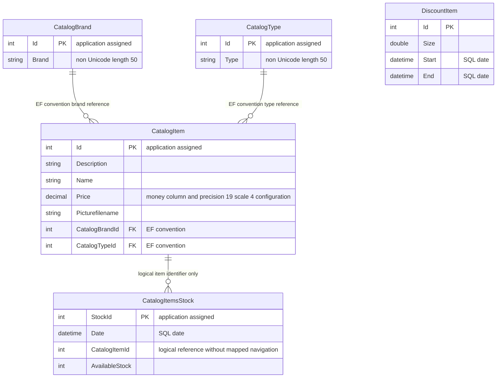

# Data Architecture & Persistence Layer

The scoped data layer contains **five EF6 entity sets** backed by a SQL Server provider, with create-if-missing initialization and programmatic sample data. This is a static model assessment, not confirmation of the deployed schema or database contents. [P1–P4]

## Database Configuration

| Service/Module | DB Type | Profile | Driver | Connection | Migration Tool |
|---|---|---|---|---|---|
| eShopWCFService | SQL Server LocalDB | Fallback when environment override is null; not a named runtime profile | System.Data.SqlClient / EF6 SQL provider | Named application connection resolves to local eShopDatabase | EF CreateDatabaseIfNotExists initializer; no versioned migration chain identified. [P1–P4] |
| eShopWCFService | SQL Server | Environment-selected connection; Compose declares a server | Same provider | Full environment value replaces named fallback; checked-in deployment value contains an incomplete credential placeholder, so connectivity is unknown | Same initializer; no separate production schema strategy declared. [P1, P3–P5] |
| eShopWinForms | No DB access on traced UI path | Desktop client | EF 6.4.4 package and LocalDB provider configuration are present | Controller calls WCF rather than opening a database | No client migration execution found in startup path. [P6, P7] |

No explicit pool sizing, isolation level, command timeout or retry is configured in the inspected context/configuration. Initialization inserts types, brands, products, stock and discounts in successive SaveChanges calls; seed samples include historical 2017 stock/discount dates. This is not a schema-upgrade mechanism for an existing database. [P1–P4, P8] Configuration keys/values are cataloged in `D:\a\eShopModernizing\eShopModernizing\eShopModernizedNTier\.github\modernize\assessment\engines\facts\configuration-inventory.md`.

## Data Ownership per Service

| Service | Tables Owned | ORM Framework | Caching | Notes |
|---|---|---|---|---|
| CatalogService | CatalogBrands, CatalogItems, CatalogTypes, DiscountItems: convention-derived names; CatalogItemsStock: explicit table name | EF 6.1.3 | No cache in inspected service path | Five sets in one context. Physical names other than the explicit stock mapping remain unverified against a database. [P1, P9–P13] |
| WinForms | None in traced controller | Generated service DTOs; declared EF package does not prove ownership | No cache in controller path | Catalog/discount display composition only. [P6, P7] |

## Entity Model

Entity definitions: CatalogItem [P9], CatalogBrand [P10], CatalogType [P11], CatalogItemsStock [P12], DiscountItem [P13]. All displayed fields are mutable public properties. CatalogItem also has CatalogBrand and CatalogType reference properties; neither reference is virtual, and no inverse collection is declared on brand/type. These imply unidirectional relationships by EF conventions, not explicit fluent relationship mappings. [P9–P11]

Stock's item ID has **no navigation property, ForeignKey annotation or fluent relationship declaration** in the inspected model; its diagram edge is business-level linkage, not proof of referential integrity. No uniqueness index for item/date or concurrency token is declared. DiscountItem has no mapped relationship to products. Cascade/fetch strategy and actual database constraints were not inspected at runtime. [P1, P12, P13]

Price has a money column annotation and context precision configuration; actual generated SQL type must be verified against a database. String storage constraints and key-generation annotations are source declarations, not evidence that an existing database matches them. [P1, P9–P13]

## Key Repository Methods

There is **no repository interface** in the traced persistence path: CatalogService operates directly on EntityModel and exposes these query/mutation methods. DbSet supplies LINQ/Add/Remove; entity state changes and SaveChanges are explicit. [P1, P14]

| Service | Repository | Notable Methods | Purpose |
|---|---|---|---|
| CatalogService | EntityModel.CatalogItems | `FindCatalogItem(int id) : CatalogItem` | First matching item, then explicit brand/type lookups; null when absent. [P14] |
| CatalogService | EntityModel.CatalogItems | `GetCatalogItems(int brandIdFilter, int typeIdFilter) : List<CatalogItem>` | Materializes all products before optional in-memory filtering; no paging/bulk-ID query. [P14] |
| CatalogService | EntityModel.DiscountItems | `GetDiscount(DateTime day) : DiscountItem` | Materializes discounts then selects first date-range match. [P14] |
| CatalogService | EntityModel.CatalogItemsStocks | `GetAvailableStock(DateTime date, int catalogItemId) : int` | SQL item filter, materialization, then date-only match; returns zero when absent. [P14] |
| CatalogService | EntityModel.CatalogItemsStocks | `CreateAvailableStock(CatalogItemsStock value) : void` | First existing same-item/day record is overwritten; otherwise assigns maximum key plus one and inserts. [P14] |
| CatalogService | EntityModel.CatalogBrands / CatalogTypes | `GetCatalogBrands() : List<CatalogBrand>`; `GetCatalogTypes() : List<CatalogType>` | Full lookup lists. [P14] |
| CatalogService | EntityModel.CatalogItems | `CreateCatalogItem(CatalogItem)`, `UpdateCatalogItem(CatalogItem)`, `RemoveCatalogItem(CatalogItem)` | Max-plus-one insert, marked-modified update, direct Remove; each calls SaveChanges. [P14] |
| Service helper, not used by traced create path | EntityModel.Database | `CatalogItemHiLoGenerator.GetNextSequenceValue(EntityModel db) : int` | Raw `SELECT NEXT VALUE FOR catalog_hilo;` and locally locked blocks of ten. No sequence creation or service invocation is shown by the inspected initializer/service. [P15, P2, P14] |

No explicit encompassing transaction/TransactionScope is declared in these methods. SaveChanges calls are separate EF persistence boundaries; application-wide atomicity, distributed transactions and concurrent ID allocation guarantees are not established. [P2, P14]

## Caching Strategy

| Layer | Provider / TTL | Pattern | Evidence and limits |
|---|---|---|---|
| Production service | None configured in inspected context/service | Re-queries and materializes sets | No Redis, MemoryCache, query-result cache or explicit second-level-cache configuration appears in these paths. [P1, P4, P14] |
| Desktop | None in controller | Reloads catalog and discount on filter change | No memoization/TTL in controller. [P7] |
| Alternative mock | In-process lists, no TTL | Sample-data substitute, **not production cache** | Mock constructs lists; live startup constructs the generated WCF client. [P6, P16] |

EF context tracking is not asserted to be an application cache. External database/host caching, if any, is unknown. [P1]

## Data Ownership Boundaries

One service context holds all catalog, lookup, stock and promotion records. The desktop accesses them through service contracts; it combines catalog and discount responses for display, not by querying another service's tables. No database-per-business-service separation, CQRS read model, outbox or event-driven replication is implemented in the inspected paths. [P1, P6, P7, P14] The LocalDB fallback and environment-selected SQL server are **alternative connection choices**, not demonstrated replicas or two simultaneously used stores. [P3, P4]

### Data Classification & Sensitivity

| Entity | Sensitive Fields | Classification (PII/PHI/PCI/None) | Controls in Place |
|---|---|---|---|
| CatalogItem | Product description/name, price and picture filename only | None detected in intended schema | No field encryption/masking/access control declared. Free text could contain unexpected data at runtime, which was not inspected. [P9] |
| CatalogBrand, CatalogType | Product classification labels | None detected | No field-level protection declared. [P10, P11] |
| CatalogItemsStock | Product/date/quantity | None detected; business inventory data | No masking/encryption annotation declared. [P12] |
| DiscountItem | Discount amount and date window | None detected; business promotion data | No field-level protection declared. [P13] |

No PII, PHI or payment-card fields were detected in these five entity definitions. Encryption at rest, backups, retention, SQL permissions and actual stored contents are **unknown**, not proven absent. Database credentials are configuration secrets rather than entity fields; their values are intentionally omitted. [P4, P5, P9–P13]

### Evidence

- [P1] `D:\a\eShopModernizing\eShopModernizing\eShopModernizedNTier\src\eShopWCFService\EntityModel.cs:10-40`
- [P2] `D:\a\eShopModernizing\eShopModernizing\eShopModernizedNTier\src\eShopWCFService\Models\Infrastructure\CatalogDBInitializer.cs:11-79`
- [P3] `D:\a\eShopModernizing\eShopModernizing\eShopModernizedNTier\src\eShopWCFService\Models\Infrastructure\CatalogConfiguration.cs:10-17`
- [P4] `D:\a\eShopModernizing\eShopModernizing\eShopModernizedNTier\src\eShopWCFService\Web.config:52-64`
- [P5] `D:\a\eShopModernizing\eShopModernizing\eShopModernizedNTier\docker-compose.override.yml:5-20`
- [P6] `D:\a\eShopModernizing\eShopModernizing\eShopModernizedNTier\src\eShopWinForms\Program.cs:22-27`; `D:\a\eShopModernizing\eShopModernizing\eShopModernizedNTier\src\eShopWinForms\eShopWinForms.csproj:21-28`; `D:\a\eShopModernizing\eShopModernizing\eShopModernizedNTier\src\eShopWinForms\App.config:32-40`
- [P7] `D:\a\eShopModernizing\eShopModernizing\eShopModernizedNTier\src\eShopWinForms\Controllers\CatalogController.cs:35-91`
- [P8] `D:\a\eShopModernizing\eShopModernizing\eShopModernizedNTier\src\eShopWCFService\Models\Infrastructure\PreconfiguredData.cs:10-75`
- [P9] `D:\a\eShopModernizing\eShopModernizing\eShopModernizedNTier\src\eShopWCFService\Models\CatalogItem.cs:10-35`
- [P10] `D:\a\eShopModernizing\eShopModernizing\eShopModernizedNTier\src\eShopWCFService\Models\CatalogBrand.cs:10-19`
- [P11] `D:\a\eShopModernizing\eShopModernizing\eShopModernizedNTier\src\eShopWCFService\Models\CatalogType.cs:10-19`
- [P12] `D:\a\eShopModernizing\eShopModernizing\eShopModernizedNTier\src\eShopWCFService\Models\CatalogItemsStock.cs:10-25`
- [P13] `D:\a\eShopModernizing\eShopModernizing\eShopModernizedNTier\src\eShopWCFService\Models\DiscountItem.cs:11-31`
- [P14] `D:\a\eShopModernizing\eShopModernizing\eShopModernizedNTier\src\eShopWCFService\CatalogService.svc.cs:28-118`
- [P15] `D:\a\eShopModernizing\eShopModernizing\eShopModernizedNTier\src\eShopWCFService\Models\CatalogItemHiLoGenerator.cs:10-29`
- [P16] `D:\a\eShopModernizing\eShopModernizing\eShopModernizedNTier\src\eShopWCFService\CatalogServiceMock.cs:11-24`
