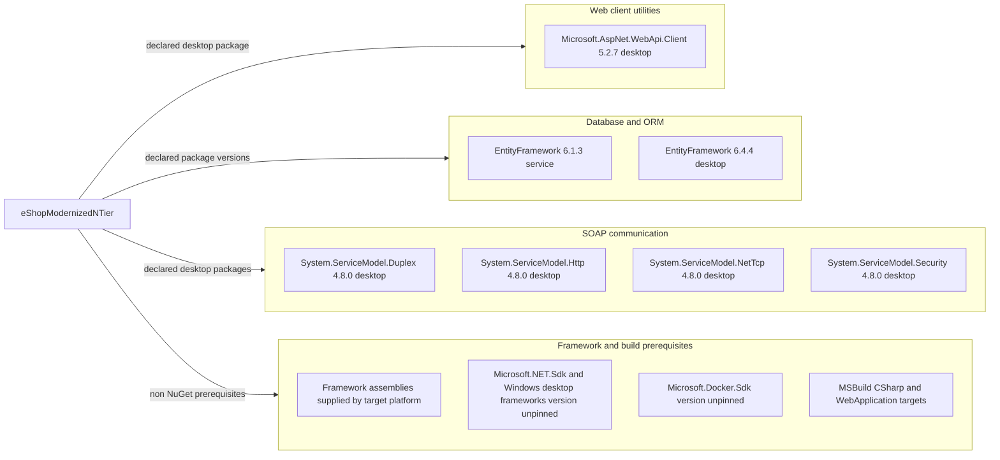

# Dependency Map

Build/package-only assessment of `D:\a\eShopModernizing\eShopModernizing\eShopModernizedNTier`: **six distinct NuGet package IDs, seven package/version declarations** across desktop and service. EntityFramework appears at two versions; framework assembly references and build/runtime prerequisites are accounted for separately, not miscounted as NuGet packages. [D1–D4]

## Dependencies

All package nodes come from [D1, D2]. Platform nodes come from [D3–D6]. The diagram is a declaration map, not a runtime usage graph; no source code was used to infer dependency use.

### Dependency Summary

| Category | Count | Key Libraries | Notes |
|---|---:|---|---|
| Database / ORM | 1 ID / 2 versions | EntityFramework 6.1.3 and 6.4.4 | 6.1.3 in service packages.config with net461 marker and net45 DLL hint paths; 6.4.4 is a desktop PackageReference. [D1–D3] |
| Web client utilities | 1 | Microsoft.AspNet.WebApi.Client 5.2.7 | Desktop direct compile/runtime package declaration; this alone does not establish a Web API server. [D1] |
| SOAP communication | 4 | System.ServiceModel.Duplex, Http, NetTcp, Security, all 4.8.0 | Desktop direct compile/runtime PackageReferences; protocol availability is not proof of protocol use. [D1] |
| Framework assemblies | Not part of package count | System.ServiceModel, System.Web, System.Data, System.Runtime.Serialization and platform libraries | Unversioned individual references bound to target Framework; full inventory below. [D3, D4] |
| Build and runtime platform | Not part of package count | Microsoft.NET.Sdk, Microsoft.Docker.Sdk, Microsoft.CSharp.targets, Microsoft.WebApplication.targets | SDK versions are not pinned in these project files; Framework ToolsVersion is not evidence of installed tooling. [D3–D6] |

**Explicit framework assembly inventory:** the service project declares Microsoft.CSharp; System.ComponentModel.DataAnnotations; System.Data.DataSetExtensions; System.Data.Entity.Design; System.Web.DynamicData; System.Web.Entity; System.Web.ApplicationServices; System; System.Configuration; System.Data; System.Drawing; System.EnterpriseServices; System.Runtime.Serialization; System.ServiceModel; System.ServiceModel.Web; System.Web; System.Web.Extensions; System.Web.Services; System.Xml; System.Xml.Linq. EntityFramework and EntityFramework.SqlServer DLL references resolve to the **same** EntityFramework package and are not extra packages. [D3]

The legacy desktop project declares System; System.ComponentModel.DataAnnotations; System.Configuration; System.Core; System.IO.Compression; System.IO.Compression.FileSystem; System.Runtime.Serialization; System.ServiceModel; System.Xml.Linq; System.Data.DataSetExtensions; Microsoft.CSharp; System.Data; System.Deployment; System.Drawing; System.Net.Http; System.Windows.Forms; System.Xml. It is an alternative project file, not the desktop project selected by the solution. [D4, D7]

### Version & Compatibility Risks

Versions and targets are demonstrably divergent: desktop `net6.0-windows`, legacy desktop Framework 4.7.1, service Framework 4.6.1, and EF 6.4.4 versus 6.1.3. Service DLL resolution assumes an existing packages directory, whereas desktop uses PackageReference. Compatibility, supported-lifecycle status and CVEs were **not verified** by this build-file-only assessment; no advisory scan, restore or build was run. [D1–D4]

### Notable Observations

- Counts are unique package IDs/version pairs, not sums of package and DLL references. No dependency is explicitly test-scoped in the inspected declarations. [D1–D4]
- The solution lists desktop, service and Compose orchestration, with no project-reference edge between the two application projects. [D7; D1; D3]
- No lock file or central package-management declaration was found under the scoped project; transitive versions remain unresolved rather than inferred from package names. packages.config does not distinguish direct from previously installed transitive packages. [D2]
- The legacy desktop project is retained but absent from solution membership; the `temp` Docker project is also an alternative configuration artifact, not another discovered application module. [D7, D8]

## Test Dependencies

| Framework | Version | Notes |
|---|---|---|
| None declared | Not applicable | No test package declarations in either desktop project or service package manifest; no test project listed in solution. [D1–D4, D7] |

Total test-scope dependencies: **0 detected**. This does not establish whether external test infrastructure exists.

### Evidence

- [D1] `D:\a\eShopModernizing\eShopModernizing\eShopModernizedNTier\src\eShopWinForms\eShopWinForms.csproj:1-34`
- [D2] `D:\a\eShopModernizing\eShopModernizing\eShopModernizedNTier\src\eShopWCFService\packages.config:1-4`
- [D3] `D:\a\eShopModernizing\eShopModernizing\eShopModernizedNTier\src\eShopWCFService\eShopWCFService.csproj:1-71`; `D:\a\eShopModernizing\eShopModernizing\eShopModernizedNTier\src\eShopWCFService\eShopWCFService.csproj:111-117`
- [D4] `D:\a\eShopModernizing\eShopModernizing\eShopModernizedNTier\src\eShopWinForms\eShopWinForms.fx.csproj:1-74`
- [D5] `D:\a\eShopModernizing\eShopModernizing\eShopModernizedNTier\docker-compose.dcproj:1-17`
- [D6] `D:\a\eShopModernizing\eShopModernizing\eShopModernizedNTier\src\eShopWinForms\eShopWinForms.csproj:1-8`
- [D7] `D:\a\eShopModernizing\eShopModernizing\eShopModernizedNTier\eShopModernizedNTier.sln:6-29`
- [D8] `D:\a\eShopModernizing\eShopModernizing\eShopModernizedNTier\temp\docker-compose.dcproj:1-18`
