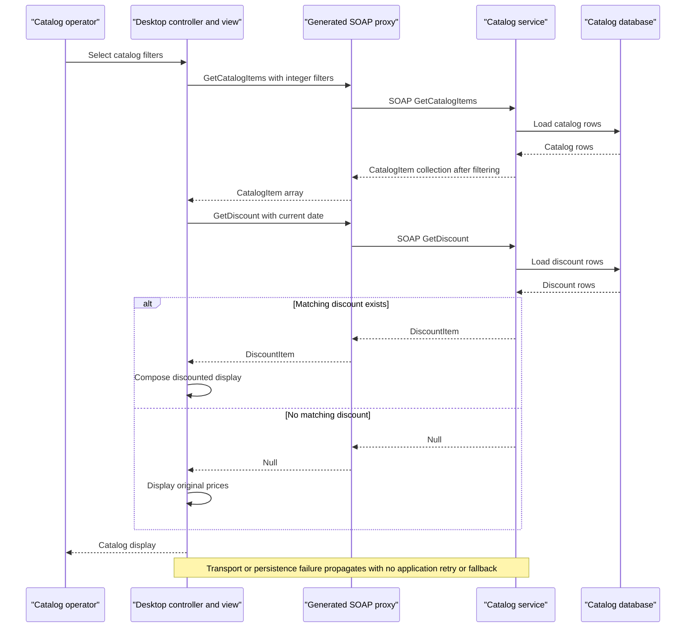

# API & Service Communication Contracts

The scoped workspace exposes ten synchronous SOAP operations on one catalog service, consumed by a generated desktop proxy. There are no REST resource routes or asynchronous messaging contracts in the inspected service interface (`src\eShopWCFService\ICatalogService.cs:12-34`).

## Service Catalog

| Service | Port | Category | Purpose |
|---|---|---|---|
| eShopWCFService / eshopwcfservice | Container 80; host 5113; development IIS URL uses 5200 | Business | Catalog, stock, discount SOAP operations; WCF plus EF6 (`docker-compose.override.yml:8-9`; `src\eShopWCFService\Dockerfile:1-2`; `src\eShopWCFService\eShopWCFService.csproj:45-49,126`) |
| eShopWinForms | No listening port | API consumer / desktop | Generated WCF 4.8.0 client and presentation controller (`src\eShopWinForms\eShopWinForms.csproj:24-27`; `src\eShopWinForms\Program.cs:22-27`) |
| sql.data | Container 1433; host 5433 | Infrastructure | Third-party SQL Server container, not a source-defined API (`docker-compose.yml:12-13`; `docker-compose.override.yml:15-16`) |

The alternate desktop project is not a separate service selected by the solution (`eShopModernizedNTier.sln:10`). No gateway, discovery server, or observability service is declared in the scoped Compose file (`docker-compose.yml:3-13`).

## API Endpoints Inventory

All rows below use the same SOAP endpoint. The operation name is a SOAP action, **not** an appended HTTP route; generated actions follow `http://tempuri.org/ICatalogService/<operation>` (`src\eShopWinForms\Connected Services\eShopServiceReference\Reference.cs:370-428`). Request parameters are serialized in the SOAP body.

| Service | Method | Path | Request Type | Response Type |
|---|---|---|---|---|
| CatalogService | POST / SOAP FindCatalogItem | `/CatalogService.svc` | `int id` | `CatalogItem`, null if absent |
| CatalogService | POST / SOAP GetCatalogBrands | `/CatalogService.svc` | None | `List<CatalogBrand>` |
| CatalogService | POST / SOAP GetCatalogItems | `/CatalogService.svc` | `int brandIdFilter, int typeIdFilter` | `List<CatalogItem>` |
| CatalogService | POST / SOAP GetCatalogTypes | `/CatalogService.svc` | None | `List<CatalogType>` |
| CatalogService | POST / SOAP GetAvailableStock | `/CatalogService.svc` | `DateTime date, int catalogItemId` | `int`, zero when absent |
| CatalogService | POST / SOAP CreateAvailableStock | `/CatalogService.svc` | `CatalogItemsStock` | Void SOAP acknowledgement |
| CatalogService | POST / SOAP CreateCatalogItem | `/CatalogService.svc` | `CatalogItem` | Void SOAP acknowledgement; no created-ID result |
| CatalogService | POST / SOAP UpdateCatalogItem | `/CatalogService.svc` | `CatalogItem` | Void SOAP acknowledgement |
| CatalogService | POST / SOAP RemoveCatalogItem | `/CatalogService.svc` | `CatalogItem` | Void SOAP acknowledgement |
| CatalogService | POST / SOAP GetDiscount | `/CatalogService.svc` | `DateTime day` | `DiscountItem`, null if absent |

Evidence: all signatures in `src\eShopWCFService\ICatalogService.cs:15-34`; null/zero handling in `src\eShopWCFService\CatalogService.svc.cs:28-44,90-96`; endpoint binding in `src\eShopWCFService\Web.config:37-40`. Responses use WCF SOAP envelopes; no custom HTTP status mapping, versioning policy, or typed `FaultContract` is declared in that interface. Unhandled failures are subject to WCF fault handling rather than documented REST 400/404 contracts.

## Management & Observability Endpoints

| Service | Endpoint | Custom Metrics (if any) |
|---|---|---|
| CatalogService | `/CatalogService.svc/mex` — HTTP metadata exchange | None declared (`src\eShopWCFService\Web.config:40`) |
| CatalogService | `/CatalogService.svc?wsdl` — HTTP GET metadata enabled | None declared; HTTPS metadata also enabled but no deployed HTTPS listener proven (`src\eShopWCFService\Web.config:27,34`) |
| Application services | No dedicated health, Swagger, metrics, or tracing route found | No exporter/metric registration found; SQL's container healthcheck is not an application endpoint (`docker-compose.override.yml:17-20`) |

## DTOs & Contracts

| Contract class | API role | Mutability / ownership |
|---|---|---|
| CatalogItem | Create/update/remove request and lookup/list response | Mutable service-owned entity data contract |
| CatalogBrand, CatalogType | Lookup-list responses and nested item references | Mutable service-owned entity data contracts |
| CatalogItemsStock | Availability write request | Mutable service-owned entity data contract |
| DiscountItem | Discount lookup response | Mutable service-owned entity data contract |

Evidence: `src\eShopWCFService\Models\CatalogItem.cs:10-35`; `src\eShopWCFService\Models\CatalogBrand.cs:10-19`; `src\eShopWCFService\Models\CatalogType.cs:10-19`; `src\eShopWCFService\Models\CatalogItemsStock.cs:10-25`; `src\eShopWCFService\Models\DiscountItem.cs:11-31`. `[DataContract]` / `[DataMember]` identify WCF serialization; there are no separate gateway aggregation DTOs. Generated client collections are arrays and include Task-returning convenience counterparts, not additional server operations (`src\eShopWinForms\Connected Services\eShopServiceReference\Reference.cs:370-428`). Entity fields and mapping are in `data-architecture.md`. No OpenAPI, protobuf, or GraphQL schema was found in the scoped file inventory.

## Communication Patterns

- **Synchronous:** UI events call the controller, then the generated proxy, then SOAP service operations. The controller uses synchronous methods even though generated Async variants exist (`src\eShopWinForms\Controllers\CatalogController.cs:35-54,75-84`; generated proxy `Reference.cs:501-508`).
- **Composition:** The desktop separately fetches catalog items and today's discount, then combines them for display. It is not gateway aggregation and involves only one business service (`src\eShopWinForms\Controllers\CatalogController.cs:75-84`).
- **Resilience:** No application retry, circuit breaker, bulkhead, fallback, or explicit timeout value is configured in the inspected controller/proxy binding. Platform timeout defaults are not restated as source configuration. Failure interrupts the caller; mock data is not an automatic fallback (`src\eShopWinForms\Controllers\CatalogController.cs:35-84`; generated proxy `Reference.cs:591-600`; `src\eShopWinForms\Modules\ApplicationModule.cs:12-34`).
- **Discovery:** No registry/load balancer; the default generated client uses a hardcoded loopback URL. Constructor overloads allow alternate addresses, but Program selects the default constructor (`src\eShopWinForms\Program.cs:23`; generated proxy `Reference.cs:448-477,605-609`).
- **Startup:** SQL must be usable before service database access; desktop initialization requires service availability. Compose ordering does not guarantee readiness. See `configuration-inventory.md`.
- **Security posture:** No application authentication or authorization checks are present in the service contract/implementation. The active endpoint and default client use plain HTTP basicHttpBinding without an explicit security mode; HTTPS protocol mapping and metadata flags do not prove enforced TLS on the deployed endpoint (`src\eShopWCFService\Web.config:27-40`; generated proxy `Reference.cs:595-609`). External IIS policy is not established by this assessment. Exception details in SOAP faults are disabled (`Web.config:29`).
- **Other protocols:** No broker/events are used by the inspected paths. NetTcp and Duplex package references alone do not prove those protocols are active.

## Service Technology Matrix

| Service | Web | Data Access | Discovery | Gateway | Actuator | Cache | Metrics |
|---|---|---|---|---|---|---|---|
| eShopWCFService | IIS / WCF SOAP | EF6 DbContext | None found | None | None found | No application cache found | None found |
| eShopWinForms | None; SOAP consumer | No direct DB access in controller | Static endpoint | Client-side display composition only | None | None found | None found |
| sql.data | None | SQL Server | Compose hostname | None | Container SQL check only | Not assessed internally | None configured |

Evidence: `src\eShopWCFService\EntityModel.cs:10-22`; `src\eShopWinForms\Controllers\CatalogController.cs:75-84`; `docker-compose.yml:3-13`; `docker-compose.override.yml:17-20`.

## Service Communication Sequence

This sequence follows `src\eShopWinForms\Controllers\CatalogController.cs:75-84`, `src\eShopWCFService\CatalogService.svc.cs:28-30,56-62`, and `src\eShopWinForms\Views\CatalogView.cs:48-61`; it is source-traced, not runtime-verified.
