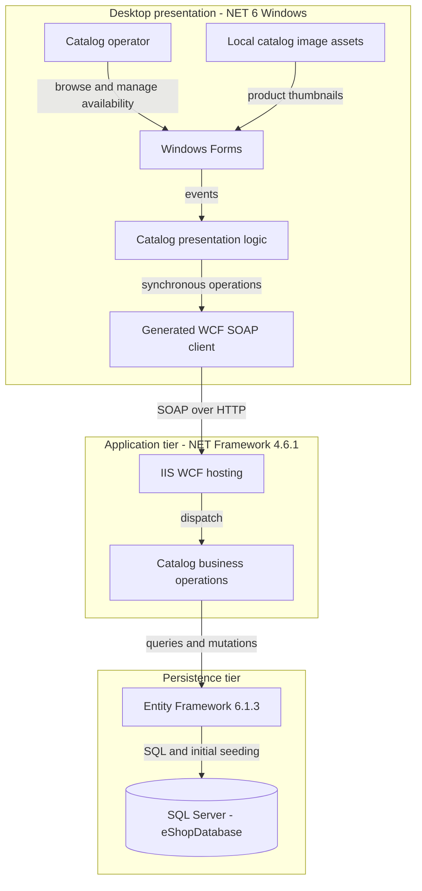
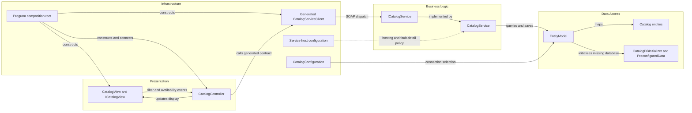

# Architecture Diagram

Static assessment scoped exclusively to `eShopModernizedNTier`; all evidence paths are relative to that workspace. The solution contains a Windows desktop client and an IIS-hosted catalog service, with SQL Server as the persistent store (`eShopModernizedNTier.sln:6-11`).

## Application Architecture

### Technology Stack Summary

| Layer | Technology | Version | Purpose |
|---|---|---|---|
| Presentation | Windows Forms; WPF also enabled | .NET 6 Windows | Desktop UI; actual view derives from Form (`src\eShopWinForms\eShopWinForms.csproj:4-8`; `src\eShopWinForms\Views\CatalogView.cs:18`) |
| Communication | WCF client packages | 4.8.0 | Generated SOAP proxy (`src\eShopWinForms\eShopWinForms.csproj:24-27`) |
| Application | WCF on ASP.NET / IIS | .NET Framework 4.6.1 target | Catalog service (`src\eShopWCFService\eShopWCFService.csproj:15`; `src\eShopWCFService\Web.config:18-41`) |
| Persistence | Entity Framework | 6.1.3 server; 6.4.4 declared in desktop | Server DbContext; client package does not establish direct database access (`src\eShopWCFService\packages.config:3`; `src\eShopWinForms\eShopWinForms.csproj:22`; `src\eShopWCFService\EntityModel.cs:10-22`) |
| Storage | SQL Server / LocalDB alternative | Server image unpinned | Persistent catalog database (`docker-compose.yml:12-13`; `src\eShopWCFService\Web.config:52-64`) |
| Hosting | Windows WCF container | Framework image 4.7.2 | Hosts the 4.6.1-targeted service (`src\eShopWCFService\Dockerfile:1-5`) |
| Alternate client build | Legacy WinForms project | .NET Framework 4.7.1 | Present but not selected by solution (`src\eShopWinForms\eShopWinForms.fx.csproj:11`; `eShopModernizedNTier.sln:10`) |

### Data Storage & External Services

The service owns one SQL Server database; its environment-provided connection overrides a named LocalDB fallback (`src\eShopWCFService\Models\Infrastructure\CatalogConfiguration.cs:10-17`). Compose declares the service and SQL Server, but no cache, broker, identity provider, or external business API (`docker-compose.yml:3-13`). Images are desktop-local files, not a remote image service (`src\eShopWinForms\Views\CatalogView.cs:55-61`). This is source/configuration evidence, not proof of a running deployment.

### Key Architectural Decisions

- Manual composition connects a generated proxy, controller, and view; constructor injection is used without an active DI container (`src\eShopWinForms\Program.cs:22-27`; `src\eShopWinForms\Controllers\CatalogController.cs:14-20`). The apparent registration module is commented out, not an active mock switch (`src\eShopWinForms\Modules\ApplicationModule.cs:12-34`).
- Business operations access DbContext directly, with no separate repository layer. Missing-database creation and programmatic seeding replace a migration pipeline (`src\eShopWCFService\CatalogService.svc.cs:16-25`; `src\eShopWCFService\Models\Infrastructure\CatalogDBInitializer.cs:11-20`).
- The deployed contract is SOAP, not REST; the default desktop proxy hardcodes an HTTP loopback destination (`src\eShopWCFService\Web.config:37-40`; `src\eShopWinForms\Connected Services\eShopServiceReference\Reference.cs:591-609`). Remote deployment requires explicit endpoint configuration changes.

## Component Relationships

### Component Inventory

| Component | Layer | Type | Responsibility |
|---|---|---|---|
| CatalogView / ICatalogView | Presentation | Form / view interface | Render catalog and raise user events (`src\eShopWinForms\Views\CatalogView.cs:18-29,48-61`) |
| CatalogController | Presentation | Controller | Load filters, combine discounts, submit stock changes (`src\eShopWinForms\Controllers\CatalogController.cs:35-84,98-157`) |
| Program | Infrastructure | Composition root | Instantiate client/view/controller and load before modal display (`src\eShopWinForms\Program.cs:22-27`) |
| Generated CatalogServiceClient | Infrastructure | WCF proxy | Forward contract operations over HTTP (`src\eShopWinForms\Connected Services\eShopServiceReference\Reference.cs:438-452,591-609`) |
| ICatalogService / CatalogService | Business Logic | SOAP contract / service | Ten catalog, stock, and discount operations (`src\eShopWCFService\ICatalogService.cs:12-34`; `src\eShopWCFService\CatalogService.svc.cs:28-117`) |
| EntityModel / catalog entities | Data Access | EF DbContext / data contracts | Map five entity sets (`src\eShopWCFService\EntityModel.cs:18-40`) |
| CatalogDBInitializer / PreconfiguredData | Data Access | Initializer / seed factory | Seed a newly created database (`src\eShopWCFService\Models\Infrastructure\CatalogDBInitializer.cs:11-20`) |
| CatalogConfiguration / Web.config | Infrastructure | Configuration helper / host policy | Select connection; configure SOAP and metadata (`src\eShopWCFService\Models\Infrastructure\CatalogConfiguration.cs:12-17`; `src\eShopWCFService\Web.config:22-41`) |

The similarly named handwritten `src\eShopWCFService\CatalogServiceClient.cs` is not included in the server's explicit Compile list and is not the desktop proxy (`src\eShopWCFService\eShopWCFService.csproj:76-93`). Mock discount lookup throws and is not wired into the production entry point (`src\eShopWCFService\CatalogServiceMock.cs:118-120`; `src\eShopWinForms\Program.cs:23`).
