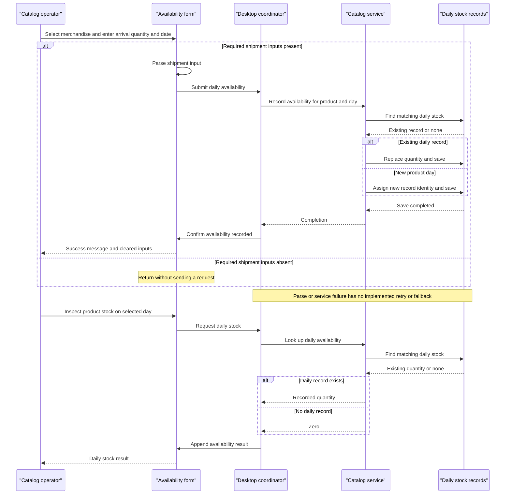

# Core Business Workflows

The application lets operators browse merchandise with date-based promotional pricing, inspect daily stock, and record product availability for an arrival date. These workflows are traced only within `eShopModernizedNTier`; evidence paths below are relative to that workspace.

## Domain Entities

| Entity | Service / Bounded Context | Description | Key Relationships |
|---|---|---|---|
| CatalogItem | CatalogService / Catalog | Merchandise displayed to the operator | Categorized by brand and product type; referenced by stock records |
| CatalogBrand | CatalogService / Catalog | Brand lookup used for filtering | Classifies merchandise |
| CatalogType | CatalogService / Catalog | Product-category lookup used for filtering | Classifies merchandise |
| CatalogItemsStock | CatalogService / Availability | Availability recorded for an item on a calendar day | Logical reference to merchandise |
| DiscountItem | CatalogService / Promotions | A time-bounded catalog-wide discount fraction | Applied to displayed merchandise, not linked to individual products |

Evidence: `src\eShopWCFService\Models\CatalogItem.cs:11-35`; `Models\CatalogBrand.cs:11-19`, `Models\CatalogType.cs:11-19`, `Models\CatalogItemsStock.cs:12-25`, `Models\DiscountItem.cs:12-31`, all under `src\eShopWCFService`; application use at `src\eShopWinForms\Controllers\CatalogController.cs:35-84`. These are functional groupings within one service, not independently deployed bounded-context services.

## Service-to-Domain Mapping

| Service | Domain Context | Owned Entities | External Dependencies |
|---|---|---|---|
| CatalogService | Catalog, availability, promotions | All five domain entities | Service-owned persistence (`src\eShopWCFService\EntityModel.cs:18-22`) |
| Desktop CatalogController / CatalogView | Operator interaction and display composition | No authoritative persistent entities; contract copies only | CatalogService and local product images (`src\eShopWinForms\Controllers\CatalogController.cs:35-84`; `src\eShopWinForms\Views\CatalogView.cs:55-61`) |

The service is the source of truth for stock and catalog data. The desktop computes displayed discounts but does not persist discounted prices. No cross-service domain-event ownership or shared aggregate transaction is implemented in the traced code.

## Primary Workflows

### Workflow 1: Browse catalog with active promotional pricing

1. Startup constructs the view and service client, connects the controller, and loads initial data before displaying the window (`src\eShopWinForms\Program.cs:22-27`).
2. `LoadView` initializes the discount banner, catalog, brand/type filters, and shipment product selectors (`src\eShopWinForms\Controllers\CatalogController.cs:150-157`).
3. Changing either filter raises an event; the controller reloads the catalog using the **All-filter rule** (`src\eShopWinForms\Views\CatalogView.cs:106-135`; `src\eShopWinForms\Controllers\CatalogController.cs:27-29,75-78`).
4. The service selects matching products. The desktop requests today's discount separately and applies the **Promotional-date rule** and **Display-price rule** (`src\eShopWCFService\CatalogService.svc.cs:28-30,56-62`; `src\eShopWinForms\Controllers\CatalogController.cs:79-84`).
5. The view renders each price and local thumbnail. With no active promotion, original prices are shown; local image-file or service errors have no implemented fallback in this path (`src\eShopWinForms\Views\CatalogView.cs:48-61`).

### Workflow 2: Record availability and inspect daily stock

1. Operator selects a product, quantity, and arrival date. The **Shipment-input rule** gates submission (`src\eShopWinForms\Views\CatalogView.cs:157-167`).
2. Controller constructs a stock request and sends it to the service (`src\eShopWinForms\Controllers\CatalogController.cs:35-42`).
3. Service finds any stock record for the product/calendar day. Under the **Daily-stock replacement rule**, it replaces an existing quantity or inserts a new record, then persists it (`src\eShopWCFService\CatalogService.svc.cs:99-117`).
4. Only after the call returns does the controller notify success; the view displays a message and clears shipment inputs (`src\eShopWinForms\Controllers\CatalogController.cs:42-43`; `src\eShopWinForms\Views\CatalogView.cs:189-195`).
5. For a stock inquiry, the selected product and calendar date are sent to the service. The **Missing-stock rule** determines the result, which is appended to the stock results list (`src\eShopWinForms\Views\CatalogView.cs:142-151,173-178`; `src\eShopWinForms\Controllers\CatalogController.cs:50-54`; `src\eShopWCFService\CatalogService.svc.cs:90-96`).

Although the UI calls this a shipment, it records a daily availability total, not an additive shipment ledger. There is no order placement, reservation, payment, or fulfillment workflow in these sources.

### Workflow 3: Initialize demonstration business data

On first data use, a missing database is created and seeded with product classifications, merchandise, availability, and promotions (`src\eShopWCFService\EntityModel.cs:12-15`; `src\eShopWCFService\Models\Infrastructure\CatalogDBInitializer.cs:11-20`). Seed stock/promotion dates are in 2017, so the seed promotions do not cover the assessment date; existing databases are not automatically refreshed (`src\eShopWCFService\Models\Infrastructure\PreconfiguredData.cs:41-50,65-74`). No scheduler or background job advances promotional periods.

## Cross-Service Data Flows

There is one business service and one desktop consumer, not a gateway with multiple downstream services. The controller joins catalog and promotion responses in memory for display; each product's base price is combined with a single selected global discount fraction (`src\eShopWinForms\Controllers\CatalogController.cs:75-84`). Stock requests correlate to products by identifier, and thumbnails correlate to a local filename (`src\eShopWinForms\Controllers\CatalogController.cs:37-42`; `src\eShopWinForms\Views\CatalogView.cs:55-61`).

No circuit breaker, automatic mock substitution, compensating workflow, or partial-response recovery is implemented. A missing promotion is a normal business branch, not an outage fallback; a service failure propagates from the synchronous calls (`src\eShopWinForms\Controllers\CatalogController.cs:35-84`). The mock's discount operation itself throws and is not selected by Program (`src\eShopWCFService\CatalogServiceMock.cs:118-120`; `src\eShopWinForms\Program.cs:23`).

## Business Workflow Sequence

The sequence follows Workflow 2's cited implementation. Decision blocks show actual input/record branches, not an invented circuit breaker.

## Business Rules & Decision Logic

| Rule | Implemented decision / constraint | Evidence |
|---|---|---|
| All-filter rule | Filter ID zero means all brands/types; nonzero filters are combined with AND. The desktop inserts an All option with ID zero. | `src\eShopWCFService\CatalogService.svc.cs:56-62`; `src\eShopWinForms\Controllers\CatalogController.cs:103-115,129-141` |
| Promotional-date rule | Match calendar dates inclusively from start through end; take first matching promotion. No priority/overlap arbitration is specified. | `src\eShopWCFService\CatalogService.svc.cs:28-30` |
| Display-price rule | Display base price multiplied by one minus discount fraction, using double conversion and fixed-point formatting; banner percentage rounds fraction times 100. No persisted price change occurs. | `src\eShopWinForms\Views\CatalogView.cs:48-61`; `src\eShopWinForms\Controllers\CatalogController.cs:60-68` |
| Shipment-input rule | Return if no selected product, empty quantity, or empty date; otherwise use int.Parse and Convert.ToDateTime. No TryParse/culture override or positivity/date-range validation is implemented. | `src\eShopWinForms\Views\CatalogView.cs:157-167` |
| Daily-stock replacement rule | Match product and calendar day; replace quantity, never add to it. Otherwise insert using largest stock key plus one. No uniqueness check beyond first-match application logic. | `src\eShopWCFService\CatalogService.svc.cs:99-117` |
| Missing-stock rule | Missing daily record returns zero, indistinguishable from an explicitly recorded zero. | `src\eShopWCFService\CatalogService.svc.cs:90-96` |
| Stock-inquiry selection | Assumes a product is selected and its label can be parsed; no null guard is present. | `src\eShopWinForms\Views\CatalogView.cs:142-150` |
| Entity-level constraints | Brand/type text annotations set maximum length 50; no explicit required/range constraints for price, discount fraction, or stock are declared in the inspected models. | `src\eShopWCFService\Models\CatalogBrand.cs:17`; `src\eShopWCFService\Models\CatalogType.cs:17`; `Models\CatalogItem.cs:13-35`, `Models\CatalogItemsStock.cs:14-25`, `Models\DiscountItem.cs:18-31` under `src\eShopWCFService` |
| Product identity allocation | Creation uses maximum current ID plus one, without an empty-table or concurrent-create branch. | `src\eShopWCFService\CatalogService.svc.cs:65-70` |

- **Transactions and consistency:** Each mutation saves locally; there is no explicit transaction spanning lookup plus Max allocation or multiple service calls. Concurrent requests can race on stock upsert or manually allocated identities (`src\eShopWCFService\CatalogService.svc.cs:65-82,99-117`).
- **Lifecycle:** Stock is created or overwritten; no shipment state machine, reservation lifecycle, approval state, or historical adjustment audit is modeled in the five entity declarations.
- **Errors and compensation:** No business-specific exception contract, controller recovery, compensation, or dead-letter mechanism appears in these paths. Fault exception-detail output is disabled (`src\eShopWCFService\Web.config:29`).
- **Authorization and audit:** No role, resource-owner, or business authorization checks or business audit logging appear in the traced service methods (`src\eShopWCFService\CatalogService.svc.cs:28-117`). External host policies and database auditing are not established.

These are source-traced behaviors and limitations, not results from an execution test.
