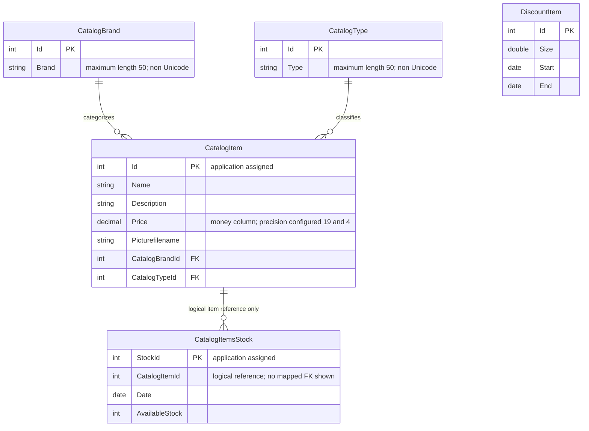

# Data Architecture & Persistence Layer

Five EF6 entity sets represent catalog products, brands, types, daily stock, and discount periods in SQL Server. This source-based assessment is scoped to `eShopModernizedNTier`; paths are workspace-relative (`src\eShopWCFService\EntityModel.cs:10-22`).

## Database Configuration

| Service/Module | DB Type | Profile | Driver | Connection | Migration Tool |
|---|---|---|---|---|---|
| eShopWCFService | SQL Server LocalDB | Default named-connection fallback; not a formal runtime profile | System.Data.SqlClient / EF6 SQL provider | Local eShopDatabase; authentication success not verified | No migrations found; create only if database missing |
| eShopWCFService | SQL Server | Compose environment override | Same provider | Container-hosted eShopDatabase; credential-bearing value omitted | Same initializer and seed factories |
| eShopWinForms | No direct store observed | All inspected paths | EF package is declared, but controller uses SOAP | Service-owned access | Not applicable |

Evidence: `src\eShopWCFService\Models\Infrastructure\CatalogConfiguration.cs:10-17`; `src\eShopWCFService\Web.config:52-64`; `docker-compose.override.yml:5-7`; `src\eShopWinForms\Controllers\CatalogController.cs:35-84`.

`CreateDatabaseIfNotExists<EntityModel>` seeds types, brands, items, stocks, and discounts, with separate SaveChanges calls for each category. It neither supplies incremental schema migrations nor reseeds an existing database (`src\eShopWCFService\Models\Infrastructure\CatalogDBInitializer.cs:11-79`). Seed data contains 12 products, five brands, four types, six historical stock entries, and six historical discount periods (`src\eShopWCFService\Models\Infrastructure\PreconfiguredData.cs:10-75`). No custom connection-pool settings were found; raw configuration belongs in `configuration-inventory.md`.

## Data Ownership per Service

| Service | Tables Owned | ORM Framework | Caching | Notes |
|---|---|---|---|---|
| eShopWCFService | CatalogBrands, CatalogItems, CatalogTypes, DiscountItems (conventional names); CatalogItemsStock (explicit name) | Entity Framework 6.1.3 | No explicit application cache | Five DbSets; stock table explicitly mapped (`src\eShopWCFService\EntityModel.cs:18-22`; `src\eShopWCFService\Models\CatalogItemsStock.cs:10`) |
| eShopWinForms | None | No active persistence path observed | No explicit cache | Generated contract copies are transfer objects, not a second store (`src\eShopWinForms\Program.cs:22-24`) |

## Entity Model

The stock relationship expresses the code's logical item reference, **not** an asserted database FK. `CatalogItemsStock` has no navigation property, `[ForeignKey]`, or fluent relationship declaration; the scalar name alone does not demonstrate enforcement (`src\eShopWCFService\Models\CatalogItemsStock.cs:10-25`; `src\eShopWCFService\EntityModel.cs:24-40`).

| Entity | Fields / mapping evidence |
|---|---|
| CatalogBrand | Non-generated integer Id and optional-by-annotation string Brand, max 50; non-Unicode mapping (`src\eShopWCFService\Models\CatalogBrand.cs:13-19`; `src\eShopWCFService\EntityModel.cs:26-28`) |
| CatalogType | Non-generated integer Id and string Type, max 50; non-Unicode mapping (`src\eShopWCFService\Models\CatalogType.cs:13-19`; `src\eShopWCFService\EntityModel.cs:36-38`) |
| CatalogItem | Non-generated integer Id; strings Name, Description, Picturefilename; decimal Price mapped to money; integer brand/type references and unidirectional reference navigation properties (`src\eShopWCFService\Models\CatalogItem.cs:13-35`; `src\eShopWCFService\EntityModel.cs:30-32`) |
| CatalogItemsStock | Explicit table; DateTime mapped to date, integer CatalogItemId, AvailableStock, non-generated StockId key (`src\eShopWCFService\Models\CatalogItemsStock.cs:10-25`) |
| DiscountItem | Integer Id key, double Size, DateTime Start/End mapped to date; no relationship to individual products (`src\eShopWCFService\Models\DiscountItem.cs:18-31`) |

Brand/type inverse collections and explicit loading/cascade overrides are absent from these mappings; EF conventions apply. Navigation properties are not virtual, so these declarations do not establish navigation lazy loading. No row-version/concurrency token or item/date unique index is declared. Physical schema, indexes, and database-side defaults were not inspected.

## Key Repository Methods

There is no repository interface: the service directly queries EntityModel. These are service persistence methods, not an additional API inventory.

| Service | Repository | Notable Methods | Purpose |
|---|---|---|---|
| CatalogService | EntityModel.CatalogItems | `GetCatalogItems(int,int): List<CatalogItem>` | Materialize all rows before filtering in memory (`src\eShopWCFService\CatalogService.svc.cs:56-62`) |
| CatalogService | EntityModel.CatalogItems / brands / types | `FindCatalogItem(int): CatalogItem` | Item query followed by explicit brand/type lookups (`CatalogService.svc.cs:33-44`) |
| CatalogService | EntityModel.DiscountItems | `GetDiscount(DateTime): DiscountItem` | Materialize discount rows; first matching date interval (`CatalogService.svc.cs:28-30`) |
| CatalogService | EntityModel.CatalogItemsStocks | `GetAvailableStock(DateTime,int): int` | Filter item in SQL, then compare calendar dates in memory (`CatalogService.svc.cs:90-96`) |
| CatalogService | EntityModel.CatalogItemsStocks | `CreateAvailableStock(CatalogItemsStock): void` | Update matching tracked row or insert using Max-plus-one key (`CatalogService.svc.cs:99-117`) |
| CatalogService | EntityModel.CatalogItems | Create/update/remove entity methods | Add, mark Modified, or Remove followed by SaveChanges; removal receives a detached SOAP object and does not explicitly attach it (`CatalogService.svc.cs:65-82`) |
| Infrastructure | CatalogItemHiLoGenerator | `GetNextSequenceValue(EntityModel): int` | Raw `SELECT NEXT VALUE FOR catalog_hilo`, batches of ten; not used by active create methods and no sequence DDL found (`src\eShopWCFService\Models\CatalogItemHiLoGenerator.cs:10-29`; `CatalogService.svc.cs:65-70,113-116`) |

`CatalogService.svc.cs` in abbreviated citations above is `src\eShopWCFService\CatalogService.svc.cs`. Each SaveChanges has EF's ordinary local transaction semantics; no explicit encompassing transaction or cross-call transaction is defined. Max-plus-one allocation is not concurrency-safe and Max on an empty set is not handled. No bulk cross-service query or stored procedure was found.

## Caching Strategy

No Redis, MemoryCache, distributed cache, result-cache TTL, or second-level cache is declared in the scoped dependencies/configuration. EF change tracking is context-local identity tracking, not a shared query cache; repeated calls materialize lists anew (`src\eShopWCFService\CatalogService.svc.cs:28-30,46-62`). `CatalogServiceMock` holds seed lists but is not a production cache or automatic fallback (`src\eShopWCFService\CatalogServiceMock.cs:18-23`; `src\eShopWinForms\Program.cs:23`).

## Data Ownership Boundaries

One business service owns one catalog store; this is not database-per-microservice or a multi-service shared-database design. The desktop accesses data through the generated SOAP contract and composes item/discount results locally (`src\eShopWinForms\Controllers\CatalogController.cs:75-84`). Reads and writes share the same DbContext/entity model; no CQRS, outbox, broker replication, or cross-service database joins were found (`src\eShopWCFService\EntityModel.cs:18-22`; `src\eShopWCFService\CatalogService.svc.cs:28-117`).

### Data Classification & Sensitivity

| Entity | Sensitive Fields | Classification (PII/PHI/PCI/None) | Controls in Place |
|---|---|---|---|
| CatalogItem, CatalogBrand, CatalogType | None detected; product descriptions, prices, classification, local image filenames | None | No field-level encryption or masking declared in the inspected models |
| CatalogItemsStock | None detected; product/date/quantity | None | No field-level controls declared |
| DiscountItem | None detected; promotional interval/fraction | None | No field-level controls declared |

No PII, PHI, or PCI data detected in entity model. Evidence is the complete property sets cited in Entity Model. Database encryption-at-rest and external database access policy cannot be established from source; connection credentials are sensitive configuration, not domain fields, and are masked in `configuration-inventory.md`.
