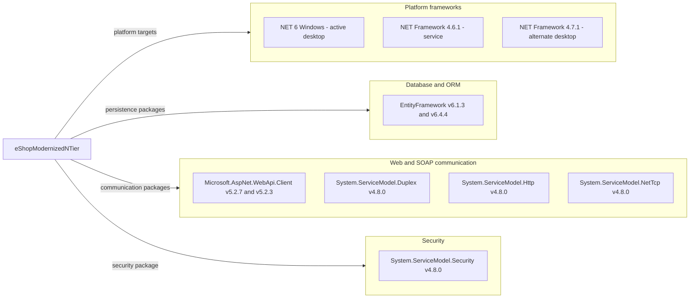

# Dependency Map

`eShopModernizedNTier` declares six unique NuGet package IDs: nine direct declarations and eight distinct package/version pairs when the alternate legacy client project is included. This inventory is restricted to this workspace's build/package files; framework assemblies are distinguished from NuGet packages.

## Dependencies

### Dependency Summary

| Category | Count | Key Libraries | Notes |
|---|---|---|---|
| Database / ORM | 1 package ID; 3 declarations | EntityFramework 6.1.3 server and alternate client; 6.4.4 active client | Server uses packages.config and assembly HintPaths; clients use PackageReference (`src\eShopWCFService\packages.config:3`; `src\eShopWCFService\eShopWCFService.csproj:45-49`; `src\eShopWinForms\eShopWinForms.csproj:22`; `src\eShopWinForms\eShopWinForms.fx.csproj:265-267`) |
| Web / SOAP communication | 4 package IDs; 5 declarations | Microsoft.AspNet.WebApi.Client 5.2.7 active / 5.2.3 alternate; System.ServiceModel.Duplex, Http, NetTcp 4.8.0 | Direct compile references, normally copied/resolved for runtime; no test-only scope (`src\eShopWinForms\eShopWinForms.csproj:23-26`; `src\eShopWinForms\eShopWinForms.fx.csproj:268-270`) |
| Security | 1 package ID; 1 declaration | System.ServiceModel.Security 4.8.0 | Package presence does not establish configured transport/authentication (`src\eShopWinForms\eShopWinForms.csproj:27`) |
| Platform frameworks | 3 target declarations; excluded from package total | .NET 6 Windows; .NET Framework 4.6.1 and 4.7.1 | Active desktop enables WinForms and WPF; service has bundled System.Web, System.ServiceModel, System.Data, and serialization references (`src\eShopWinForms\eShopWinForms.csproj:5-7`; `src\eShopWCFService\eShopWCFService.csproj:15,51-70`; `src\eShopWinForms\eShopWinForms.fx.csproj:11,57-73`) |

### Version & Compatibility Risks

The mixed .NET 6 desktop / .NET Framework 4.6.1 server targets and alternate 4.7.1 client require different build/runtime tooling. .NET 6 and .NET Framework 4.6.1 are out of support as of this assessment; package patch levels are old, but no vulnerability lookup or compatibility build was performed. EF6-to-EF Core and WCF-server-to-modern-.NET changes are not simple target-framework substitutions. Evidence: target declarations above; server imports classic web application targets (`src\eShopWCFService\eShopWCFService.csproj:115-117`).

### Notable Observations

- The solution selects `eShopWinForms.csproj`, not `eShopWinForms.fx.csproj`; alternate-project dependencies are explicitly included here to avoid hiding legacy declarations (`eShopModernizedNTier.sln:8-10`).
- EF package versions differ between server and active desktop; WebApi.Client versions differ between the two desktop project files. Counts deduplicate package IDs, not declarations.
- No central package management, dependency lockfile, or test package declaration was found among the scoped build files. Full transitive versions cannot be recovered from direct declarations alone.
- Docker tooling uses `Microsoft.Docker.Sdk` without a pinned SDK version; it is build infrastructure, not an additional application NuGet dependency (`docker-compose.dcproj:2`).

## Test Dependencies

| Framework | Version | Notes |
|---|---|---|
| None detected | Not applicable | No test project in the solution and no test-scoped package in the three application project/package manifests (`eShopModernizedNTier.sln:6-11`; package declarations above) |

Total test-scope dependencies: 0.

No test dependencies detected. This is a declared-build inventory, not evidence that external/manual testing does not exist.
