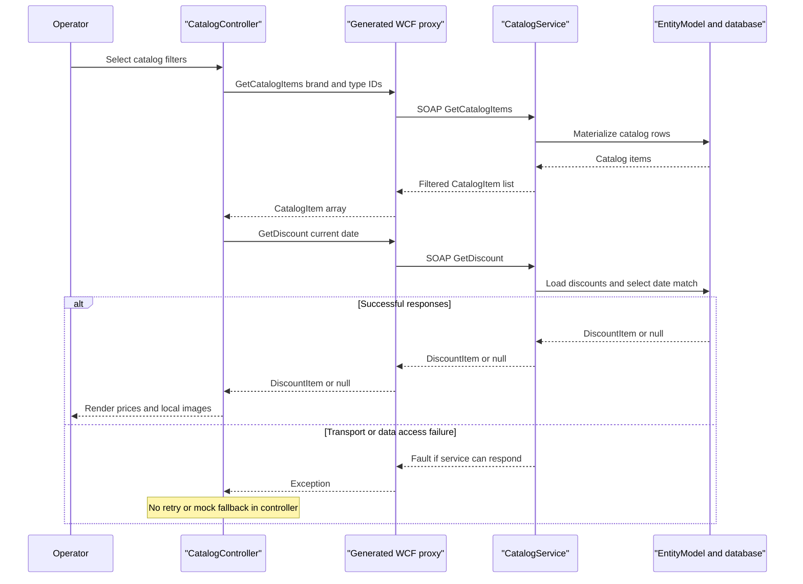

# API & Service Communication Contracts

The exposed business contract contains **10 SOAP operations at one WCF service address**, not 10 REST routes. The desktop uses synchronous request/response calls; generated asynchronous wrappers are not message-broker communication [S1, S2].

## Service Catalog

| Service | Port | Category | Purpose |
|---|---|---|---|
| eShopWinForms, selected SDK project | No listening port identified | Desktop client, outside API Layer category | Operator UI; generated WCF client packages [S3, S4] |
| eShopWCFService | Container 80; host 5113; local IIS URL uses 5200 | Business | Source-built catalog service; WCF framework assemblies and EF6 [S5, S6] |
| sql.data | Container 1433; host 5433 | Infrastructure | Third-party SQL Server container, not an application API [S5] |

The solution selects `eShopWinForms.csproj`, not `eShopWinForms.fx.csproj`. `temp` Compose definitions are alternate artifacts, not additional services in the root Compose topology [S4, S5].

## API Endpoints Inventory

All rows belong to `CatalogService` and use **POST `/CatalogService.svc`** with SOAP envelopes. Operation identity is the SOAP action `http://tempuri.org/ICatalogService/<Operation>`; no explicit API versioning is declared [S1, S2, S7].

| Service | Method | Path | Request Type | Response Type |
|---|---|---|---|---|
| CatalogService.FindCatalogItem | POST SOAP | `/CatalogService.svc` | `int id` | `CatalogItem`, nullable |
| CatalogService.GetCatalogBrands | POST SOAP | Same address | Empty operation body | `List<CatalogBrand>` |
| CatalogService.GetCatalogItems | POST SOAP | Same address | `int brandIdFilter`, `int typeIdFilter` | `List<CatalogItem>` |
| CatalogService.GetCatalogTypes | POST SOAP | Same address | Empty operation body | `List<CatalogType>` |
| CatalogService.GetAvailableStock | POST SOAP | Same address | `DateTime date`, `int catalogItemId` | `int`, zero when absent in database implementation |
| CatalogService.CreateAvailableStock | POST SOAP | Same address | `CatalogItemsStock` | Void operation response |
| CatalogService.CreateCatalogItem | POST SOAP | Same address | `CatalogItem` | Void operation response |
| CatalogService.UpdateCatalogItem | POST SOAP | Same address | `CatalogItem` | Void operation response |
| CatalogService.RemoveCatalogItem | POST SOAP | Same address | `CatalogItem` | Void operation response |
| CatalogService.GetDiscount | POST SOAP | Same address | `DateTime day` | `DiscountItem`, nullable |

Contract source: [S1]; nullable/zero semantics and persistence behavior: [S7]. Successful basic HTTP SOAP calls ordinarily return HTTP 200; no custom HTTP status mapping, application FaultContract, or validation-to-400 contract is declared. Exceptions may surface as SOAP faults rather than REST error bodies [S1, S6, S7].

## Management & Observability Endpoints

| Service | Endpoint | Custom Metrics (if any) |
|---|---|---|
| CatalogService | HTTP metadata enabled; conventional service `?wsdl` retrieval | No custom metric registration found [S6] |
| CatalogService | `/CatalogService.svc/mex`, `mexHttpBinding` | WCF metadata exchange, not health checking [S6] |
| Application | No health/Swagger/metrics route identified | SQL container has an internal readiness command; see configuration inventory [S5, S6] |

HTTPS metadata is enabled in configuration, but no certificate or HTTPS listener deployment is established by the root Compose files [S5, S6].

## DTOs & Contracts

`CatalogItem`, `CatalogBrand`, `CatalogType`, `CatalogItemsStock` and `DiscountItem` are mutable service-level DataContract classes; entities double as transport contracts. Generated client copies are separate types; server lists become client arrays. No gateway aggregation DTO, OpenAPI, protobuf or GraphQL contract is evidenced in this scoped service. WCF data-contract serialization is used, not JSON. See `data-architecture.md` for fields and persistence details [S1, S2, S8].

## Communication Patterns

- **Synchronous:** UI controller calls generated WCF proxy methods; service queries EF in-process. UI loads service data before displaying the dialog [S3, S9].
- **No async transport:** generated `Task` wrappers exist, but no queue, event choreography, discovery registration, gateway, load balancing, or retry/circuit-breaker policy is evidenced by the traced code [S2, S7, S9].
- **Timeouts:** no explicit timeout values are set in generated binding construction or service endpoint configuration; WCF defaults apply. Client receive/buffer limits are `int.MaxValue`, reader quotas are maximal, and cookies are enabled [S10].
- **Discovery/configuration:** active default client address is compiled into the generated proxy as localhost HTTP. Editing legacy `App.config` alone does not change that generated constructor's selected address [S3, S10].
- **Failure handling:** no controller catch/retry or automatic switch to mock. The mock's discount operation throws; it is not operationally equivalent to the database service [S9, S11].
- **Startup:** database availability affects first service data access; Compose start ordering is not a guaranteed healthy dependency gate. Details belong to `configuration-inventory.md` [S5].
- **Security posture:** active client and explicit service endpoint use basic HTTP without configured transport security or application authentication/authorization. No role/resource checks appear in the traced operations. A separate HTTPS protocol mapping is present but does not establish TLS on the active HTTP deployment. Hosting/network restrictions outside source remain unverified [S6, S7, S10].

## Service Technology Matrix

| Service | Web | Data Access | Discovery | Gateway | Health | Cache | Metrics |
|---|---|---|---|---|---|---|---|
| eShopWinForms | WCF client | No active local DB path shown | Hardcoded address | None | None identified | None identified | None identified |
| eShopWCFService | IIS WCF SOAP | EF6 | None identified | None | Metadata only | None identified | None identified |
| sql.data | Not applicable | SQL Server | Compose service DNS | None | SQL command | Not assessed | None declared |

Evidence: [S3, S5-S7, S9, S10]. No framework actuator is present.

## Service Communication Sequence

The failure branch describes source-level propagation, not a tested fault response for every failure mode [S7, S9].

### Source evidence

- **[S1]** `D:\a\eShopModernizing\eShopModernizing\eShopModernizedNTier\src\eShopWCFService\ICatalogService.cs:12-34`
- **[S2]** `D:\a\eShopModernizing\eShopModernizing\eShopModernizedNTier\src\eShopWinForms\Connected Services\eShopServiceReference\Reference.cs:366-428`
- **[S3]** `D:\a\eShopModernizing\eShopModernizing\eShopModernizedNTier\src\eShopWinForms\Program.cs:17-27`
- **[S4]** `D:\a\eShopModernizing\eShopModernizing\eShopModernizedNTier\eShopModernizedNTier.sln:6-11`; `D:\a\eShopModernizing\eShopModernizing\eShopModernizedNTier\src\eShopWinForms\eShopWinForms.csproj:21-28`
- **[S5]** `D:\a\eShopModernizing\eShopModernizing\eShopModernizedNTier\docker-compose.yml:3-13`; `D:\a\eShopModernizing\eShopModernizing\eShopModernizedNTier\docker-compose.override.yml:5-25`
- **[S6]** `D:\a\eShopModernizing\eShopModernizing\eShopModernizedNTier\src\eShopWCFService\Web.config:22-50`; `D:\a\eShopModernizing\eShopModernizing\eShopModernizedNTier\src\eShopWCFService\eShopWCFService.csproj:124-127`
- **[S7]** `D:\a\eShopModernizing\eShopModernizing\eShopModernizedNTier\src\eShopWCFService\CatalogService.svc.cs:28-118`
- **[S8]** `D:\a\eShopModernizing\eShopModernizing\eShopModernizedNTier\src\eShopWCFService\Models\CatalogItem.cs:10-35`; `D:\a\eShopModernizing\eShopModernizing\eShopModernizedNTier\src\eShopWinForms\Connected Services\eShopServiceReference\Reference.cs:17-365`
- **[S9]** `D:\a\eShopModernizing\eShopModernizing\eShopModernizedNTier\src\eShopWinForms\Controllers\CatalogController.cs:35-85,150-157`
- **[S10]** `D:\a\eShopModernizing\eShopModernizing\eShopModernizedNTier\src\eShopWinForms\Connected Services\eShopServiceReference\Reference.cs:448-451,591-621`
- **[S11]** `D:\a\eShopModernizing\eShopModernizing\eShopModernizedNTier\src\eShopWCFService\CatalogServiceMock.cs:95-120`; `D:\a\eShopModernizing\eShopModernizing\eShopModernizedNTier\src\eShopWinForms\Modules\ApplicationModule.cs:12-34`
