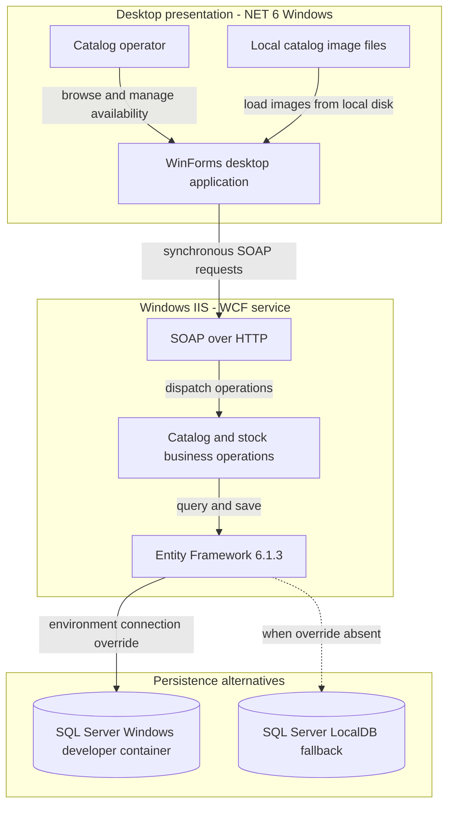
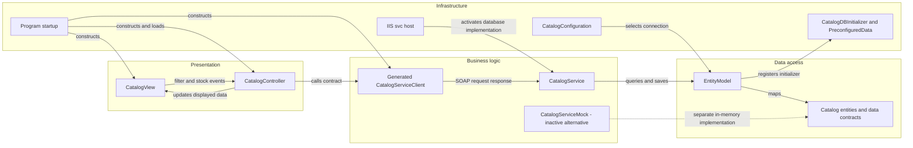

# Architecture Diagram

Source-based assessment of **eShopModernizedNTier only**. “Active” means selected by the checked-in solution and startup wiring, not a verified running deployment.

## Application Architecture

The solution selects the SDK-style desktop project and the classic WCF project [A1]. The desktop constructs the generated service client directly; the `.svc` host selects the database-backed service [A2, A3]. Compose describes the SQL Server container alternative, while connection selection falls back to the configured LocalDB database [A4, A5].

### Technology Stack Summary

| Layer | Technology | Version | Purpose |
|---|---|---|---|
| Presentation, active | WinForms with Windows desktop SDK; WPF also enabled | `net6.0-windows` | Desktop UI; WPF enablement is a build setting, not proof of WPF screens [A6] |
| Presentation, alternate | Classic WinForms project | .NET Framework 4.7.1 | `eShopWinForms.fx.csproj`, not selected by this solution [A1, A7] |
| Service | WCF, IIS, classic ASP.NET hosting | Project target .NET Framework 4.6.1 | SOAP service; not ASP.NET Core or REST [A8] |
| Container runtime image | WCF on .NET Framework | Image tag 4.7.2 | Hosting image differs from service compilation target [A9] |
| Persistence | Entity Framework and SQL Server provider | 6.1.3 on server; 6.4.4 declared on client | Server DbContext; client package does not establish client database access [A6, A10] |
| Storage | SQL Server Windows developer image / LocalDB | SQL image untagged; engine version not pinned | Persistent service data [A4, A5] |

### Data Storage & External Services

One service owns the catalog database. There is no source-evidenced broker, distributed cache, gateway, or external business API in the traced execution path. Catalog images are read from the desktop filesystem, not fetched from the WCF host [A11]. Compose exposes the WCF and SQL containers, but the desktop is not containerized [A4].

### Key Architectural Decisions

- The desktop view raises events to a controller, which makes synchronous WCF calls; application startup uses manual construction, not active dependency injection [A2, A12].
- The service accesses EF directly rather than through a repository layer; initialization creates and seeds a missing database [A3, A10].
- `CatalogServiceMock` is an alternative in-memory implementation, **not an automatic outage fallback**. `ApplicationModule` registrations are commented out; its mock flag does not control active startup [A2, A13].

## Component Relationships

### Component Inventory

| Component | Layer | Type | Responsibility |
|---|---|---|---|
| Program | Infrastructure | Entry point | Constructs view, generated proxy, controller; loads before showing UI [A2] |
| CatalogView / ICatalogView | Presentation | Form / view contract | Filters, discount display, stock search and shipment inputs [A11, A12] |
| CatalogController | Presentation orchestration | Controller | Coordinates service calls and view updates [A12] |
| Generated CatalogServiceClient | Business boundary | WCF proxy | SOAP contract and endpoint configuration [A14] |
| CatalogService | Business | Hosted service | Catalog CRUD, stock replacement, discount selection [A3] |
| EntityModel | Data access | EF DbContext | Five entity sets and mapping configuration [A10] |
| CatalogConfiguration / CatalogDBInitializer | Infrastructure | Connection selector / initializer | Environment override, fallback, create-and-seed behavior [A5, A10] |
| CatalogServiceMock | Alternate business implementation | In-memory service | Seeded lists; discount operation unimplemented [A13] |
| ApplicationModule | Inactive infrastructure | Registration scaffold | Commented registration code only [A13] |

The server-side file named `CatalogServiceClient.cs` is a separate incomplete stub, excluded from the classic service project's explicit compile list; it is **not** the desktop's generated proxy [A8, A15]. `CatalogItemHiLoGenerator` is compiled but not invoked by the traced service CRUD path [A3, A8].

### Source evidence

- **[A1]** `D:\a\eShopModernizing\eShopModernizing\eShopModernizedNTier\eShopModernizedNTier.sln:6-15`
- **[A2]** `D:\a\eShopModernizing\eShopModernizing\eShopModernizedNTier\src\eShopWinForms\Program.cs:17-27`
- **[A3]** `D:\a\eShopModernizing\eShopModernizing\eShopModernizedNTier\src\eShopWCFService\CatalogService.svc:1`; `D:\a\eShopModernizing\eShopModernizing\eShopModernizedNTier\src\eShopWCFService\CatalogService.svc.cs:14-118`
- **[A4]** `D:\a\eShopModernizing\eShopModernizing\eShopModernizedNTier\docker-compose.yml:3-13`; `D:\a\eShopModernizing\eShopModernizing\eShopModernizedNTier\docker-compose.override.yml:5-25`
- **[A5]** `D:\a\eShopModernizing\eShopModernizing\eShopModernizedNTier\src\eShopWCFService\Models\Infrastructure\CatalogConfiguration.cs:10-18`; `D:\a\eShopModernizing\eShopModernizing\eShopModernizedNTier\src\eShopWCFService\Web.config:52-64`
- **[A6]** `D:\a\eShopModernizing\eShopModernizing\eShopModernizedNTier\src\eShopWinForms\eShopWinForms.csproj:1-28`
- **[A7]** `D:\a\eShopModernizing\eShopModernizing\eShopModernizedNTier\src\eShopWinForms\eShopWinForms.fx.csproj:4-14`
- **[A8]** `D:\a\eShopModernizing\eShopModernizing\eShopModernizedNTier\src\eShopWCFService\eShopWCFService.csproj:15-23,44-92`
- **[A9]** `D:\a\eShopModernizing\eShopModernizing\eShopModernizedNTier\src\eShopWCFService\Dockerfile:1-5`
- **[A10]** `D:\a\eShopModernizing\eShopModernizing\eShopModernizedNTier\src\eShopWCFService\EntityModel.cs:10-40`; `D:\a\eShopModernizing\eShopModernizing\eShopModernizedNTier\src\eShopWCFService\Models\Infrastructure\CatalogDBInitializer.cs:11-79`; `D:\a\eShopModernizing\eShopModernizing\eShopModernizedNTier\src\eShopWCFService\packages.config:3`
- **[A11]** `D:\a\eShopModernizing\eShopModernizing\eShopModernizedNTier\src\eShopWinForms\Views\CatalogView.cs:48-71,142-195`
- **[A12]** `D:\a\eShopModernizing\eShopModernizing\eShopModernizedNTier\src\eShopWinForms\Controllers\CatalogController.cs:14-20,35-85,98-157`
- **[A13]** `D:\a\eShopModernizing\eShopModernizing\eShopModernizedNTier\src\eShopWinForms\Modules\ApplicationModule.cs:6-34`; `D:\a\eShopModernizing\eShopModernizing\eShopModernizedNTier\src\eShopWCFService\CatalogServiceMock.cs:11-24,95-120`
- **[A14]** `D:\a\eShopModernizing\eShopModernizing\eShopModernizedNTier\src\eShopWinForms\Connected Services\eShopServiceReference\Reference.cs:366-428,448-451,591-621`
- **[A15]** `D:\a\eShopModernizing\eShopModernizing\eShopModernizedNTier\src\eShopWCFService\CatalogServiceClient.cs:9-54`
