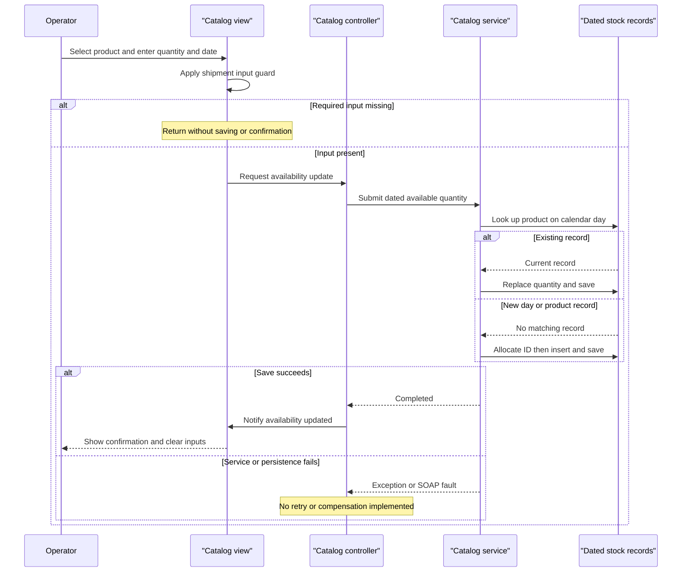

# Core Business Workflows

The desktop application lets an operator browse products by brand/type, see date-dependent sale prices, query stock for a selected day, and record or replace dated availability. This scope contains no checkout, order placement, payment, or shipping execution workflow; “shipment” is the UI's name for a dated stock record [B1, B2].

## Domain Entities

| Entity | Service / Bounded Context | Description | Key Relationships |
|---|---|---|---|
| CatalogItem | CatalogService / catalog management | Product offered for display | Belongs to brand and type; logical target for stock records |
| CatalogBrand | CatalogService / catalog classification | Product brand filter choice | Classifies products |
| CatalogType | CatalogService / catalog classification | Product category filter choice | Classifies products |
| CatalogItemsStock | CatalogService / inventory availability | Available quantity for one product on a day | Logical product link; not a shipment lifecycle aggregate |
| DiscountItem | CatalogService / promotions | Global time-bounded price reduction | Applied by desktop to displayed catalog prices; no product-specific association |

Business meaning is inferred from entity declarations and consuming code [B1-B4]. Persistence field details and relationship enforcement belong to `data-architecture.md`.

## Service-to-Domain Mapping

| Service | Domain Context | Owned Entities | External Dependencies |
|---|---|---|---|
| CatalogService | Catalog, dated availability, promotions | All five domain entities | Database through EntityModel |
| eShopWinForms | Operator interaction, display composition | No authoritative stored domain entities | Generated WCF service contract and local image files |
| CatalogServiceMock, inactive alternative | In-memory demonstration data | Copies of catalog/classification/stock state | Preconfigured data; discount unsupported |

These are application tiers, not independently owned microservice bounded contexts. The `.svc` host selects the database implementation; startup selects a remote generated proxy, not the mock. The alternate `.fx.csproj` is not selected by this solution [B5-B7].

## Primary Workflows

### Workflow 1: Initial catalog load and filtered sale-price display

1. Startup creates the view, WCF proxy and controller; `LoadView` runs before the dialog is shown [B5].
2. Controller checks today's discount for the banner, loads catalog products and separately queries today's discount again for price display, loads brands/types, then loads the unfiltered product list for stock controls [B1:60-85,88-157].
3. Brand/type dropdown changes raise filter events. Service applies the **All-filter rule**; view combines returned products with the discount fraction and local image files [B1:27-29,75-85; B2:48-61,106-135; B3:56-62].
4. **Promotion-window rule** selects the first matching discount. With no current promotion, displayed prices use the original price. Seed promotions are historical 2017 data, not evidence of a sale at assessment time [B1:60-85; B3:28-30; B8:41-51].

No gateway performs this composition: the desktop joins a product response and global discount response. Responses are independent calls, not a transactionally consistent snapshot [B1:75-85].

### Workflow 2: Record or replace availability

1. Operator selects a product and enters quantity/date. View applies the **Shipment-input guard** before raising an availability event [B2:157-167].
2. Controller constructs a stock contract and synchronously submits it; service searches for that product on the same calendar day [B1:35-43; B3:99-102].
3. **Stock-replacement rule:** replace the existing row's quantity, otherwise allocate a new stock ID and add a row; save changes [B3:104-117].
4. On successful return, view shows a confirmation and clears inputs. No automatic availability-search refresh is performed in this handler [B1:42-43; B2:189-195].

This replaces a snapshot quantity; it does not increment stock, reserve inventory, or initiate shipment delivery.

### Workflow 3: Query availability for a selected day

1. Operator selects a product from the list and a calendar day. View extracts the product ID and raises a search event [B2:142-151].
2. Controller requests availability. Database service selects the first matching dated stock row and returns quantity or zero [B1:50-54; B3:90-96].
3. View appends a result row to the list; it does not replace previous search history [B2:173-182].

Mock behavior differs: a missing stock row is dereferenced rather than safely returning zero, and discount lookup throws NotImplementedException. Mock is not a resilient substitute for these active workflows [B7].

### Workflow 4: First-use business data initialization

When a database is absent, its initializer seeds classifications, products, dated stock, and promotions. This is setup state, not a scheduled replenishment or promotion-update job; existing databases are not reseeded by this initializer [B8, B9].

The SOAP contract also exposes product create/update/remove operations, but the inspected controller does not initiate them. Do not equate public service CRUD with implemented desktop editing screens [B1, B10].

## Cross-Service Data Flows

The only traced inter-process business exchange is desktop ↔ CatalogService; the service accesses its own database. Desktop composes products and the global promotion, and resolves product image filenames against local files. Classification dropdowns are built from separate brand/type responses, adding an All choice locally. There are no broker events, gateway aggregation, compensating actions or downstream partial-result fallbacks in the inspected path [B1, B2, B3].

Service or database failure propagates through unguarded synchronous controller calls. The application does not automatically return stale catalog data or switch to mock mode; startup data loading happens before the modal UI appears [B1, B5, B6].

## Business Workflow Sequence

The diagram follows source branches; it is not an executed integration test [B1:35-43; B2:157-167,189-195; B3:99-117].

## Business Rules & Decision Logic

| Rule | Observed behavior and limits | Evidence |
|---|---|---|
| All-filter rule | ID zero means no filter; nonzero brand/type conditions are combined with AND; products materialized before filtering | B3:56-62 |
| Promotion-window rule | Start and end are inclusive calendar days; first matching discount wins with no explicit ordering/overlap arbitration | B3:28-30 |
| Sale-price calculation | Display uses original price multiplied by one minus discount fraction, converted to double and formatted; banner rounds fraction times 100. No bounded fraction validation or stored price mutation shown | B1:60-85; B2:48-61 |
| Shipment-input guard | Missing product, empty quantity or empty date returns silently; quantity parsed as int, date by Convert.ToDateTime. No TryParse, nonnegative quantity check or date-range rule shown | B2:157-167 |
| Search-input assumption | Selected stock-search item is dereferenced without null guard; ID parsed from display string | B2:142-150 |
| Stock-replacement rule | First row matching item/calendar day is overwritten, not summed; missing row receives maximum StockId plus one | B3:99-117 |
| Availability absence | Database implementation returns zero; mock can fail on absent row | B3:90-96; B7:95-98 |
| Identifier rule | New product and stock IDs use maximum plus one; no empty-set handling or concurrency-safe allocator on this path | B3:65-70,113-116 |
| Classification text rule | Brand and type have maximum length 50; no dedicated domain validator appears in traced service | B4 |

**State transitions:** stock is inserted or replaced; there is no shipment/order status machine. Product CRUD persists supplied state without a domain approval workflow [B3].

**Transactions and integrity:** separate SaveChanges calls establish persistence boundaries. There is no explicit cross-call transaction, saga or compensation for the desktop sequence, stock read/write allocation, or multi-stage seeding; no explicit unique item/date constraint is declared in the stock entity [B3, B9, B11].

**Error handling, audit and authorization:** no business exception hierarchy, local catch/retry, business audit log, or role/ownership check is present in the inspected controller/service flows. UI notification follows a successful call, not a verified distributed transaction. Image-loading/parse errors are likewise unhandled in the traced view methods [B1-B3]. Hosting and infrastructure access controls outside source are not assessed.

### Source evidence

- **[B1]** `D:\a\eShopModernizing\eShopModernizing\eShopModernizedNTier\src\eShopWinForms\Controllers\CatalogController.cs:14-157`
- **[B2]** `D:\a\eShopModernizing\eShopModernizing\eShopModernizedNTier\src\eShopWinForms\Views\CatalogView.cs:48-195`
- **[B3]** `D:\a\eShopModernizing\eShopModernizing\eShopModernizedNTier\src\eShopWCFService\CatalogService.svc.cs:28-118`
- **[B4]** `D:\a\eShopModernizing\eShopModernizing\eShopModernizedNTier\src\eShopWCFService\Models\CatalogItem.cs:10-35`; `D:\a\eShopModernizing\eShopModernizing\eShopModernizedNTier\src\eShopWCFService\Models\CatalogBrand.cs:10-19`; `D:\a\eShopModernizing\eShopModernizing\eShopModernizedNTier\src\eShopWCFService\Models\CatalogType.cs:10-19`; `D:\a\eShopModernizing\eShopModernizing\eShopModernizedNTier\src\eShopWCFService\Models\DiscountItem.cs:11-31`
- **[B5]** `D:\a\eShopModernizing\eShopModernizing\eShopModernizedNTier\src\eShopWinForms\Program.cs:17-27`
- **[B6]** `D:\a\eShopModernizing\eShopModernizing\eShopModernizedNTier\src\eShopWinForms\Modules\ApplicationModule.cs:6-34`; `D:\a\eShopModernizing\eShopModernizing\eShopModernizedNTier\eShopModernizedNTier.sln:6-11`
- **[B7]** `D:\a\eShopModernizing\eShopModernizing\eShopModernizedNTier\src\eShopWCFService\CatalogServiceMock.cs:18-24,95-120`; `D:\a\eShopModernizing\eShopModernizing\eShopModernizedNTier\src\eShopWCFService\CatalogService.svc:1`
- **[B8]** `D:\a\eShopModernizing\eShopModernizing\eShopModernizedNTier\src\eShopWCFService\Models\Infrastructure\PreconfiguredData.cs:10-75`
- **[B9]** `D:\a\eShopModernizing\eShopModernizing\eShopModernizedNTier\src\eShopWCFService\Models\Infrastructure\CatalogDBInitializer.cs:11-79`
- **[B10]** `D:\a\eShopModernizing\eShopModernizing\eShopModernizedNTier\src\eShopWCFService\ICatalogService.cs:12-34`
- **[B11]** `D:\a\eShopModernizing\eShopModernizing\eShopModernizedNTier\src\eShopWCFService\Models\CatalogItemsStock.cs:10-25`
