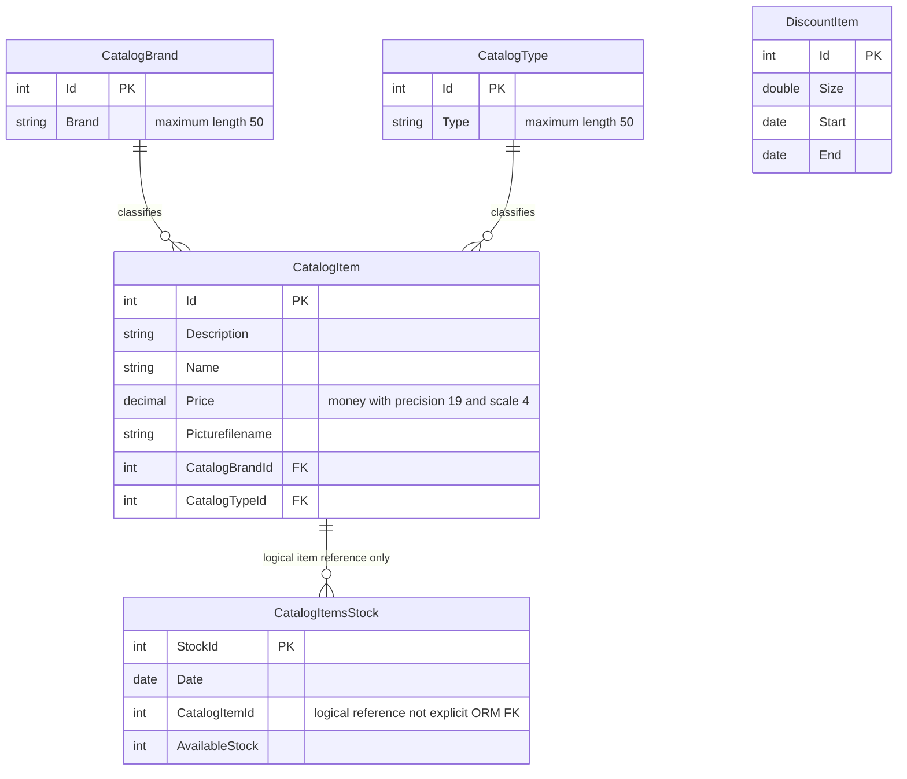

# Data Architecture & Persistence Layer

The database-backed service uses EF6 with **five entity sets** for catalog, classification, dated stock and discounts [P1]. A separate mock holds seeded lists and is not the selected hosted implementation [P2].

## Database Configuration

| Service/Module | DB Type | Profile | Driver | Connection | Migration Tool |
|---|---|---|---|---|---|
| CatalogService | SQL Server LocalDB | Default when environment override absent | System.Data.SqlClient / EF6 SQL provider | Named application configuration; see configuration inventory | CreateDatabaseIfNotExists initializer; no versioned migration flow evidenced [P1, P3] |
| CatalogService | SQL Server Windows developer container | Root Compose override | Same provider | Environment-supplied connection, credentials redacted | Same initializer [P3, P4] |
| CatalogServiceMock | None | Inactive alternative, not a runtime profile | In-memory lists | No database | Reconstructs preconfigured lists [P2] |

Initialization seeds only a newly created database: types, brands, products, stock and discounts, with separate saves for each category. It is not a drop/recreate-on-start or versioned migration policy [P5]. Seed content contains 12 products, 5 brands, 4 types, 6 stock rows and 6 historical discount periods; date-sensitive behavior must not be interpreted as current sample promotions [P6]. No explicit connection pool sizing is declared in the inspected connection selection/configuration [P3].

## Data Ownership per Service

| Service | Tables Owned | ORM Framework | Caching | Notes |
|---|---|---|---|---|
| CatalogService | CatalogBrands, CatalogItems, CatalogTypes, DiscountItems: names inferred by EF conventions; CatalogItemsStock explicitly mapped | EF6, server package 6.1.3 | No explicit cache | All five DbSets in one EntityModel; physical schema not inspected [P1, P7-P10] |
| eShopWinForms | None in traced startup | EF6 package declared but no active desktop DbContext path shown | No explicit cache | Generated transport models, not a second store [P11] |
| CatalogServiceMock | No tables | None | Mutable lists are mock state, not a database cache | List lifetime is object lifetime [P2] |

## Entity Model

All entities are owned by the catalog service [P1]. Product-to-brand/type navigation is unidirectional from product; no inverse collection is declared. Non-null integer references imply required relationships by EF conventions, but explicit cascade configuration and deployed constraints are not shown. **The stock relationship is logical only:** a scalar item ID without a navigation property, ForeignKey annotation or fluent relationship does not establish an EF/database FK. DiscountItem has no mapped relationship to products [P7-P10].

Brand/type IDs and product IDs are non-database-generated. Stock uses explicit non-generated `StockId`; DiscountItem has a conventional integer key without that suppression. Brand/type strings are non-Unicode, and product Price is configured with precision 19,4 as well as a money annotation [P1, P7-P10].

## Key Repository Methods

No separate repository interface is defined: `CatalogService` owns an `EntityModel` and directly queries DbSets [P12].

| Service | Repository | Notable Methods | Purpose |
|---|---|---|---|
| CatalogService | EntityModel via CatalogService | `FindCatalogItem(int) -> CatalogItem` | Fetches product and explicitly populates brand/type; returns null if absent [P12] |
| CatalogService | Same | `GetCatalogItems(int,int) -> List<CatalogItem>` | Materializes all products before applying optional filters [P12] |
| CatalogService | Same | `GetDiscount(DateTime) -> DiscountItem` | Materializes discounts then selects first inclusive calendar-day match [P12] |
| CatalogService | Same | `GetAvailableStock(DateTime,int) -> int` | Database filter by item, in-memory date match; absent row returns zero [P12] |
| CatalogService | Same | `CreateAvailableStock(CatalogItemsStock) -> void` | Finds dated item row, replaces quantity or adds new row; saves changes [P12] |
| CatalogService | Same | `CreateCatalogItem`, `UpdateCatalogItem`, `RemoveCatalogItem` | Explicit Add/Modified/Remove plus SaveChanges; new product ID uses maximum plus one [P12] |
| Infrastructure, not called in traced CRUD | CatalogItemHiLoGenerator | `GetNextSequenceValue(EntityModel) -> int` | Raw SQL sequence `catalog_hilo`, block increment 10; do not treat as active ID allocator [P13, P12] |

No explicit transaction wrapping the read/maximum-ID/write operations is present. Individual SaveChanges calls use EF's normal persistence boundary; database-wide atomicity for multi-step seeding or concurrent ID allocation is not established by this source [P5, P12].

## Caching Strategy

No explicit application cache provider, TTL, invalidation policy, distributed cache, or second-level cache appears in the traced data layer [P1, P12]. EF context tracking is not a documented shared result cache. Mock lists are the alternative implementation's sole data store, not cache-aside for SQL; no synchronization or persistence back to SQL is implemented [P2].

## Data Ownership Boundaries

This is one catalog data owner, not database-per-microservice architecture. Desktop exchanges copied data contracts through WCF; service performs both reads and writes against the same context. No direct desktop cross-service database access, CQRS split, outbox, broker projection or cross-service aggregation is evidenced in this execution path [P11, P12].

### Data Classification & Sensitivity

| Entity | Sensitive Fields | Classification (PII/PHI/PCI/None) | Controls in Place |
|---|---|---|---|
| CatalogItem | Product text, price, local picture filename | None of PII/PHI/PCI evident in declared model | No field encryption/masking or field-level access rule declared [P7] |
| CatalogBrand / CatalogType | Product classifications | None evident | No field-level protection declared [P8] |
| CatalogItemsStock | Inventory quantities and dates | Business operational data; no personal/health/card fields | No field encryption/masking declared [P9] |
| DiscountItem | Discount periods and fractions | Business commercial data; no personal/health/card fields | No field-level protection declared [P10] |

No PII, PHI or PCI fields are detected in these models. User-entered free text and actual database contents were not inspected. Encryption-at-rest, backup protection and deployment permissions are not established by model source; credentials are configuration secrets, not entity fields, and are excluded from this document.

### Source evidence

- **[P1]** `D:\a\eShopModernizing\eShopModernizing\eShopModernizedNTier\src\eShopWCFService\EntityModel.cs:10-40`
- **[P2]** `D:\a\eShopModernizing\eShopModernizing\eShopModernizedNTier\src\eShopWCFService\CatalogServiceMock.cs:11-24,95-120`; `D:\a\eShopModernizing\eShopModernizing\eShopModernizedNTier\src\eShopWCFService\CatalogService.svc:1`
- **[P3]** `D:\a\eShopModernizing\eShopModernizing\eShopModernizedNTier\src\eShopWCFService\Models\Infrastructure\CatalogConfiguration.cs:10-18`; `D:\a\eShopModernizing\eShopModernizing\eShopModernizedNTier\src\eShopWCFService\Web.config:52-64`
- **[P4]** `D:\a\eShopModernizing\eShopModernizing\eShopModernizedNTier\docker-compose.yml:4-13`; `D:\a\eShopModernizing\eShopModernizing\eShopModernizedNTier\docker-compose.override.yml:5-20`
- **[P5]** `D:\a\eShopModernizing\eShopModernizing\eShopModernizedNTier\src\eShopWCFService\Models\Infrastructure\CatalogDBInitializer.cs:11-79`
- **[P6]** `D:\a\eShopModernizing\eShopModernizing\eShopModernizedNTier\src\eShopWCFService\Models\Infrastructure\PreconfiguredData.cs:10-75`
- **[P7]** `D:\a\eShopModernizing\eShopModernizing\eShopModernizedNTier\src\eShopWCFService\Models\CatalogItem.cs:10-35`
- **[P8]** `D:\a\eShopModernizing\eShopModernizing\eShopModernizedNTier\src\eShopWCFService\Models\CatalogBrand.cs:10-19`; `D:\a\eShopModernizing\eShopModernizing\eShopModernizedNTier\src\eShopWCFService\Models\CatalogType.cs:10-19`
- **[P9]** `D:\a\eShopModernizing\eShopModernizing\eShopModernizedNTier\src\eShopWCFService\Models\CatalogItemsStock.cs:10-25`
- **[P10]** `D:\a\eShopModernizing\eShopModernizing\eShopModernizedNTier\src\eShopWCFService\Models\DiscountItem.cs:11-31`
- **[P11]** `D:\a\eShopModernizing\eShopModernizing\eShopModernizedNTier\src\eShopWinForms\Program.cs:22-27`; `D:\a\eShopModernizing\eShopModernizing\eShopModernizedNTier\src\eShopWinForms\eShopWinForms.csproj:21-28`
- **[P12]** `D:\a\eShopModernizing\eShopModernizing\eShopModernizedNTier\src\eShopWCFService\CatalogService.svc.cs:16-118`
- **[P13]** `D:\a\eShopModernizing\eShopModernizing\eShopModernizedNTier\src\eShopWCFService\Models\CatalogItemHiLoGenerator.cs:10-29`
