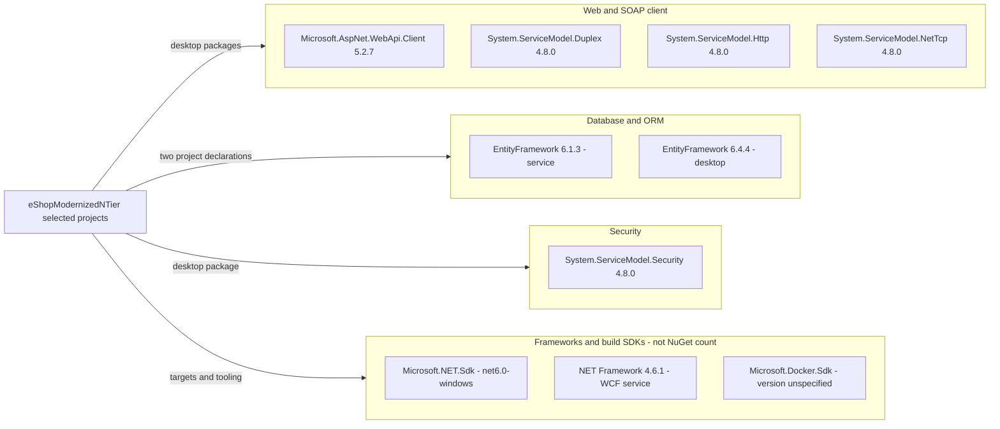

# Dependency Map

The selected eShopModernizedNTier projects declare **7 NuGet package occurrences, representing 6 unique package IDs and 7 package/version pairs**. This inventory uses build/package files only; framework assembly references and build SDKs are listed separately, not counted as NuGet packages [D1-D4].

## Dependencies

### Dependency Summary

| Category | Count | Key Libraries | Notes |
|---|---|---|---|
| Web and SOAP client | 4 package occurrences / 4 IDs | Microsoft.AspNet.WebApi.Client 5.2.7; System.ServiceModel.Duplex, Http, NetTcp 4.8.0 | All declared by selected desktop project; declaration does not prove each transport is used [D1] |
| Database / ORM | 2 occurrences / 1 ID | EntityFramework 6.4.4 desktop; 6.1.3 service | Server references both EF and its SQL Server assembly from the same package; not two packages [D1, D2, D3] |
| Security | 1 occurrence / 1 ID | System.ServiceModel.Security 4.8.0 | Client WCF package, not proof authentication is configured [D1] |
| Framework assemblies and SDKs | Excluded from package totals | System.ServiceModel, System.Web, System.Data, WinForms; Microsoft.NET.Sdk; Microsoft.Docker.Sdk | Classic service target v4.6.1; selected client target net6.0-windows; Docker SDK not explicitly versioned [D1, D3, D4] |

### Version & Compatibility Risks

The selected client targets .NET 6 and the service targets .NET Framework 4.6.1, both older runtime targets requiring support/compatibility review. Server EF 6.1.3 differs from the client's 6.4.4 declaration; EF6 is not EF Core. The classic server depends on Visual Studio WebApplication MSBuild targets and package HintPaths, while the desktop is SDK-style [D1-D3]. These are source-observed compatibility concerns, **not a vulnerability scan or a restored transitive dependency analysis**.

### Notable Observations

- No package lock file, central package version file, or declared test package was found in the scoped project inventory. Transitive versions are unresolved; do not infer them from direct versions.
- The alternate `eShopWinForms.fx.csproj` targets .NET Framework 4.7.1 and declares framework assembly references, but is not selected by the solution; it adds no declared NuGet package to the active count [D5, D6].
- Windows desktop settings enable both WinForms and WPF. SOAP-related assemblies are framework references in the server and NuGet packages in the SDK client [D1, D3].
- The classic service's EF assembly identity is `6.0.0.0`; its package version is **6.1.3**, as shown by HintPaths and `packages.config` [D2, D3].

## Test Dependencies

| Framework | Version | Notes |
|---|---|---|
| None detected | Not applicable | Selected solution contains desktop, WCF service and Docker Compose projects only; scoped package declarations contain no test framework [D1, D2, D6] |

Total test-scope dependencies: **0 detected**. This states absence in the scoped declarations, not that tests elsewhere in the repository do not exist.

### Source evidence

- **[D1]** `D:\a\eShopModernizing\eShopModernizing\eShopModernizedNTier\src\eShopWinForms\eShopWinForms.csproj:1-8,21-28`
- **[D2]** `D:\a\eShopModernizing\eShopModernizing\eShopModernizedNTier\src\eShopWCFService\packages.config:1-4`
- **[D3]** `D:\a\eShopModernizing\eShopModernizing\eShopModernizedNTier\src\eShopWCFService\eShopWCFService.csproj:15-23,44-70,111-117`
- **[D4]** `D:\a\eShopModernizing\eShopModernizing\eShopModernizedNTier\docker-compose.dcproj:2-9`
- **[D5]** `D:\a\eShopModernizing\eShopModernizing\eShopModernizedNTier\src\eShopWinForms\eShopWinForms.fx.csproj:4-14,56-73`
- **[D6]** `D:\a\eShopModernizing\eShopModernizing\eShopModernizedNTier\eShopModernizedNTier.sln:6-15`
