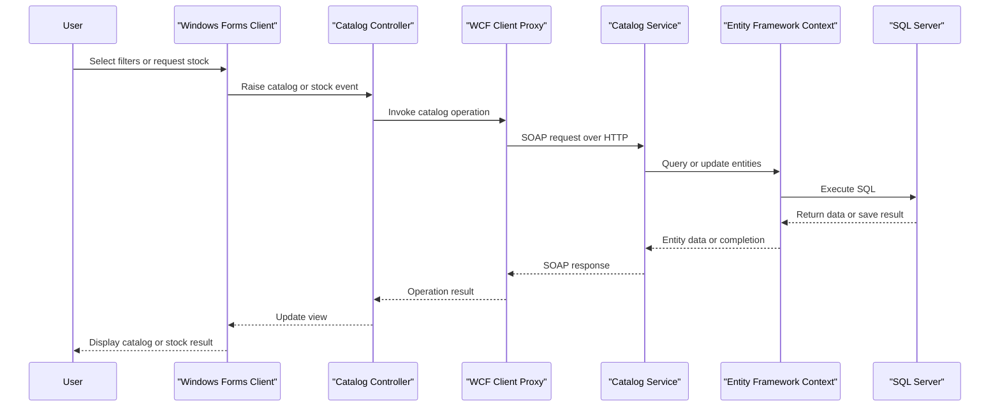

# API & Service Communication Contracts

The application exposes one WCF SOAP service contract with ten operations. The Windows Forms client invokes the service synchronously over HTTP; no asynchronous messaging or inter-service composition was identified.

## Service Catalog

| Service | Port | Category | Purpose |
|---|---|---|---|
| `eShopWCFService` / `CatalogService` | Container 80; host 5113 | API Layer | Provides catalog, discount, and inventory operations |
| `eShopWinForms` | Desktop client; no listening port | Client | Displays catalog data and initiates stock lookups and updates |
| `sql.data` | Container 1433; host 5433 | Infrastructure | SQL Server Developer database container |

## API Endpoints Inventory

All operations use the WCF SOAP endpoint at `/CatalogService.svc` with `BasicHttpBinding`. The operation name is carried in the SOAP action; there are no REST HTTP methods or per-operation URL routes.

| Service | Operation | Path | Request Type | Response Type |
|---|---|---|---|---|
| `CatalogService` | `FindCatalogItem` | `/CatalogService.svc` | `id: int` | `CatalogItem` |
| `CatalogService` | `GetCatalogBrands` | `/CatalogService.svc` | None | `List<CatalogBrand>` |
| `CatalogService` | `GetCatalogItems` | `/CatalogService.svc` | `brandIdFilter: int`, `typeIdFilter: int` | `List<CatalogItem>` |
| `CatalogService` | `GetCatalogTypes` | `/CatalogService.svc` | None | `List<CatalogType>` |
| `CatalogService` | `GetAvailableStock` | `/CatalogService.svc` | `date: DateTime`, `catalogItemId: int` | `int` |
| `CatalogService` | `CreateAvailableStock` | `/CatalogService.svc` | `CatalogItemsStock` | `void` |
| `CatalogService` | `CreateCatalogItem` | `/CatalogService.svc` | `CatalogItem` | `void` |
| `CatalogService` | `UpdateCatalogItem` | `/CatalogService.svc` | `CatalogItem` | `void` |
| `CatalogService` | `RemoveCatalogItem` | `/CatalogService.svc` | `CatalogItem` | `void` |
| `CatalogService` | `GetDiscount` | `/CatalogService.svc` | `day: DateTime` | `DiscountItem` |

## Management & Observability Endpoints

| Service | Endpoint | Custom Metrics |
|---|---|---|
| `CatalogService` | `/CatalogService.svc/mex` metadata exchange over HTTP; `/CatalogService.svc?wsdl` metadata retrieval is enabled over HTTP and HTTPS | None detected |
| `CatalogService` | No health-check, metrics, or tracing endpoint configured | None detected |

## DTOs & Contracts

`ICatalogService` defines the service contract. `CatalogItem`, `CatalogBrand`, `CatalogType`, `CatalogItemsStock`, and `DiscountItem` are mutable data-contract classes used as both persistence entities and wire types; no separate request/response DTO layer or immutable contract types were found. The connected-service proxy contains generated client-side contract representations. WCF uses its data-contract serialization; no OpenAPI, protobuf, or GraphQL schema was found.

## Communication Patterns

The client uses a generated WCF proxy and synchronous SOAP requests with `BasicHttpBinding` to `http://localhost:5113/CatalogService.svc`. The service uses synchronous EF6 queries and saves against SQL Server. No message broker, retry policy, circuit breaker, explicit timeout policy, service discovery, API gateway, or client-side load balancing was identified.

The service configuration enables metadata retrieval, but the configured service endpoint and client endpoint use HTTP rather than an HTTPS binding. No authentication or authorization configuration was found for the service operations.

## Service Technology Matrix

| Service | Web / Protocol | Data Access | Discovery | Gateway | Health | Cache | Metrics |
|---|---|---|---|---|---|---|---|
| `CatalogService` | WCF SOAP / BasicHttpBinding | EF6 | None | None | None | None | None |
| `eShopWinForms` | Windows Forms / WCF client | WCF proxy | None | None | None | None | None |
| `sql.data` | SQL Server | Database engine | None | None | None | Database-managed | None |

## Service Communication Sequence

