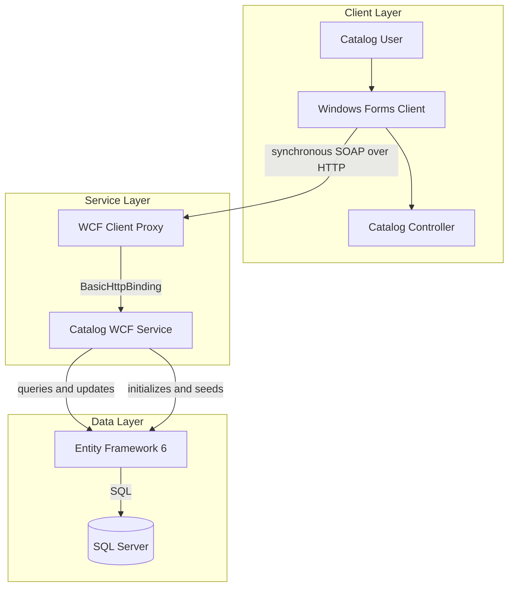
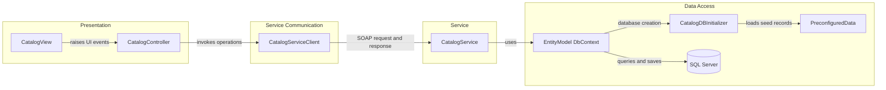

# Architecture Diagram

The solution separates a Windows Forms catalog client from a WCF service that owns catalog data access. The service uses Entity Framework to read and write a SQL Server database.

## Application Architecture

### Technology Stack Summary

| Layer | Technology | Version | Purpose |
|---|---|---|---|
| Presentation | Windows Forms | .NET 6.0-windows project; legacy .NET Framework 4.7.1 project also present | Desktop catalog and stock UI |
| Service | WCF hosted with ASP.NET compatibility | Service project targets .NET Framework 4.6.1; WCF container base is 4.7.2 | SOAP service operations |
| Data access | Entity Framework 6 | NuGet 6.1.3 in legacy projects; 6.4.4 in the .NET 6 client project | Entity querying and persistence |
| Database | SQL Server Developer container or SQL Server LocalDB | Container image tag is unpinned; LocalDB is the configured default | Catalog, stock, and discount records |
| Containerization | Docker Compose and Windows containers | Compose format 3.4 | Runs WCF and SQL Server containers |

### Data Storage & External Services

The WCF service persists catalog, brand, type, stock, and discount data through Entity Framework to SQL Server. LocalDB is the service configuration default; the Compose override supplies a container connection string to the SQL Server service. No cache, message broker, or third-party API integration was identified.

### Key Architectural Decisions

- The Windows Forms client communicates with the service through a generated WCF proxy using synchronous BasicHttpBinding.
- The service accesses the database directly through an Entity Framework `DbContext`; no repository layer is present.
- `CreateDatabaseIfNotExists` initializes the database and seeds preconfigured catalog data.

## Component Relationships

### Component Inventory

| Component | Layer | Type | Responsibility |
|---|---|---|---|
| `CatalogView` | Presentation | Windows Forms view | Displays catalog items, discounts, filters, and stock interactions |
| `CatalogController` | Presentation | Controller | Coordinates view events and WCF service calls |
| `CatalogServiceClient` | Service Communication | Generated WCF proxy | Sends catalog service operations to the configured endpoint |
| `CatalogService` | Service | WCF implementation | Implements catalog, discount, and stock operations |
| `EntityModel` | Data Access | EF6 `DbContext` | Exposes entity sets and model configuration |
| `CatalogDBInitializer` | Data Access | EF initializer | Creates a missing database and seeds its initial records |
| `PreconfiguredData` | Data Access | Seed data provider | Supplies initial catalog, brand, type, discount, and stock records |
