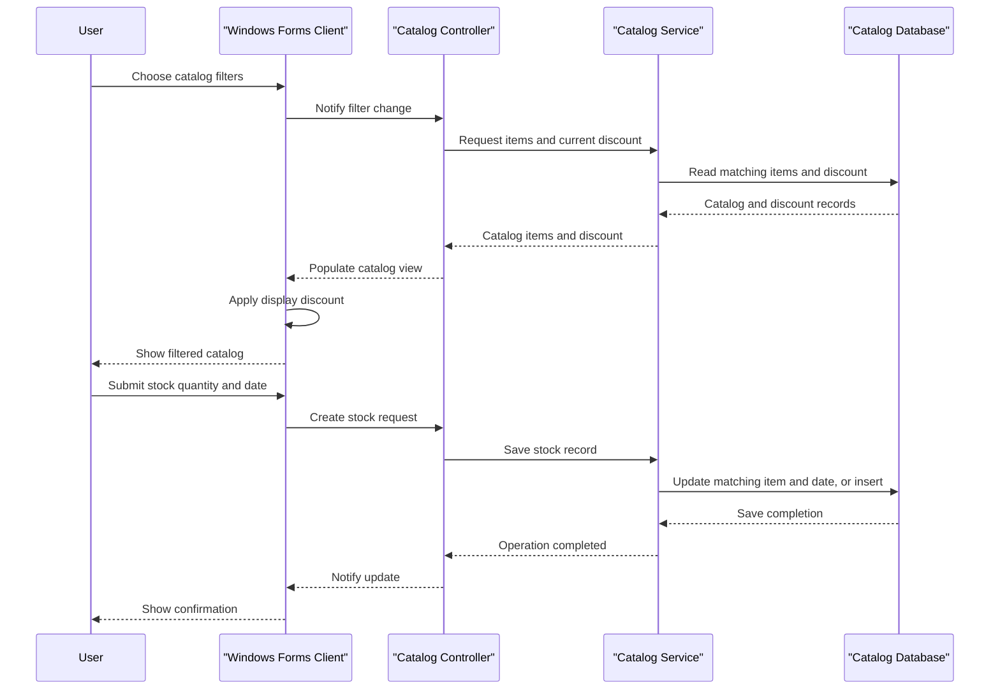

# Core Business Workflows

The application supports browsing a product catalog and checking or updating inventory availability. A desktop user initiates these workflows through the client, which calls the catalog service and presents the returned results.

## Domain Entities

| Entity | Service / Bounded Context | Description | Key Relationships |
|---|---|---|---|
| `CatalogItem` | Catalog | A product offered in the catalog | Classified by a brand and type; has inventory records by date |
| `CatalogBrand` | Catalog | A product brand filter | Groups catalog items |
| `CatalogType` | Catalog | A product category filter | Groups catalog items |
| `CatalogItemsStock` | Inventory | Available quantity for one item on a date | Refers to a catalog item by ID |
| `DiscountItem` | Pricing | A date-bounded discount | Applies to catalog display during its active dates |

## Service-to-Domain Mapping

| Service | Domain Context | Owned Entities | External Dependencies |
|---|---|---|---|
| `CatalogService` | Catalog, pricing, and inventory | `CatalogItem`, `CatalogBrand`, `CatalogType`, `CatalogItemsStock`, `DiscountItem` | SQL Server through EF6 |
| `eShopWinForms` | User-facing catalog client | No persisted domain entities | WCF `CatalogService` |

All persistent business data is owned by the WCF service. The WinForms client uses the service contract and does not directly access the database.

## Primary Workflows

### Workflow 1: Browse and filter the catalog

1. The client loads the catalog and filter choices from the service.
2. A user selects a brand and/or type; the client raises a filter event to the controller.
3. The controller requests matching catalog items and the current discount.
4. A filter value of zero means that dimension is not restricted.
5. The view computes the displayed discounted price and renders the item list.

### Workflow 2: Check and update stock availability

1. The user selects an item and date to check available stock.
2. The controller requests the matching availability from the service.
3. To record a shipment, the user selects an item, quantity, and date; the client submits a stock record.
4. The service updates an existing item/date record when found, or inserts a new record otherwise.
5. The client displays the returned quantity or confirms the update.

## Cross-Service Data Flows

There is no multi-service aggregation. The WinForms client obtains catalog, discount, and stock information from one WCF service, which queries or updates its SQL Server database. No circuit-breaker or fallback behavior was found; service unavailability prevents the requested operation.

## Business Workflow Sequence

## Business Rules & Decision Logic

- Catalog filter ID zero represents “all”; nonzero brand and type IDs restrict the catalog.
- A discount is active when the requested date is between its start and end dates, inclusive. The client applies the discount percentage to the displayed price.
- Stock availability is selected by item ID and date. A stock submission overwrites the quantity for an existing item/date pair; otherwise, it creates a record.
- New catalog and stock IDs are calculated from the current maximum ID in the data set.
- The UI checks that item, quantity, and date inputs are present before submitting stock; numeric and date values are parsed directly. No broader business validation, authorization, audit trail, or explicit transaction scope was identified.
