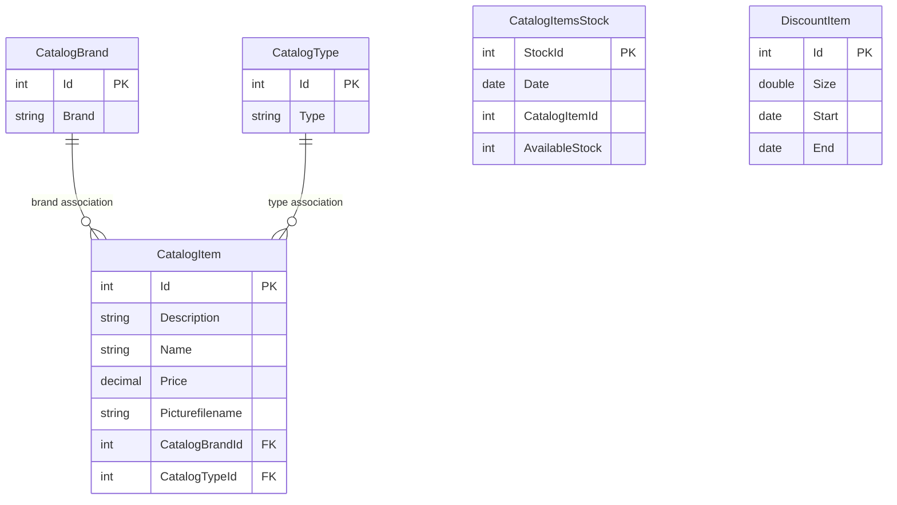

# Data Architecture & Persistence Layer

The service persists five catalog-related entity types in SQL Server through Entity Framework 6. A WinForms client consumes service operations rather than accessing the database directly.

## Database Configuration

| Service/Module | DB Type | Profile | Driver | Connection | Migration Tool |
|---|---|---|---|---|---|
| `eShopWCFService` | SQL Server LocalDB | Default local configuration | `System.Data.SqlClient` with EF6 | The configured default is LocalDB; the `ConnectionString` environment variable can override it | None detected; `CreateDatabaseIfNotExists` initializes an absent database |
| `eShopWCFService` | SQL Server Developer | Docker Compose | `System.Data.SqlClient` with EF6 | Compose supplies a service connection string referencing `sql.data` | None detected |
| `eShopWinForms` | No direct database connection identified | Desktop client | WCF proxy | Uses the WCF service contract for data | Not applicable |

## Data Ownership per Service

| Service | Tables Owned | ORM Framework | Caching | Notes |
|---|---|---|---|---|
| `eShopWCFService` | `CatalogItems`, `CatalogBrands`, `CatalogTypes`, `CatalogItemsStock`, `DiscountItems` | Entity Framework 6 | None detected | Owns database context, queries, updates, and seed data |
| `eShopWinForms` | None | No direct data access identified | None detected | Receives service contract objects |

## Entity Model

`CatalogItem` has navigation properties to `CatalogBrand` and `CatalogType`, with corresponding ID properties. `CatalogItemsStock` stores a catalog item ID but has no navigation property or explicit foreign-key mapping in the inspected model. `DiscountItem` is independent. Entity classes are defined in `src/eShopWCFService/Models/`; `CatalogItemsStock` is defined in `src/eShopWCFService/Models/CatalogItemsStock.cs`.

The `EntityModel` context exposes five entity sets, configures string and decimal mappings, and uses an initializer that seeds preconfigured records. No explicit transaction-scope configuration or migration history was found.

## Key Repository Methods

| Service | Repository | Notable Methods | Purpose |
|---|---|---|---|
| `eShopWCFService` | No repository interface | `CatalogService.FindCatalogItem`, `GetCatalogItems`, `GetCatalogBrands`, `GetCatalogTypes`, `GetDiscount`, `GetAvailableStock` | Performs EF6 lookups for catalog, classification, discounts, and stock |
| `eShopWCFService` | No repository interface | `CatalogService.CreateCatalogItem`, `UpdateCatalogItem`, `RemoveCatalogItem`, `CreateAvailableStock` | Persists catalog and stock changes through `EntityModel` |

## Caching Strategy

No in-memory, distributed, session, or ORM second-level cache was identified. Catalog reads are served by direct EF6 queries.

## Data Ownership Boundaries

All persisted entities are owned by the WCF service and stored in one SQL Server database. The WinForms application accesses service operations; no cross-service database access, CQRS split, or aggregation service was found. The service context acts as the data-access boundary, but there is no separate repository abstraction.

### Data Classification & Sensitivity

| Entity | Sensitive Fields | Classification | Controls in Place |
|---|---|---|---|
| `CatalogItem` | None identified | None | Not applicable |
| `CatalogBrand` | None identified | None | Not applicable |
| `CatalogType` | None identified | None | Not applicable |
| `CatalogItemsStock` | None identified | None | Not applicable |
| `DiscountItem` | None identified | None | Not applicable |

No PII, PHI, or PCI data detected in the entity model.
