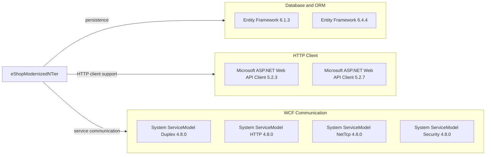

# Dependency Map

The workspace declares 9 package/version references across the service and client project files, representing 6 distinct NuGet package IDs. The solution contains no test-scoped package dependencies.

## Dependencies

### Dependency Summary

| Category | Count | Key Libraries | Notes |
|---|---:|---|---|
| Database / ORM | 3 references | Entity Framework 6.1.3 and 6.4.4 | EF 6.1.3 is referenced by both legacy .NET Framework project files; the SDK-style client declares 6.4.4 |
| HTTP Client | 2 references | Microsoft ASP.NET Web API Client 5.2.3 and 5.2.7 | Declared by the two WinForms project files |
| WCF Communication | 4 references | System.ServiceModel packages 4.8.0 | Duplex, HTTP, NetTcp, and Security client packages |

### Version & Compatibility Risks

The dependency set spans older .NET Framework projects and a .NET 6 Windows client. Entity Framework 6.1.3 and Web API Client 5.2.3 are older declarations, and duplicate project variants use different package versions. The WCF service project also targets .NET Framework 4.6.1, while its container image uses a 4.7.2 WCF base.

### Notable Observations

- The package inventory is split between `packages.config` and SDK-style `PackageReference` declarations.
- The WCF project uses EF6 directly; there are no repository or test packages in the target solution.
- The SQL Server Developer container image in Compose has no explicit version tag.

## Test Dependencies

| Framework | Version | Notes |
|---|---|---|
| None detected | — | No test-scoped packages or test project were identified in the solution. |

Total test-scope dependencies: 0

No test dependencies detected.
