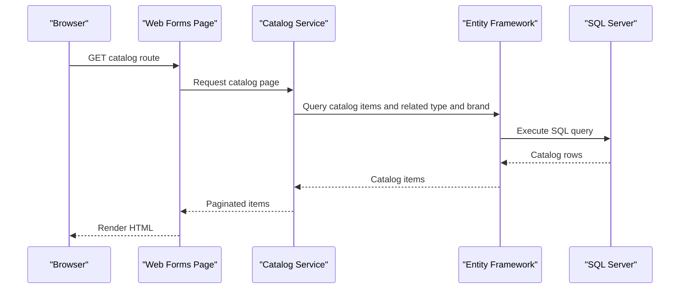

# API & Service Communication Contracts

The application exposes server-rendered catalog routes and one ASMX image-upload method. It is a single deployable application with synchronous in-process service calls and optional external SQL Server, Azure Blob Storage, and OpenID Connect integrations.

## Service Catalog

| Service | Port | Category | Purpose |
|---|---:|---|---|
| `eShopModernizedWebForms` | 80 in container; 5114 host mapping | API Layer | Serves catalog pages and the image-upload ASMX endpoint |
| `sql.data` | 1433 in container; 5433 host mapping | Infrastructure | Development SQL Server database for catalog persistence |
| Azure Blob Storage | External | Infrastructure | Optional image storage backend |
| Azure Active Directory | External | Infrastructure | Optional OpenID Connect identity provider |

## API Endpoints Inventory

| Service | Method | Path | Request Type | Response Type |
|---|---|---|---|---|
| `eShopModernizedWebForms` | GET | `/Default` | Optional pagination route values | HTML catalog page |
| `eShopModernizedWebForms` | GET | `/Default/index/{index}/size/{size}` | Route parameters `index`, `size` | HTML catalog page |
| `eShopModernizedWebForms` | GET, POST | `/Catalog/Create` | Form fields for catalog item | HTML form or redirect |
| `eShopModernizedWebForms` | GET, POST | `/Catalog/Edit/{id}` | Route `id` and catalog form fields | HTML form or redirect |
| `eShopModernizedWebForms` | GET, POST | `/Catalog/Details/{id}` | Route `id` | HTML item details |
| `eShopModernizedWebForms` | GET, POST | `/Catalog/Delete/{id}` | Route `id` | HTML confirmation or redirect |
| `eShopModernizedWebForms` | POST | `/Catalog/PicUploader.asmx/UploadImage` | Multipart image field `HelpSectionImages` and form `itemId` | JSON object with image name and URL; 400 for invalid image data |

No URL, header, or query-parameter API versioning scheme was identified.

## Management & Observability Endpoints

| Service | Endpoint | Custom Metrics (if any) |
|---|---|---|
| `eShopModernizedWebForms` | No health-check, Swagger, or metrics endpoint identified | Application Insights telemetry is configured optionally |

## DTOs & Contracts

There are no dedicated immutable API DTOs. Web Forms and the catalog service use the mutable `CatalogItem`, `CatalogBrand`, and `CatalogType` model classes directly; `PaginatedItemsViewModel<CatalogItem>` carries page metadata and results. The ASMX upload method returns an anonymous JSON object containing an image name and URL, serialized with `JavaScriptSerializer`. No OpenAPI, protobuf, or GraphQL contract was found.

## Communication Patterns

Page code synchronously calls `ICatalogService`; the SQL implementation uses Entity Framework 6 and `CatalogDBContext`, while mock mode uses an in-memory service. Image handling calls either the mock image service or Azure Blob Storage. There is no active message-broker flow, service discovery, API gateway, retry policy, circuit breaker, or explicit timeout policy in the application code.

Azure AD OpenID Connect can be enabled by configuration. When it is disabled, the OWIN pipeline uses the application's custom middleware; no role-based authorization policy was identified. The development container publishes HTTP port 80 to host port 5114, and no application-level TLS termination is configured in the assessed workspace. The Compose file defines a SQL health check but no explicit application startup dependency on that health check.

## Service Technology Matrix

| Service | Web | Data Access | Discovery | Gateway | Health | Cache | Metrics |
|---|---|---|---|---|---|---|---|
| `eShopModernizedWebForms` | ASP.NET Web Forms | EF6 / SQL Server or mock | None | None | No endpoint identified | None active | Application Insights optional |
| `sql.data` | SQL Server | SQL Server database | None | None | Compose `sqlcmd` health check | None identified | None identified |

## Service Communication Sequence

