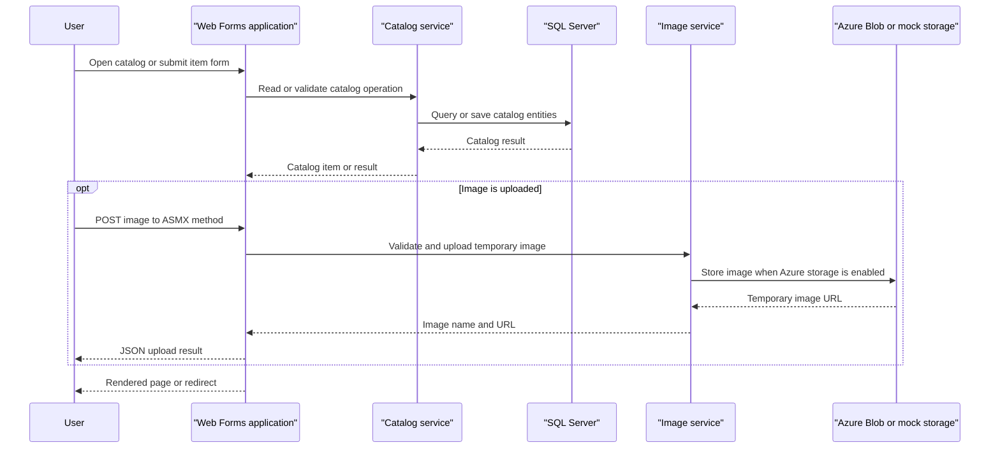

# API & Service Communication Contracts

The application exposes server-rendered catalog pages and one JSON-returning ASMX image-upload method. Requests are handled synchronously in the web application; no independently deployed application API or message-driven contract was found.

## Service Catalog

| Service | Port | Category | Purpose |
|---|---|---|---|
| eShopModernizedWebForms | 80 in the supplied Compose configuration | Business and presentation | Serves catalog pages and image-upload requests |
| SQL Server container | 1433 internally; host port is configured by Compose | Infrastructure | Persists catalog data |
| Azure Blob Storage | External endpoint, when enabled | Infrastructure | Stores uploaded catalog images |

## API Endpoints Inventory

| Service | Method | Path | Request Type | Response Type |
|---|---|---|---|---|
| Web Forms | GET | `/Default` | Optional pagination values | Rendered catalog page |
| Web Forms | GET | `/Default/index/{index}/size/{size}` | Route pagination values | Rendered catalog page |
| Web Forms | GET/POST | `/Catalog/Create` | Form fields for a catalog item | Rendered page or redirect after creation |
| Web Forms | GET/POST | `/Catalog/Edit/{id}` | Route item ID and edit form | Rendered page or redirect after update |
| Web Forms | GET/POST | `/Catalog/Details/{id}` | Route item ID | Rendered item details |
| Web Forms | GET/POST | `/Catalog/Delete/{id}` | Route item ID and delete action | Rendered page or redirect after deletion |
| PicUploader ASMX | POST (script service) | `/Catalog/PicUploader.asmx/UploadImage` | Multipart file `HelpSectionImages` and form item ID | JSON object with temporary image name and URL |

The catalog paths are Web Forms page routes, not a versioned REST API. `PicUploader.UploadImage` is the identified scripted web method; it returns HTTP 400 for an image that fails its format check.

## Management & Observability Endpoints

| Service | Endpoint | Custom Metrics |
|---|---|---|
| eShopModernizedWebForms | No application health or Swagger endpoint identified | Application Insights request, dependency, and exception telemetry is configured |

## DTOs & Contracts

`CatalogItem`, `CatalogBrand`, and `CatalogType` are service-level domain/entity classes used by the rendered pages; they are not immutable API DTOs. The upload method serializes an anonymous JSON contract containing `name` and `url` using `JavaScriptSerializer`. No OpenAPI, protobuf, or GraphQL contract was found.

## Communication Patterns

Web Forms pages call `ICatalogService` and `IImageService` directly within the same process. Catalog operations use EF6 and SQL Server; image storage uses the configured Azure Blob implementation or a mock implementation. The ASMX upload method is synchronous from the client’s perspective, while blob operations include asynchronous Azure SDK APIs internally. No broker, service discovery, gateway, retry policy, circuit breaker, or cross-service aggregation was identified.

Azure Active Directory OpenID Connect and cookie authentication are enabled conditionally by configuration; otherwise a custom OWIN middleware is used. The inspected page handlers do not show a common explicit role or resource-authorization policy. TLS enforcement is not established by the application source; the supplied local Compose URL uses HTTP.

## Service Technology Matrix

| Service | Web | Data Access | Discovery | Gateway | Health | Cache | Metrics |
|---|---|---|---|---|---|---|---|
| eShopModernizedWebForms | ASP.NET Web Forms and ASMX | EF6 / SQL Server | None | None | No application health endpoint found | No application cache identified | Application Insights |
| SQL Server container | — | SQL Server | None | — | Compose SQL health check | — | — |

## Service Communication Sequence

