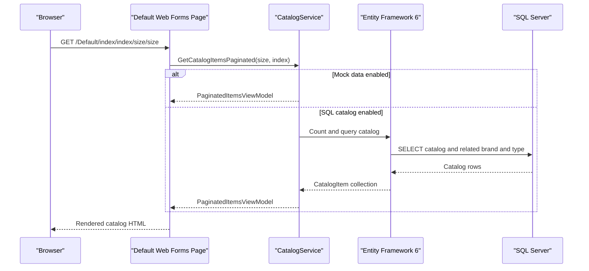

# API & Service Communication Contracts

This workspace exposes server-rendered catalog pages and one ASMX image-upload method. Application services communicate in-process; there are no independently deployed application APIs or asynchronous messaging contracts.

## Service Catalog

| Service | Port | Category | Purpose |
|---|---:|---|---|
| `eShopModernizedWebForms` | 80 in container; 5114 host mapping | API Layer / Web application | Serves catalog pages and image-upload method |
| `sql.data` | 1433 in container; 5433 host mapping | Infrastructure | SQL Server database container used by the compose configuration |
| Azure Blob Storage | External | Infrastructure | Optional storage for product images |
| Azure Active Directory | External | Infrastructure | Optional OWIN OpenID Connect identity provider |

## API Endpoints Inventory

| Service | Method | Path | Request Type | Response Type |
|---|---|---|---|---|
| eShopModernizedWebForms | GET | `/Default` | None | HTML catalog listing |
| eShopModernizedWebForms | GET | `/Default/index/{index}/size/{size}` | Route integers | HTML paginated catalog |
| eShopModernizedWebForms | GET/POST | `/Catalog/Create` | Web Forms fields; optional image name | HTML page or redirect |
| eShopModernizedWebForms | GET/POST | `/Catalog/Edit/{id}` | Route ID and Web Forms fields | HTML page or redirect |
| eShopModernizedWebForms | GET | `/Catalog/Details/{id}` | Route ID | HTML catalog item details |
| eShopModernizedWebForms | GET/POST | `/Catalog/Delete/{id}` | Route ID | HTML confirmation or redirect |
| eShopModernizedWebForms | POST | `/Catalog/PicUploader.asmx/UploadImage` | Multipart image file and `itemId` form value | JSON object with uploaded image name and URL; 400 on invalid image |

The Web Forms routes are registered in `App_Start/RouteConfig.cs`; the upload method is a JSON-enabled ASMX `WebMethod`.

## Management & Observability Endpoints

| Service | Endpoint | Custom Metrics (if any) |
|---|---|---|
| eShopModernizedWebForms | No application health, metrics, or Swagger endpoint identified | No custom metrics identified; Application Insights modules collect request, dependency, and exception telemetry |

## DTOs & Contracts

`CatalogItem`, `CatalogBrand`, and `CatalogType` are service-level domain entities used by the page code; there are no separate request/response DTO classes or immutable API records. `PaginatedItemsViewModel<CatalogItem>` is the catalog-list response view model. The image uploader returns an anonymous `{ name, url }` object serialized with `JavaScriptSerializer`. No OpenAPI, protobuf, or GraphQL schema was found.

## Communication Patterns

Page handlers call `ICatalogService` and `IImageService` synchronously in-process. The SQL-backed catalog service uses EF6 and SQL Server, while image operations can call Azure Blob Storage. There is no message broker or application gateway, and no explicit retry, circuit-breaker, or bulkhead policy was identified. Azure AD authentication is enabled conditionally; otherwise the application installs its custom OWIN authentication middleware. TLS is not forced by the container port mapping; IIS Express declares a local SSL port for development.

## Service Technology Matrix

| Service | Web | Data Access | Discovery | Gateway | Health | Cache | Metrics |
|---|---|---|---|---|---|---|---|
| eShopModernizedWebForms | ASP.NET Web Forms | EF6 / SQL Server or mock list | None | None | None identified | No application cache; optional Redis session package/configuration | Application Insights |
| sql.data | SQL Server container | SQL Server | None | None | Compose SQL health check | None identified | None identified |

## Service Communication Sequence

