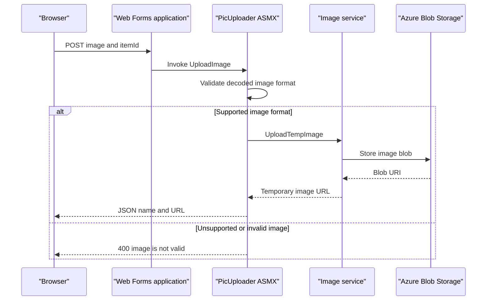

# API & Service Communication Contracts

The application exposes server-rendered catalog pages and one AJAX-oriented ASMX image-upload method. No versioned REST API or inter-application service contract was identified.

## Service Catalog

| Service | Port | Category | Purpose |
|---|---:|---|---|
| eShopModernizedWebForms | 80 in container; host mapping 5114 | API Layer / Web application | Renders catalog pages and handles administration and image upload |
| SQL Server catalog database | 1433 in container; host mapping 5433 | Infrastructure | Stores catalog items, brands, and types |
| Azure Blob Storage | External | Infrastructure | Optional image storage |
| Azure Active Directory | External | Infrastructure | Optional OpenID Connect identity provider |
| Application Insights | External | Observability | Optional telemetry collection |

The application and SQL Server are the only source-built/deployed services described by Docker Compose. The remaining entries are external integrations.

## API Endpoints Inventory

| Service | Method | Path | Request Type | Response Type |
|---|---|---|---|---|
| eShopModernizedWebForms | GET | `/Default` | Optional route paging values | Rendered catalog page |
| eShopModernizedWebForms | GET / POST | `/Catalog/Create` | Form postback with catalog fields | Redirect or rendered form |
| eShopModernizedWebForms | GET / POST | `/Catalog/Edit/{id}` | Route item ID and form postback | Redirect or rendered form |
| eShopModernizedWebForms | GET | `/Catalog/Details/{id}` | Route item ID | Rendered catalog details |
| eShopModernizedWebForms | GET / POST | `/Catalog/Delete/{id}` | Route item ID and postback | Redirect or rendered confirmation |
| eShopModernizedWebForms | POST | `/Catalog/PicUploader.asmx/UploadImage` | Multipart upload and `itemId` form value | JSON object containing image name and URL; 400 for invalid image |

The page routes are Web Forms page requests and postbacks, not REST resources. No API versioning, OpenAPI document, or GraphQL/protobuf schema was identified.

## Management & Observability Endpoints

| Service | Endpoint | Custom Metrics (if any) |
|---|---|---|
| eShopModernizedWebForms | No application health or management endpoint identified | No custom metric registration identified |
| SQL Server container | Compose health check uses `sqlcmd` | None |

## DTOs & Contracts

`CatalogItem`, `CatalogBrand`, and `CatalogType` are mutable domain models used by the pages and catalog service; they are not immutable API DTOs. The image uploader creates an anonymous JSON response with `name` and `url`. `JavaScriptSerializer` is used for that response. No separate API DTO layer, OpenAPI/Swagger contract, GraphQL schema, or protobuf contract was found.

## Communication Patterns

Page handlers synchronously call the catalog service, which uses Entity Framework to access SQL Server. The upload method synchronously validates the incoming image and invokes the configured image service; Azure Blob Storage is used when enabled. No message broker communication, API gateway aggregation, service discovery, explicit retry policy, circuit breaker, or application timeout policy was identified.

OpenID Connect authentication is optionally configured for administration pages. Public catalog pages are rendered without a sign-in challenge. The upload service method does not show an explicit authorization check. The local compose mapping uses HTTP; TLS termination is not defined in the compose files.

## Service Technology Matrix

| Service | Web | Data Access | Discovery | Gateway | Health | Cache | Metrics |
|---|---|---|---|---|---|---|---|
| eShopModernizedWebForms | ASP.NET Web Forms / ASMX | Entity Framework 6 | None | None | No application endpoint identified | No active cache identified | Application Insights integration |
| SQL Server catalog database | SQL Server | SQL | None | None | Compose `sqlcmd` check | None identified | None identified |

## Service Communication Sequence

