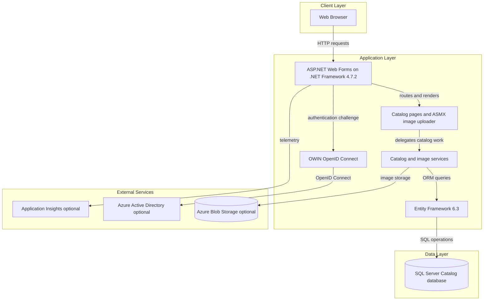
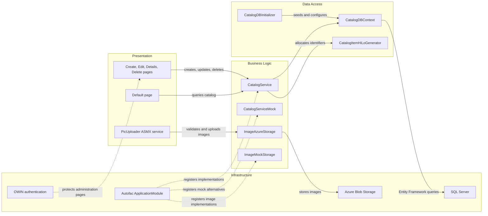

# Architecture Diagram

The solution contains one ASP.NET Web Forms application, with SQL Server persistence and optional Azure services for identity, image storage, and telemetry. The browser-facing application and its supporting infrastructure are separated below.

## Application Architecture

### Technology Stack Summary

| Layer | Technology | Version | Purpose |
|---|---|---:|---|
| Presentation | ASP.NET Web Forms | .NET Framework 4.7.2 | Server-rendered catalog and administration pages |
| Web services | ASP.NET ASMX with ScriptService | .NET Framework 4.7.2 | AJAX image upload |
| Dependency injection | Autofac | 4.9.4 | Application service registrations |
| Authentication | OWIN OpenID Connect | Microsoft.Owin 4.2.2; middleware package versions vary | Optional Azure Active Directory sign-in |
| Business services | CatalogService and image services | Application code | Catalog operations and image handling |
| Persistence | Entity Framework 6 | 6.3.0 | SQL Server data access |
| Database | SQL Server | Container image version not pinned in compose | Catalog data |
| Object storage | Azure Blob Storage SDK | 9.3.3 | Optional catalog image storage |
| Observability | Application Insights and log4net | 2.11.x; 2.0.10 | Telemetry and application logging |

### Data Storage & External Services

Catalog items, brands, and types are persisted in SQL Server through Entity Framework. Image data can be stored in Azure Blob Storage; the local compose configuration instead selects the mock storage implementation. OpenID Connect with Azure Active Directory and Application Insights are optional integrations, controlled by configuration.

### Key Architectural Decisions

- A single Web Forms application hosts both user pages and the ASMX upload endpoint.
- Autofac composes catalog, image, database, and connection-factory implementations according to configuration flags.
- Entity Framework 6 uses a single catalog database; image blobs are stored separately when Azure storage is enabled.

## Component Relationships

### Component Inventory

| Component | Layer | Type | Responsibility |
|---|---|---|---|
| Default page | Presentation | Web Forms page | Lists and paginates catalog items |
| Catalog pages | Presentation | Web Forms pages | Create, edit, view, and delete catalog items |
| PicUploader | Presentation | ASMX web service | Validates image uploads and returns a JSON result |
| CatalogService | Business Logic | Service | Implements catalog queries and changes |
| CatalogServiceMock | Business Logic | Mock service | Supplies in-memory catalog data |
| ImageAzureStorage | Business Logic | Image service | Stores catalog images in Azure Blob Storage |
| ImageMockStorage | Business Logic | Image service | Uses local image assets for the mock configuration |
| CatalogDBContext | Data Access | EF6 DbContext | Maps catalog entities and tables |
| CatalogDBInitializer | Data Access | EF initializer | Creates sequences and seeds catalog data |
| CatalogItemHiLoGenerator | Data Access | Identifier generator | Allocates catalog item identifiers |
| ApplicationModule | Infrastructure | Autofac module | Registers application and infrastructure services |
| OWIN authentication | Infrastructure | Middleware | Initiates OpenID Connect sign-in when enabled |
