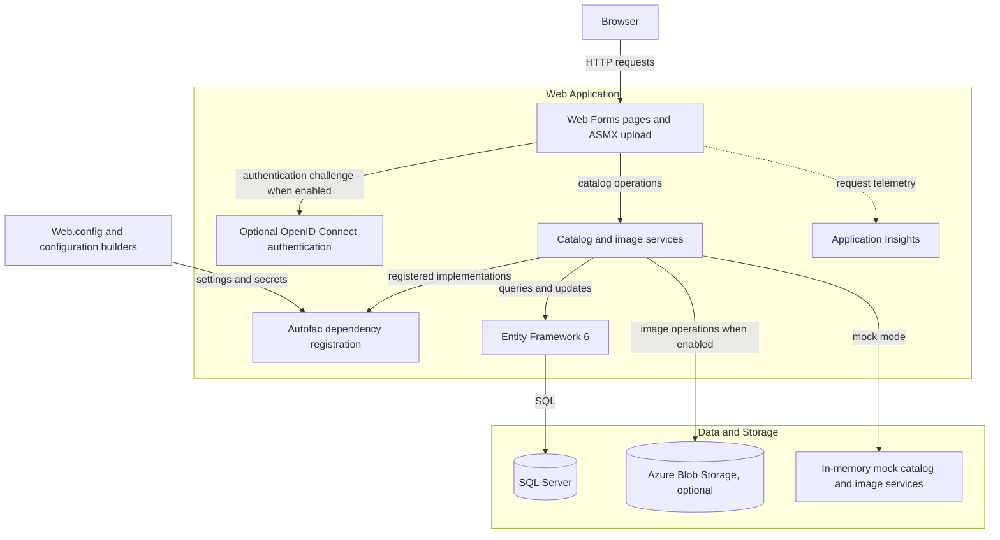
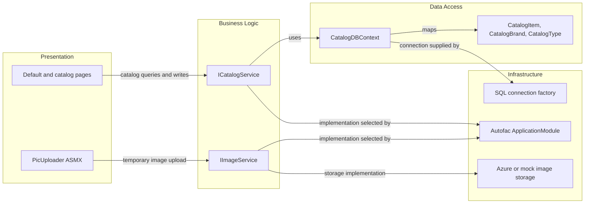

# Architecture Diagram

The solution is a single ASP.NET Web Forms application for managing a product catalog. It runs in IIS and can use SQL Server, Azure Blob Storage, OpenID Connect, and Application Insights when configured.

## Application Architecture

### Technology Stack Summary

| Layer | Technology | Version | Purpose |
|---|---|---:|---|
| Presentation | ASP.NET Web Forms and System.Web | .NET Framework 4.7.2 | Catalog pages and image-upload web method |
| Business | Catalog and image services | Application code | Catalog CRUD and image operations |
| Dependency injection | Autofac | 4.9.4 | Selects SQL/mock and Azure/mock service implementations |
| Persistence | Entity Framework | 6.3.0 | Catalog entity mapping and SQL Server access |
| Identity | OWIN OpenID Connect | 4.0.1 | Optional Azure Active Directory sign-in |
| Telemetry | Application Insights | 2.11.x | Request, dependency, and exception telemetry |

### Data Storage & External Services

SQL Server is the configured relational store. The application can instead use an in-memory mock catalog; image storage similarly switches between a mock implementation and Azure Blob Storage. OpenID Connect, Key Vault configuration, and Application Insights are optional integrations controlled by configuration.

### Key Architectural Decisions

- One Web Forms application owns presentation, catalog logic, and persistence; no independently deployed application services were found.
- Autofac registers the SQL-backed or mock catalog and Azure-backed or mock image services.
- Entity Framework 6 maps the catalog entities to SQL Server tables and uses database sequences for generated catalog IDs.

## Component Relationships

### Component Inventory

| Component | Layer | Type | Responsibility |
|---|---|---|---|
| Default and Catalog pages | Presentation | Web Forms pages | Browse and maintain catalog items |
| PicUploader | Presentation | ASMX web service | Accepts image uploads and returns JSON metadata |
| ICatalogService | Business Logic | Service interface | Catalog reads and writes |
| IImageService | Business Logic | Service interface | Image URL, upload, and update operations |
| CatalogDBContext | Data Access | EF6 DbContext | Maps and queries catalog entities |
| ApplicationModule | Infrastructure | Autofac module | Registers service implementations and lifetimes |
| SQL connection factories | Infrastructure | Connection providers | Select configured credentials or managed identity |
| Image storage implementations | Infrastructure | Storage providers | Select Azure Blob Storage or mock storage |
