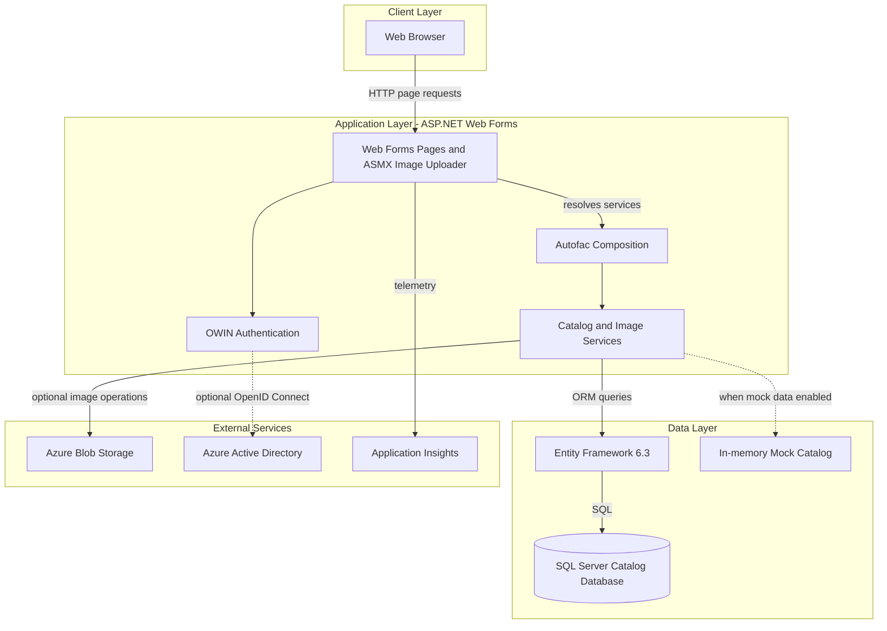
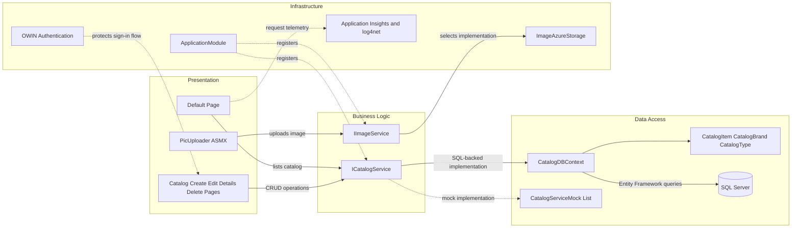

# Architecture Diagram

The solution is a single ASP.NET Web Forms catalog application with an optional SQL Server persistence path and optional Azure integrations. Its web pages invoke application services in-process; no application-to-application service boundary is defined in this workspace.

## Application Architecture

### Technology Stack Summary

| Layer | Technology | Version | Purpose |
|---|---|---:|---|
| Presentation | ASP.NET Web Forms / ASP.NET | .NET Framework 4.7.2 | Server-rendered catalog pages and ASMX upload endpoint |
| Authentication | OWIN Cookie and OpenID Connect middleware | OWIN.Security.OpenIdConnect 4.0.1 | Optional Azure AD sign-in |
| Dependency injection | Autofac | 4.9.4 | Web Forms service composition |
| Business services | C# service classes | .NET Framework 4.7.2 | Catalog and image operations |
| Persistence | Entity Framework 6 | 6.3.0 | Catalog entity mapping and SQL access |
| Storage | SQL Server; Azure Blob Storage (optional) | SQL Server image / WindowsAzure.Storage 9.3.3 | Catalog records and product images |
| Observability | Application Insights and log4net | 2.11.0 / 2.0.10 | Request, dependency, and application telemetry |

### Data Storage & External Services

The catalog is stored in SQL Server through Entity Framework 6 when mock data is disabled; otherwise a process-local mock catalog is used. Product images can use Azure Blob Storage, while Azure AD, managed-identity SQL authentication, and Application Insights instrumentation are configuration-dependent. Redis session support is present only as a commented configuration example.

### Key Architectural Decisions

- Autofac selects mock or SQL-backed catalog services and mock or Azure-backed image services from application settings.
- The application uses a single web deployment with server-rendered pages, in-process service calls, and no message broker or API gateway.
- SQL Server access supports either a configured connection string or an Azure managed-identity access token.

## Component Relationships

### Component Inventory

| Component | Layer | Type | Responsibility |
|---|---|---|---|
| `_Default` | Presentation | Web Forms page | Displays and paginates catalog items |
| `Create`, `Edit`, `Details`, `Delete` | Presentation | Web Forms pages | Catalog item maintenance and details |
| `PicUploader` | Presentation | ASMX WebMethod | Accepts and validates product-image uploads |
| `ICatalogService` / `CatalogService` | Business logic | Service interface and implementation | Catalog queries and CRUD through EF |
| `CatalogServiceMock` | Business logic | Mock service | Provides process-local catalog behavior |
| `IImageService` / `ImageAzureStorage` | Infrastructure | Service interface and implementation | Stores product images in Azure Blob Storage |
| `CatalogDBContext` | Data access | EF6 DbContext | Maps catalog entities to SQL Server |
| `ApplicationModule` | Infrastructure | Autofac module | Registers service implementations and lifetimes |
| `Startup` | Infrastructure | OWIN startup | Configures optional Azure AD authentication |
