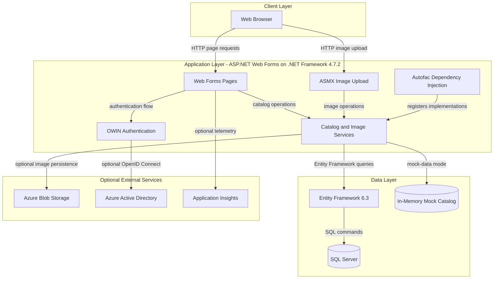
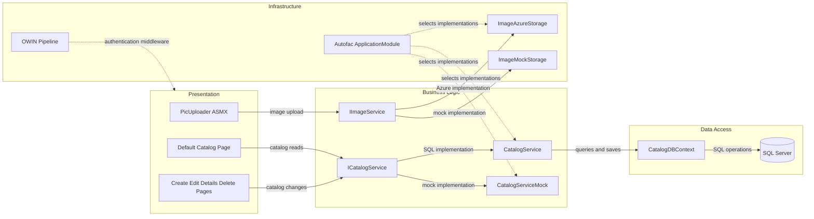

# Architecture Diagram

The solution is a single ASP.NET Web Forms application with a catalog service layer and Entity Framework persistence. It can use mock data locally or connect to SQL Server, with optional Azure integrations for image storage, identity, and telemetry.

## Application Architecture

### Technology Stack Summary

| Layer | Technology | Version | Purpose |
|---|---|---|---|
| Presentation | ASP.NET Web Forms | .NET Framework 4.7.2 | Server-rendered catalog pages |
| Service | C# catalog and image services | .NET Framework 4.7.2 | Catalog operations and image handling |
| Dependency injection | Autofac | 4.9.4 | Registers service implementations |
| Data access | Entity Framework | 6.3.0 | ORM and SQL Server persistence |
| Authentication | OWIN and OpenID Connect | 4.0.1 package line | Optional Azure AD sign-in |
| Telemetry and logging | Application Insights and log4net | 2.11.0 and 2.0.10 | Diagnostics and telemetry |

### Data Storage & External Services

The application uses SQL Server through Entity Framework when mock mode is disabled; the Compose configuration provides a SQL Server development container. Mock mode instead keeps catalog items in an in-memory list. Azure Blob Storage is an optional image backend, Azure Active Directory is an optional OpenID Connect provider, and Application Insights is an optional telemetry sink.

### Key Architectural Decisions

- The application is a single deployable Web Forms project rather than a set of independently deployed business services.
- `ICatalogService` and `IImageService` separate page code from SQL/mock catalog and local/Azure image implementations.
- Autofac modules select implementations from externalized feature settings; EF6 is the persistence ORM.

## Component Relationships

### Component Inventory

| Component | Layer | Type | Responsibility |
|---|---|---|---|
| `_Default` | Presentation | Web Forms page | Lists and paginates catalog items |
| Catalog Create, Edit, Details, Delete | Presentation | Web Forms pages | Manage and display catalog items |
| `PicUploader` | Presentation | ASMX web service | Validates and stages uploaded images |
| `ICatalogService` / `CatalogService` | Business logic | Service interface and implementation | Reads and mutates SQL-backed catalog data |
| `CatalogServiceMock` | Business logic | Mock service | Provides an in-memory catalog implementation |
| `CatalogDBContext` | Data access | EF6 DbContext | Maps catalog entities to SQL Server |
| `ImageAzureStorage` / `ImageMockStorage` | Infrastructure | Image service implementations | Stores images in Azure Blob Storage or uses mock behavior |
| `ApplicationModule` / `Startup` | Infrastructure | DI module and OWIN startup | Selects services and configures authentication |
