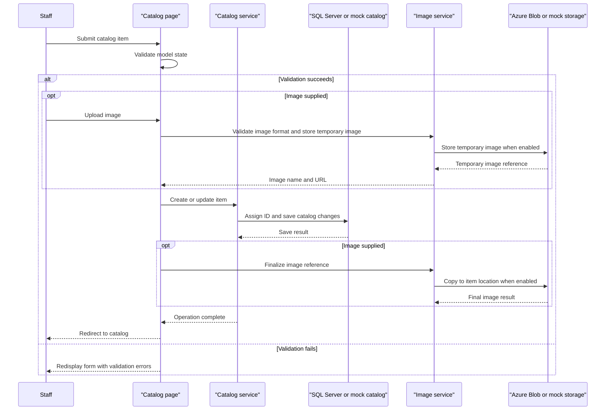

# Core Business Workflows

The application supports maintaining and browsing an e-commerce product catalog. Staff can create, edit, view, and delete catalog items, while optional image-upload support stores product images separately from catalog records.

## Domain Entities

| Entity | Service / Bounded Context | Description | Key Relationships |
|---|---|---|---|
| CatalogItem | Catalog management | Product description, price, image reference, and inventory thresholds | Belongs to one CatalogBrand and one CatalogType |
| CatalogBrand | Catalog management | Brand classification for products | Can classify many CatalogItems |
| CatalogType | Catalog management | Product type classification | Can classify many CatalogItems |

## Service-to-Domain Mapping

| Service | Domain Context | Owned Entities | External Dependencies |
|---|---|---|---|
| eShopModernizedWebForms | Catalog management | CatalogItem, CatalogBrand, CatalogType | SQL Server; optional Azure Blob Storage |

## Primary Workflows

### Workflow 1: Browse catalog

1. A visitor opens the default page or a paginated catalog route.
2. The page asks `ICatalogService` for a page of catalog items; the SQL-backed service loads brand and type relationships, while mock mode reads the in-memory catalog.
3. The application renders the catalog and image references.

### Workflow 2: Create or update a catalog item

1. A staff user opens the create or edit page; when Azure AD integration is enabled, the page issues an OpenID Connect challenge for an unauthenticated request.
2. The page validates its model state and builds a `CatalogItem` from submitted form values.
3. For an uploaded image, the page finalizes the temporary image through `IImageService`.
4. `ICatalogService` assigns an ID on creation, persists changes through EF6, and redirects to the catalog.

### Workflow 3: Upload a catalog image

1. The browser posts a multipart image to `PicUploader.UploadImage`.
2. The method checks that the uploaded content can be decoded as JPEG, PNG, or GIF.
3. The selected image service stores the temporary image and returns its name and URL as JSON.
4. During create or edit, the final image is associated with the catalog item.

## Cross-Service Data Flows

No cross-service catalog aggregation was identified. Catalog data is stored in the application’s SQL Server database; images are stored through Azure Blob Storage only when enabled, otherwise mock storage is selected. There is no application-level fallback or compensation documented for a partially completed catalog save and blob update.

## Business Workflow Sequence

## Business Rules & Decision Logic

- Catalog item prices must be non-negative and use at most two decimal places; stock, restock, and maximum-stock values have non-negative bounded ranges.
- Each catalog item requires a brand and type relationship. Item IDs are allocated with a SQL sequence-backed hi-lo generator.
- Image upload accepts decoded JPEG, PNG, and GIF content. The image-upload service stores the temporary file before a catalog update is finalized.
- Catalog initialization runs SQL sequence scripts and seeds brands, types, and items from built-in defaults or optional CSV customization data.
- Mutations are saved with EF6 `SaveChanges`; no explicit cross-resource transaction or compensation across SQL and blob storage was identified.
- No personal, health, or payment data is represented by the catalog domain entities.
