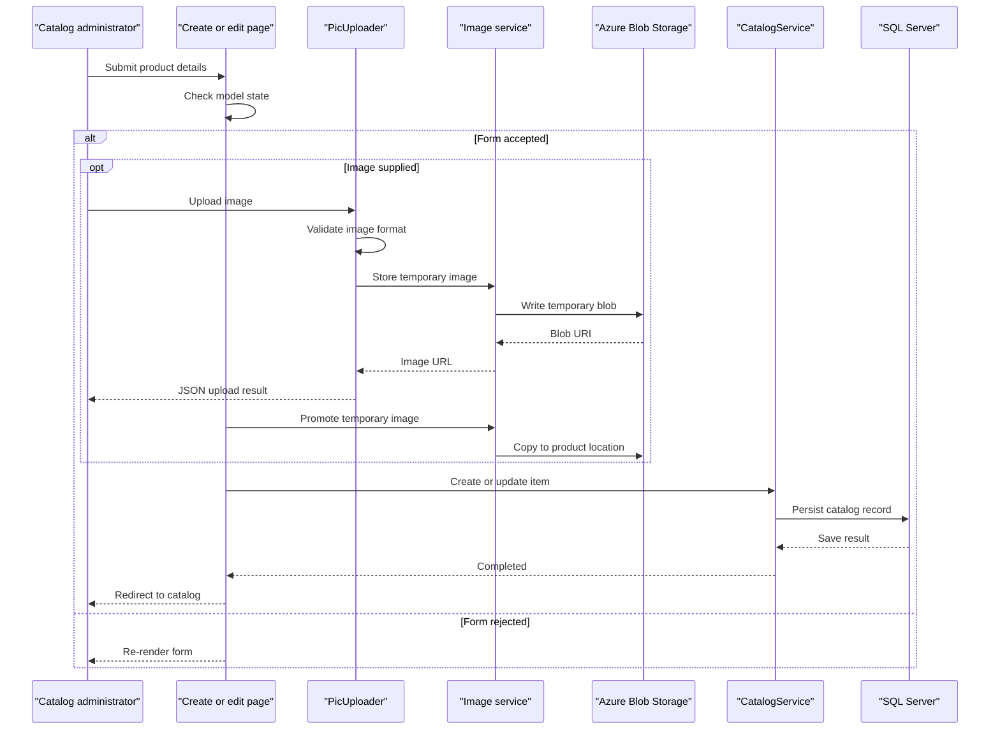

# Core Business Workflows

The application supports browsing an e-commerce product catalog and maintaining its catalog entries. Administrators can create, update, or delete products; optional image uploads accompany product creation and updates.

## Domain Entities

| Entity | Service / Bounded Context | Description | Key Relationships |
|---|---|---|---|
| CatalogItem | Catalog Management | A product offered in the catalog, including price, stock levels, and image reference | Belongs to one brand and one type |
| CatalogBrand | Catalog Management | A product brand | Can classify many catalog items |
| CatalogType | Catalog Management | A product category/type | Can classify many catalog items |

## Service-to-Domain Mapping

| Service | Domain Context | Owned Entities | External Dependencies |
|---|---|---|---|
| eShopModernizedWebForms | Catalog Management | CatalogItem, CatalogBrand, CatalogType | SQL Server; optional Azure Blob Storage and Azure Active Directory |

All catalog data is owned by the same application and database. The image service stores image objects separately; there is no cross-service domain exchange or aggregate gateway.

## Primary Workflows

### Workflow 1: Browse and inspect the catalog

1. A visitor opens the catalog page or a product-details route.
2. The page requests catalog data from `CatalogService`.
3. `CatalogService` reads catalog items and their brand/type references through Entity Framework.
4. The page renders the result and builds the image URL using the configured image service.

### Workflow 2: Create or update a product

1. An administrator opens the create or edit page. When Azure AD authentication is enabled, unauthenticated requests are challenged through OpenID Connect.
2. The administrator submits product details and optional image data.
3. The page checks the model state and builds a mutable `CatalogItem`.
4. If an image was uploaded, the image service promotes the temporary image to the product image location.
5. `CatalogService` allocates an identifier for a new item and saves the record, or updates the existing record, in SQL Server.
6. The application redirects to the catalog.

### Workflow 3: Delete a product

1. An administrator opens the delete page for an item.
2. The page loads the selected item through `CatalogService`.
3. On confirmation, the service removes the item from the catalog database and the application redirects.

## Cross-Service Data Flows

There are no application-to-application data flows. Catalog entities flow between the Web Forms pages, `CatalogService`, Entity Framework, and the SQL Server database. Optional images flow from the browser through `PicUploader` and the image service to Azure Blob Storage. Azure Active Directory is used only for the optional sign-in challenge; Application Insights is an optional telemetry destination.

## Business Workflow Sequence

## Business Rules & Decision Logic

- Catalog items require a name, picture filename, brand, and type according to the EF model configuration.
- Price is constrained by the model's numeric range and decimal-format annotations.
- Stock, restock threshold, and maximum stock values are limited to the range 0 through 10,000,000.
- The upload endpoint accepts images whose decoded format is JPEG, PNG, or GIF; invalid uploads return HTTP 400.
- Catalog item identifiers are allocated by the HiLo sequence generator. Brand and type identifiers use SQL sequences during database initialization.
- Create, edit, and delete pages initiate OpenID Connect sign-in when the request is unauthenticated; this behavior is conditional on the configured authentication integration.
- Catalog persistence uses EF6 `SaveChanges`; no explicit cross-service transaction, saga, audit trail, or compensating workflow was identified.
