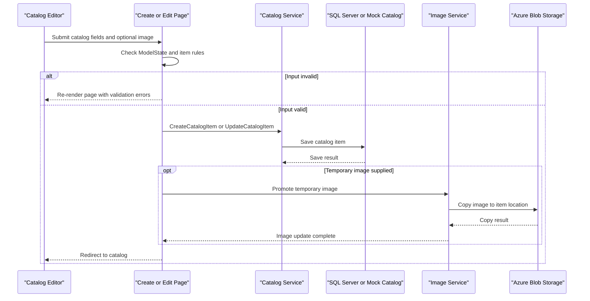

# Core Business Workflows

The application supports browsing and maintaining an online product catalog. Catalog records include product, brand, type, pricing, and stock information; product images are managed separately.

## Domain Entities

| Entity | Service / Bounded Context | Description | Key Relationships |
|---|---|---|---|
| CatalogItem | Catalog | A product offered in the catalog, with price, inventory, and image reference | Belongs to one brand and one type |
| CatalogBrand | Catalog | Brand or manufacturer associated with catalog items | Can be associated with many catalog items |
| CatalogType | Catalog | Product category/type used for catalog classification | Can classify many catalog items |

## Service-to-Domain Mapping

| Service | Domain Context | Owned Entities | External Dependencies |
|---|---|---|---|
| eShopModernizedWebForms | Product Catalog | CatalogItem, CatalogBrand, CatalogType | SQL Server or mock data; optional Azure Blob Storage |

There are no separate business microservices or cross-context data exchange flows in this solution.

## Primary Workflows

### Workflow 1: Browse the catalog

1. A visitor opens the catalog or requests a page using the pagination route.
2. The Web Forms page applies the default page size/index or reads route values.
3. `ICatalogService` retrieves and orders catalog entries, with brand and type information.
4. The page computes image URLs and renders the page of products.

When mock data is enabled, reads come from the in-memory catalog; otherwise the service reads through EF6 from SQL Server.

### Workflow 2: Create or update a catalog item

1. An authenticated editor submits catalog fields from the Create or Edit page.
2. The page checks `ModelState`; `CatalogItem` defines price and stock range constraints.
3. The service creates or updates the item in the selected backing store.
4. If a temporary image name was supplied, the image service promotes the image to the item’s image location.
5. The page redirects to the catalog.

### Workflow 3: Upload and remove product images

The ASMX image method receives a multipart upload, decodes the stream, and accepts only JPEG, PNG, or GIF image formats. Valid uploads are stored as temporary images by the configured image service. The Delete page confirms and removes a catalog record through `ICatalogService`.

## Cross-Service Data Flows

No application service aggregation or cross-service business data flow was identified. The catalog service reads and writes catalog data in the same SQL database (or its mock implementation); the image service stores image content in Azure Blob Storage when enabled. Catalog item image URLs reference the resulting image location.

## Business Workflow Sequence

## Business Rules & Decision Logic

- `CatalogItem` requires a positive price with at most two decimal places and applies configured ranges to price and stock fields.
- Catalog items reference one catalog brand and one catalog type; the EF model requires both relationships.
- Product IDs are generated from HiLo SQL sequences in SQL mode and from the current maximum mock ID in mock mode.
- Image upload accepts only decoded JPEG, PNG, or GIF content; invalid content returns HTTP 400.
- Catalog persistence and image storage are separate operations; there is no distributed transaction or compensating workflow identified.
- OWIN authentication can use Azure AD when configured; otherwise custom middleware is installed. Catalog maintenance pages check request authentication.
