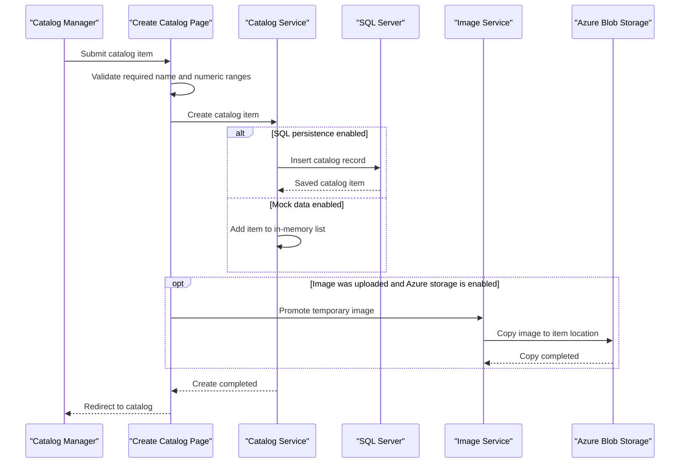

# Core Business Workflows

The application supports browsing and maintaining a product catalog. Catalog items are categorized by brand and type, with pricing, inventory thresholds, and optional product images.

## Domain Entities

| Entity | Service / Bounded Context | Description | Key Relationships |
|---|---|---|---|
| `CatalogItem` | Catalog Management | Product displayed and maintained in the catalog | Belongs to one brand and one type |
| `CatalogBrand` | Catalog Management | Brand classification for products | Has zero or more catalog items |
| `CatalogType` | Catalog Management | Type/category classification for products | Has zero or more catalog items |

## Service-to-Domain Mapping

| Service | Domain Context | Owned Entities | External Dependencies |
|---|---|---|---|
| `eShopModernizedWebForms` | Catalog Management | `CatalogItem`, `CatalogBrand`, `CatalogType` | SQL Server or mock catalog; optional Azure Blob Storage for images |

The application is the source of truth for catalog records. It has no separate business services or cross-context entity references.

## Primary Workflows

### Workflow 1: Browse the Catalog

1. A visitor opens the default route or a page/size route.
2. The page asks the catalog service for the selected page of items.
3. SQL mode reads catalog items and their brand/type through EF6; mock mode uses its in-memory catalog.
4. The page builds image URLs and renders a paginated catalog.

### Workflow 2: Create or Update a Catalog Item

1. The user opens the Create or Edit page. When Azure AD is enabled, the page challenges unauthenticated users through OpenID Connect.
2. The user supplies item details and may stage an image through the ASMX upload method.
3. Form validators check required name and numeric price/stock ranges.
4. The catalog service creates or updates the item in SQL Server or the mock catalog.
5. If an image was staged and Azure storage is enabled, the image service promotes the temporary blob to the item location.
6. The page redirects to the catalog.

### Workflow 3: Delete a Catalog Item

1. The user opens the item-specific delete page and sees the catalog item.
2. The user confirms deletion.
3. The catalog service removes the item from SQL Server or the mock catalog, and the page redirects to the catalog.

### Workflow 4: Upload an Item Image

1. The browser submits an image and item identifier to `PicUploader`.
2. The endpoint decodes the upload and permits JPEG, PNG, or GIF image formats.
3. Azure mode writes the image to a temporary Blob Storage name; mock mode returns its default or existing local image URL.
4. The upload response returns the image name and URL as JSON.

## Cross-Service Data Flows

There is no multi-service business aggregation. The application reads and writes catalog data directly through EF6 to its SQL database. Image bytes flow separately to Azure Blob Storage when enabled; otherwise the mock image service is selected. Azure AD and Application Insights are optional infrastructure integrations and do not provide catalog data.

## Business Workflow Sequence

## Business Rules & Decision Logic

- Catalog item creation requires a name; price is constrained to nonnegative currency values with at most two decimal places.
- Available stock, restock threshold, and maximum stock are constrained to the configured nonnegative range.
- Each item must reference an existing brand and type through required foreign keys.
- Catalog item identifiers are allocated by the HiLo sequence generator in SQL mode; mock mode increments the largest current item identifier.
- Image upload accepts only decoded JPEG, PNG, or GIF formats.
- Catalog data is seeded from preconfigured data by default; optional customization mode loads CSV and image data from the `Setup` directory.
- No order, checkout, payment, or customer-management workflow was found.
