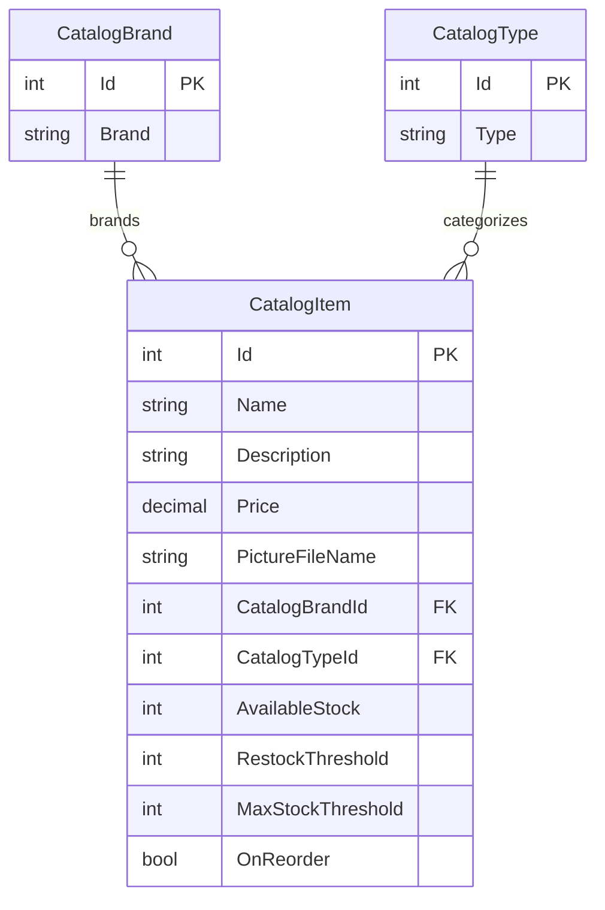

# Data Architecture & Persistence Layer

The application persists a small catalog domain consisting of items, brands, and types in SQL Server through Entity Framework 6. Images are optionally stored separately in Azure Blob Storage.

## Database Configuration

| Service/Module | DB Type | Profile | Driver | Connection | Migration Tool |
|---|---|---|---|---|---|
| eShopModernizedWebForms | SQL Server | Local Docker Compose | System.Data.SqlClient | Catalog database; connection value supplied through compose configuration | Entity Framework database initializer and SQL sequence scripts |
| eShopModernizedWebForms | SQL Server | Configured deployment | System.Data.SqlClient | Connection string resolved through environment, Key Vault, or user-secrets configuration builders | Entity Framework database initializer and SQL sequence scripts |

No Flyway/Liquibase-style schema migration framework was identified. Database initialization creates the database when absent, executes SQL sequence scripts, and seeds data from code or optional CSV files.

## Data Ownership per Service

| Service | Tables Owned | ORM Framework | Caching | Notes |
|---|---|---|---|---|
| eShopModernizedWebForms | Catalog, CatalogBrand, CatalogType | Entity Framework 6 | None identified | Single application-owned catalog database |

## Entity Model

The EF model is configured in `src/eShopModernizedWebForms/Models/CatalogDBContext.cs`. `PictureUri` and `TempImageName` are ignored by the database mapping; the stored `PictureFileName` refers to an image held in local assets or blob storage.

| Entity | Source | Persistence notes |
|---|---|---|
| CatalogItem | `src/eShopModernizedWebForms/Models/CatalogItem.cs` | Maps to `Catalog`; requires brand and type relationships |
| CatalogBrand | `src/eShopModernizedWebForms/Models/CatalogBrand.cs` | Maps to `CatalogBrand` |
| CatalogType | `src/eShopModernizedWebForms/Models/CatalogType.cs` | Maps to `CatalogType` |

## Key Repository Methods

| Service | Repository / data component | Notable Methods | Purpose |
|---|---|---|---|
| eShopModernizedWebForms | CatalogService (`src/eShopModernizedWebForms/Services/CatalogService.cs`) | `FindCatalogItem`, `GetCatalogItemsPaginated`, `GetCatalogBrands`, `GetCatalogTypes` | Loads catalog records and reference data through EF6 |
| eShopModernizedWebForms | CatalogService | `CreateCatalogItem`, `UpdateCatalogItem`, `RemoveCatalogItem` | Persists item changes |
| eShopModernizedWebForms | CatalogItemHiLoGenerator | `GetNextSequenceValue` | Obtains identifier ranges from the SQL sequence |

## Caching Strategy

No active application caching configuration or cache-aside behavior was identified. Redis client and ASP.NET Redis session provider packages are present, but no active Redis session provider configuration was found.

## Data Ownership Boundaries

All catalog entities are owned by the single Web Forms application and stored in one SQL Server database. There are no service-specific databases, cross-service database access patterns, or CQRS read/write stores. Image files are stored separately from catalog rows when Azure Blob Storage is enabled; the database retains the image filename.

### Data Classification & Sensitivity

| Entity | Sensitive Fields | Classification | Controls in Place |
|---|---|---|---|
| CatalogItem | None identified | None | No PII, PHI, or PCI fields identified |
| CatalogBrand | None identified | None | No PII, PHI, or PCI fields identified |
| CatalogType | None identified | None | No PII, PHI, or PCI fields identified |
