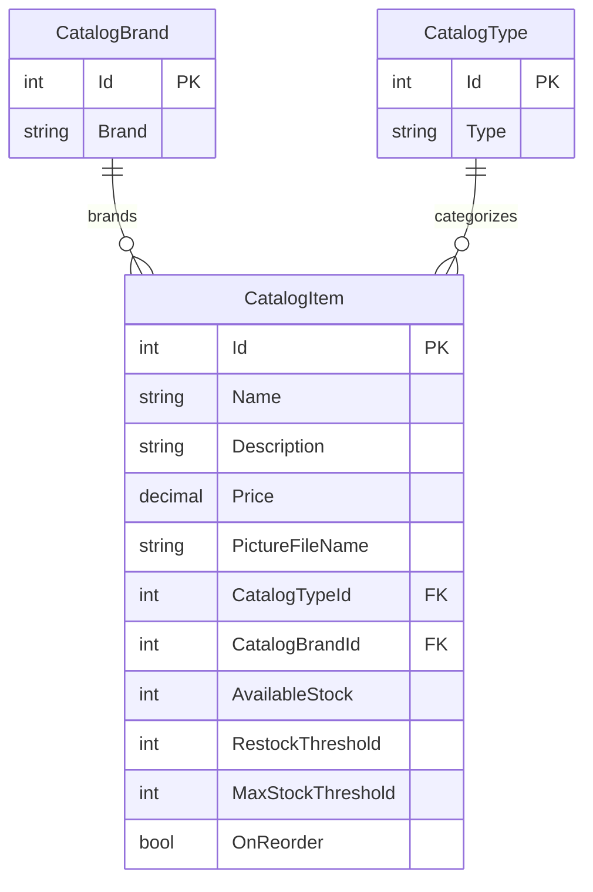

# Data Architecture & Persistence Layer

The application models a small product catalog with three EF6 entities stored in SQL Server. Entity Framework 6.3.0 provides persistence; an in-memory catalog service is available for mock mode.

## Database Configuration

| Service/Module | DB Type | Profile | Driver | Connection | Migration Tool |
|---|---|---|---|---|---|
| `eShopModernizedWebForms` | SQL Server | Compose/local configuration when mock data is disabled | EntityFramework.SqlServer / System.Data.SqlClient | `CatalogDBContext`; endpoint and credentials are supplied through configuration builders or environment settings and are masked here | EF6 `CreateDatabaseIfNotExists` initializer and SQL sequence scripts; no versioned migration tool detected |
| `eShopModernizedWebForms` | In-memory list | `UseMockData=true` default | None | No database connection | Not applicable |

The initializer creates the database if absent, runs SQL sequence scripts, and seeds configured or preconfigured catalog data. Optional customization data is read from CSV files and product-image archives.

## Data Ownership per Service

| Service | Tables Owned | ORM Framework | Caching | Notes |
|---|---|---|---|---|
| `eShopModernizedWebForms` | `Catalog`, `CatalogBrand`, `CatalogType` | Entity Framework 6.3.0 | No application cache detected | One application owns and accesses the catalog schema |

## Entity Model

`CatalogItem` requires one `CatalogBrand` and one `CatalogType`; each brand and type may be associated with multiple catalog items. `PictureUri` and `TempImageName` are runtime-only and are ignored by EF mapping.

## Key Repository Methods

| Service | Repository | Notable Methods | Purpose |
|---|---|---|---|
| `eShopModernizedWebForms` | `ICatalogService` / `CatalogService` | `GetCatalogItemsPaginated(pageSize, pageIndex)` | Queries items with brand and type, orders by ID, and returns a page |
| `eShopModernizedWebForms` | `ICatalogService` / `CatalogService` | `FindCatalogItem(id)` | Retrieves one item with brand and type |
| `eShopModernizedWebForms` | `ICatalogService` / `CatalogService` | `CreateCatalogItem`, `UpdateCatalogItem`, `RemoveCatalogItem` | Persists catalog changes through EF6 |
| `eShopModernizedWebForms` | `CatalogItemHiLoGenerator` | `GetNextSequenceValue(db)` | Allocates catalog item identifiers using a SQL sequence and a HiLo block |

## Caching Strategy

No application-level catalog cache was identified. Redis client and session-state packages are present, but the custom Redis session configuration in `Web.config` is commented out. Mock mode stores a mutable list in process rather than using a cache provider.

## Data Ownership Boundaries

The Web Forms application is the only service accessing the catalog database; no cross-service database access, CQRS split, or event-based data synchronization was found. The SQL database is a shared persistence dependency for the application, and image storage is a separate optional Azure Blob integration. With mock mode enabled, the catalog is held in an in-memory service instead.

### Data Classification & Sensitivity

| Entity | Sensitive Fields | Classification (PII/PHI/PCI/None) | Controls in Place |
|---|---|---|---|
| `CatalogItem` | Product description, image name, stock and price | None | No personal, health, or payment-card fields identified |
| `CatalogBrand` | Brand name | None | No sensitive fields identified |
| `CatalogType` | Type name | None | No sensitive fields identified |

No PII, PHI, or PCI data was detected in the catalog entity model.
