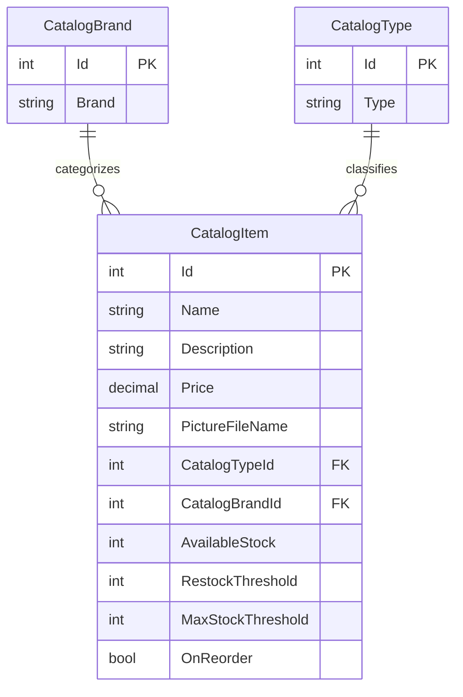

# Data Architecture & Persistence Layer

The catalog data layer contains three EF6 entities stored in SQL Server. The application uses one catalog database, with optional mock data for local runs.

## Database Configuration

| Service/Module | DB Type | Profile | Driver | Connection | Migration Tool |
|---|---|---|---|---|---|
| eShopModernizedWebForms | SQL Server | Default and Compose configuration | `System.Data.SqlClient` | Connection string is externalized through configuration builders; see `configuration-inventory.md` | No migration tool found; EF initializer creates a missing database and runs SQL sequence scripts |
| eShopModernizedWebForms | In-memory mock data | `UseMockData` enabled | None | Process memory | Not applicable |

## Data Ownership per Service

| Service | Tables Owned | ORM Framework | Caching | Notes |
|---|---|---|---|---|
| eShopModernizedWebForms | `Catalog`, `CatalogBrand`, `CatalogType` | Entity Framework 6 | None identified | Single application-owned catalog database; initializer seeds entities and sequences |

## Entity Model

`CatalogItem` is mapped to the `Catalog` table and has required foreign keys to the brand and type tables. `PictureUri` and `TempImageName` are ignored by EF. The mappings and keys are configured in `Models/CatalogDBContext.cs`; the entity declarations are in `Models/CatalogItem.cs`, `Models/CatalogBrand.cs`, and `Models/CatalogType.cs`.

## Key Repository Methods

| Service | Repository | Notable Methods | Purpose |
|---|---|---|---|
| eShopModernizedWebForms | `CatalogService` (no separate repository abstraction) | `GetCatalogItemsPaginated`, `FindCatalogItem`, `GetCatalogTypes`, `GetCatalogBrands` | Queries catalog data and loads required brand/type relationships |
| eShopModernizedWebForms | `CatalogService` | `CreateCatalogItem`, `UpdateCatalogItem`, `RemoveCatalogItem` | Adds, updates, or deletes catalog entities and saves EF changes |
| eShopModernizedWebForms | `CatalogItemHiLoGenerator` | `GetNextSequenceValue` | Allocates catalog item IDs from the SQL Server sequence |

## Caching Strategy

No application-level or EF query cache was identified. `CatalogServiceMock` keeps an in-memory mutable list when mock mode is enabled; this is the mock data source, not a cache.

## Data Ownership Boundaries

One Web Forms application accesses the catalog database directly through EF6. There are no separate service-owned stores, cross-service database reads, CQRS projections, or messaging-based data flows. SQL sequence scripts are executed during database initialization; catalog types, brands, and items are seeded from built-in data or optional CSV files.

### Data Classification & Sensitivity

| Entity | Sensitive Fields | Classification | Controls in Place |
|---|---|---|---|
| CatalogItem | None identified | None | Product and inventory attributes; no personal, health, or payment-card fields identified |
| CatalogBrand | None identified | None | Business reference data |
| CatalogType | None identified | None | Business reference data |

No PII, PHI, or PCI data was identified in the catalog entity model.
