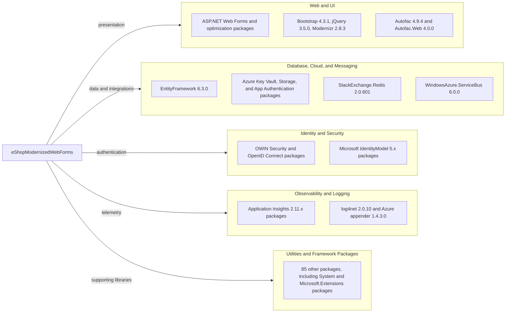

# Dependency Map

The `eShopModernizedWebForms` project has 147 package entries in `packages.config`. The legacy project cannot resolve a complete dependency graph in this environment, so this map reports the declared package inventory and groups less central packages.

## Dependencies

### Dependency Summary

| Category | Count | Key Libraries | Notes |
|---|---:|---|---|
| Web and UI | 21 | ASP.NET Web Forms, Autofac, Bootstrap, jQuery | Includes web UI and framework package entries |
| Database, cloud, and messaging | 13 | Entity Framework, Azure Storage, Key Vault, Redis, Windows Azure Service Bus | Optional services are present in configuration/packages |
| Identity and security | 15 | OWIN Security, OpenID Connect, Microsoft IdentityModel | Supports optional Azure AD authentication |
| Observability and logging | 12 | Application Insights, log4net | Telemetry and logging integrations |
| Utilities and framework | 86 | System packages, Microsoft.Extensions, compiler and supporting libraries | Aggregated for readability; exact entries remain in `packages.config` |

### Version & Compatibility Risks

The application targets .NET Framework 4.7.2 and uses the legacy packages.config format. Entity Framework 6.3.0, OWIN, and several Azure integration packages are older generations; compatibility and support should be checked when upgrading the application platform.

### Notable Observations

- `dotnet list package --include-transitive --format json` could not evaluate the project because Visual Studio WebApplication MSBuild targets are unavailable; versions and counts here come from `packages.config`, not a resolved transitive graph.
- The package inventory includes Azure Blob Storage, Key Vault, Redis session-state, and Service Bus packages, while not all are enabled in the default runtime configuration.
- No test-scoped packages or test project were identified.

## Test Dependencies

| Framework | Version | Notes |
|---|---|---|
| None detected | — | No test project or test framework package was found in the solution |

Total test-scope dependencies: 0

No test dependencies detected; automated test infrastructure is not present in the assessed solution.
