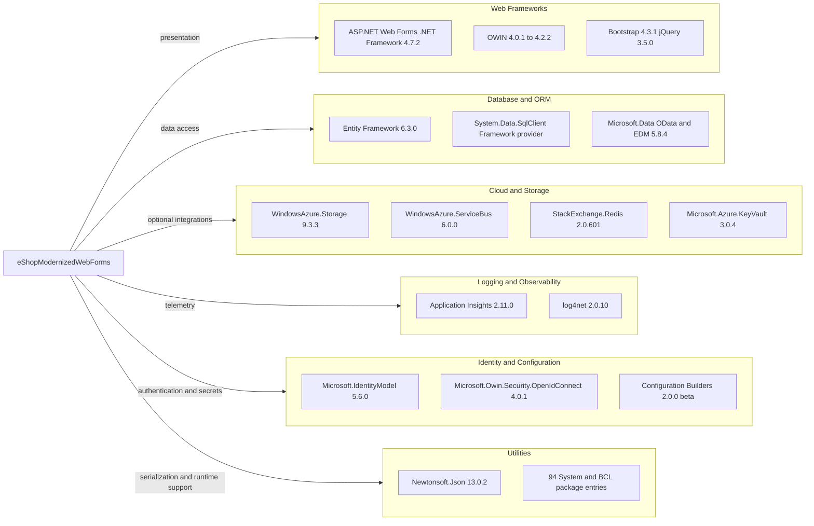

# Dependency Map

The eShopModernizedWebForms project has 147 package entries in `packages.config` (including framework and transitive package entries). The diagram groups the principal dependencies by function and omits low-level framework packages for readability.

## Dependencies

### Dependency Summary

| Category | Count | Key Libraries | Notes |
|---|---:|---|---|
| Web Frameworks | 8 | ASP.NET Web Forms, OWIN, Bootstrap, jQuery | Legacy server-rendered framework and browser assets |
| Database / ORM | 5 | Entity Framework 6.3.0, Microsoft.Data EDM/OData | SQL Server provider is part of the target framework |
| Cloud / Storage | 8 | Azure Storage, Key Vault, Service Bus, Redis | Several are optional or not currently enabled |
| Logging / Observability | 11 | Application Insights, log4net | Includes telemetry modules and collectors |
| Security / Identity | 21 | OWIN authentication, IdentityModel, configuration builders | Includes Azure AD and Key Vault integration packages |
| Utilities | 94 | Newtonsoft.Json and System/BCL packages | Primarily framework support and transitive packages |

### Version & Compatibility Risks

The application targets .NET Framework 4.7.2 and uses legacy Web Forms, Entity Framework 6, OWIN, and older Azure SDK packages. The package list contains multiple older framework-support packages and a prerelease 2.0.0-beta Configuration Builders family; compatibility should be checked when modernizing the target runtime or Azure integrations.

### Notable Observations

- `packages.config` lists installed packages, including transitive dependencies; the 147 entries are not all direct references.
- Azure Blob Storage, Azure AD, Redis session support, and Service Bus packages are present, but not all are enabled or used by the current default configuration.
- Entity Framework 6.3.0 is the only ORM package family; no EF Core dependency is declared.
- No test-scoped packages or test project were found in this solution.

## Test Dependencies

| Framework | Version | Notes |
|---|---|---|
| None detected | — | No test framework packages or test project found |

Total test-scope dependencies: 0

No test dependencies were detected in the solution package inventory.
