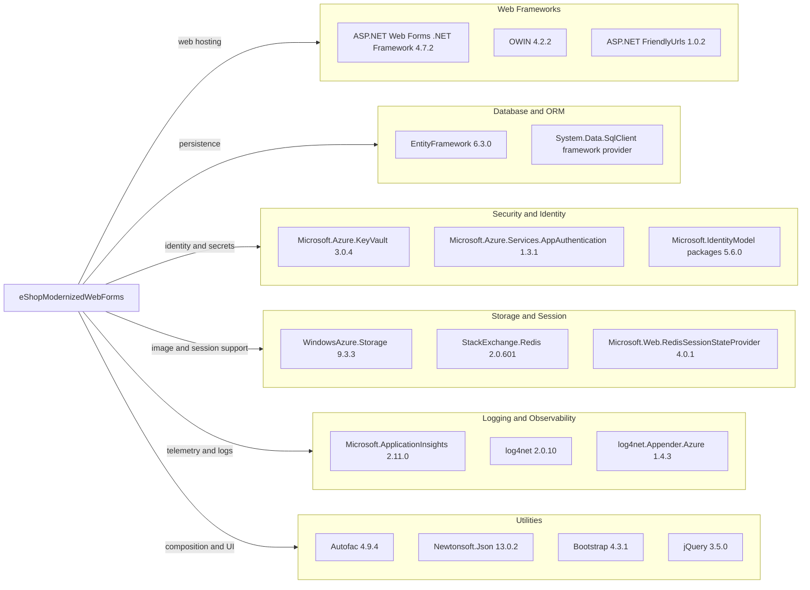

# Dependency Map

The `eShopModernizedWebForms` project uses legacy NuGet `packages.config` management. It contains 147 package entries, including packages resolved as part of the legacy dependency closure; the diagram highlights the principal runtime dependencies.

## Dependencies

### Dependency Summary

| Category | Count shown | Key Libraries | Notes |
|---|---:|---|---|
| Web Frameworks | 3 | ASP.NET Web Forms, OWIN, FriendlyUrls | Full .NET Framework application |
| Database / ORM | 2 | Entity Framework, SqlClient | EF6 over SQL Server |
| Security | 3 | Azure Key Vault, App Authentication, IdentityModel | Optional identity and secret integrations |
| Storage / Session | 3 | Azure Storage, StackExchange.Redis, Redis session provider | Blob storage is used when enabled; Redis provider configuration was not identified |
| Logging / Observability | 3 | Application Insights, log4net, Azure appender | Telemetry and logging integrations |
| Utilities | 4 | Autofac, Newtonsoft.Json, Bootstrap, jQuery | Dependency injection and UI/runtime utilities |

### Version & Compatibility Risks

The application targets .NET Framework 4.7.2 and uses a legacy `packages.config` project with numerous older package versions. The dependency scan identified medium-severity advisories affecting `Microsoft.IdentityModel.JsonWebTokens` 5.6.0 and log4net 2.0.10. The AppCAT assessment also reported package compatibility and upgrade recommendations.

### Notable Observations

- The solution has 147 package entries in its package manifest, so the dependency tree is broader than the principal runtime libraries shown above.
- Redis and Azure Service Bus packages are present in the package manifest, but active application usage was not established for those integrations.
- No test-scoped packages or separate test project were identified in the solution.

## Test Dependencies

| Framework | Version | Notes |
|---|---|---|
| None detected | — | No test project or test-scoped package was found in the solution manifest. |

Total test-scope dependencies: 0

No test infrastructure was detected in the solution.
