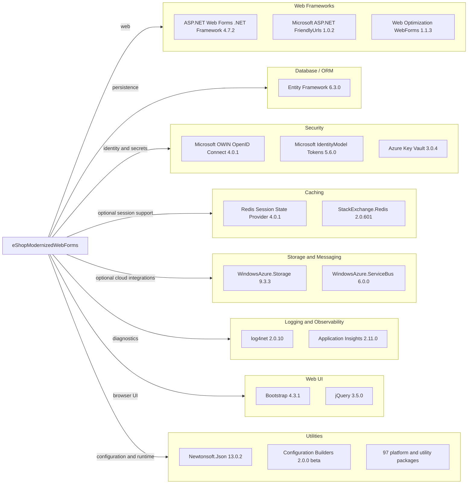

# Dependency Map

The `eShopModernizedWebForms` solution uses a legacy .NET Framework package manifest. Its `packages.config` contains 147 package entries, including platform and transitive package entries; key modernization dependencies are shown below.

## Dependencies

### Dependency Summary

| Category | Count | Key Libraries | Notes |
|---|---:|---|---|
| Web Frameworks | 16 | ASP.NET Web Forms, FriendlyUrls, Web Optimization WebForms | Legacy server-rendered web stack |
| Database / ORM | 1 | Entity Framework 6.3.0 | SQL Server provider is part of the EF package |
| Authentication / Security | 18 | OWIN, IdentityModel, Azure Key Vault | Optional OpenID Connect and externalized secrets |
| Caching / Session State | 2 | Redis Session State Provider, StackExchange.Redis | Session provider configuration is commented out |
| Storage / Messaging | 2 | WindowsAzure.Storage, WindowsAzure.ServiceBus | Azure Storage is used; no service-bus workflow was identified |
| Logging / Observability | 11 | log4net, Application Insights | Legacy telemetry libraries |
| Utilities / Platform | 97 | Newtonsoft.Json, configuration builders, System libraries | Includes many framework and platform-support packages |

### Version & Compatibility Risks

The application targets .NET Framework 4.7.2 and depends on EF6, OWIN, older IdentityModel packages, and a beta generation of configuration builders. The CVE scan matched the declared `log4net` 2.0.10 and Microsoft IdentityModel token packages to medium-severity advisories. The dependency-list CLI could not evaluate the legacy project because `Microsoft.WebApplication.targets` is absent, so the vulnerability scan used direct package-manifest entries rather than a resolved transitive tree.

### Notable Observations

- `packages.config` contains 147 entries; the project has no separate test project or test-scoped package set.
- The project declares Redis and Azure Service Bus packages, but no active cache or message-bus flow was identified in the application source/configuration.
- Application Insights, Azure Storage, Azure AD, and Key Vault integrations are optional and controlled by configuration.

## Test Dependencies

| Framework | Version | Notes |
|---|---|---|
| None detected | — | No test project or test-scoped packages were found in the assessed solution |

Total test-scope dependencies: 0

No test dependencies or automated test project were detected in this workspace.
