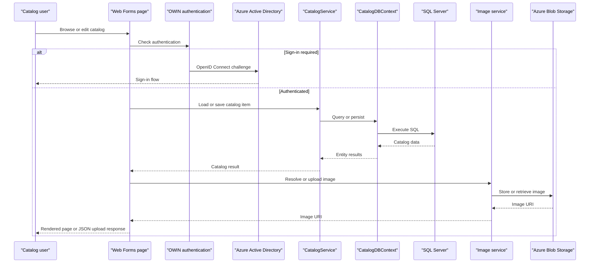

# API & Service Communication Contracts

The application exposes server-rendered catalog pages and one ASMX image-upload operation. Requests are handled within the Web Forms application; no versioned REST API, API gateway, or inter-service messaging flow was identified.

## Service Catalog

| Service | Port | Category | Purpose |
|---|---|---|---|
| eShopModernizedWebForms | IIS/IIS Express configured externally | API Layer / Web UI | Catalog browsing and administration, authentication, and image upload |
| SQL Server | External configuration | Infrastructure | Catalog persistence |
| Azure Blob Storage | External configuration | Infrastructure | Image storage and delivery when enabled |
| Redis | External configuration | Infrastructure | ASP.NET session state when enabled |
| Azure Active Directory | External identity provider | Infrastructure | OpenID Connect sign-in |

## API Endpoints Inventory

| Service | Method | Path | Request Type | Response Type |
|---|---|---|---|---|
| Web Forms | GET | `/Default` | None | Rendered catalog page |
| Web Forms | GET | `/Default/index/{index}/size/{size}` | Route values `index`, `size` | Rendered catalog page |
| Web Forms | GET/POST | `/Catalog/Create` | Form fields for a catalog item | Rendered page or redirect |
| Web Forms | GET/POST | `/Catalog/Edit/{id}` | Route `id` and catalog form fields | Rendered page or redirect |
| Web Forms | GET | `/Catalog/Details/{id}` | Route `id` | Rendered item details |
| Web Forms | GET/POST | `/Catalog/Delete/{id}` | Route `id` and postback | Rendered confirmation or redirect |
| Web Forms | POST | `/Catalog/PicUploader.asmx/UploadImage` | Multipart image (`HelpSectionImages`) and form `itemId` | JSON containing image name and URL |

No API versioning scheme is configured. The upload operation returns HTTP 400 for an invalid image; page operations use Web Forms postbacks and redirects.

## Management & Observability Endpoints

| Service | Endpoint | Custom Metrics (if any) |
|---|---|---|
| eShopModernizedWebForms | None identified | Application Insights telemetry is initialized; no custom metric registration found |

## DTOs & Contracts

`CatalogItem` is the catalog response and form model; it references `CatalogBrand` and `CatalogType`. `PaginatedItemsViewModel<CatalogItem>` packages a page of catalog results. The ASMX upload response is an anonymous JSON object with `name` and `url` properties. No dedicated request/response DTO layer, OpenAPI specification, protobuf schema, or GraphQL schema was found. JSON serialization for upload responses uses `JavaScriptSerializer`; Web Forms page models are mutable classes.

## Communication Patterns

Page and service calls are synchronous in-process calls. `CatalogService` accesses SQL Server through EF6; image operations use Azure Blob Storage or local files. OpenID Connect redirects to Azure Active Directory and maintains an application cookie. There are no discovered message-broker calls, service discovery mechanisms, API gateway composition, circuit breakers, retry policies, or application-level load balancing. SQL can use a configured connection string or an Azure managed-identity access token. The `pics` blob container is configured for public blob reads to support image delivery. HTTPS/TLS is not configured in the inspected application source and is expected to be supplied by hosting.

## Service Technology Matrix

| Service | Web | Data Access | Discovery | Gateway | Actuator | Cache | Metrics |
|---|---|---|---|---|---|---|---|
| eShopModernizedWebForms | ASP.NET Web Forms | EF6 / SQL Server | None | None | None found | Redis session | Application Insights |

## Service Communication Sequence

