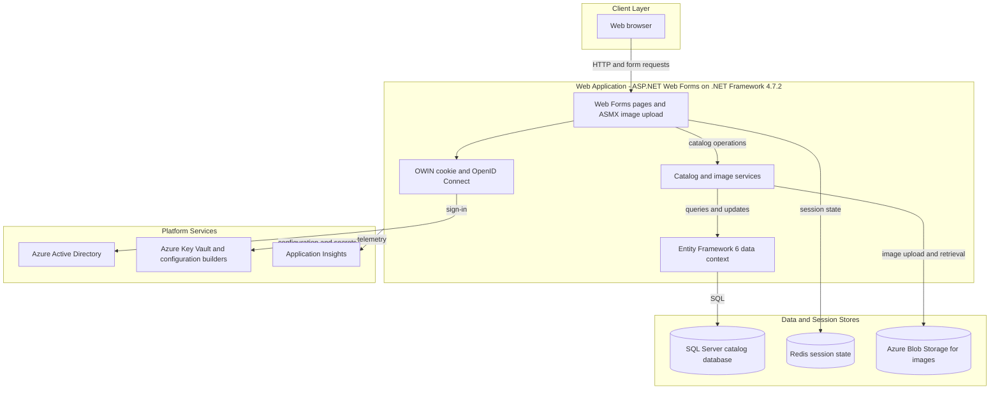
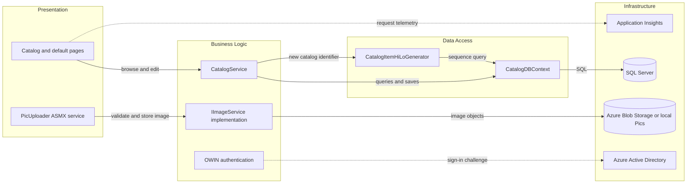

# Architecture Diagram

The application is a single IIS-hosted e-commerce catalog site. Its server-rendered Web Forms UI uses an application service and Entity Framework data layer, with optional Azure integrations selected by configuration.

## Application Architecture

### Technology Stack Summary

| Layer | Technology | Version | Purpose |
|---|---|---:|---|
| Presentation | ASP.NET Web Forms | .NET Framework 4.7.2 | Server-rendered catalog pages and image upload service |
| Authentication | OWIN Cookie and OpenID Connect | OWIN packages 4.x | User sign-in through Azure Active Directory |
| Business | Catalog and image services | In-repository | Catalog browsing, edits, and image handling |
| Data access | Entity Framework 6 | 6.3.0 | Catalog queries and persistence |
| Data | SQL Server | Configured externally | Catalog entities and lookup values |
| Session | Redis session state provider | 4.0.1 | Web session persistence when enabled |
| Image storage | Azure Blob Storage | WindowsAzure.Storage 9.3.3 | Public catalog image delivery |
| Telemetry | Application Insights | 2.11.x | Application telemetry |

### Data Storage & External Services

Catalog records are persisted in SQL Server through Entity Framework. Image assets use Azure Blob Storage when configured; the alternative image service serves local `Pics` assets. Redis is configured as a session-state provider. Azure Active Directory supplies OpenID Connect authentication, while configuration builders support environment variables, user secrets, and an optional Key Vault source. Application Insights receives telemetry.

### Key Architectural Decisions

- Autofac selects mock or database-backed catalog services, image storage, and managed-identity or connection-string SQL access from application settings.
- `CatalogService` owns catalog operations and uses a scoped `CatalogDBContext`; there is no separate repository layer.
- The UI and data services are deployed as one Web Forms application; no API gateway or service-to-service topology is present.

## Component Relationships

### Component Inventory

| Component | Layer | Type | Responsibility |
|---|---|---|---|
| Default and Catalog pages | Presentation | Web Forms pages | Browse, view, create, edit, and delete catalog items |
| PicUploader | Presentation | ASMX web service | Validates image format and accepts image uploads |
| CatalogService | Business Logic | Application service | Catalog queries and create/update/delete operations |
| ImageAzureStorage / ImageMockStorage | Business Logic | Image service implementations | Store, move, and resolve catalog image URLs |
| Startup authentication | Business Logic | OWIN middleware | Cookie session and OpenID Connect authentication |
| CatalogDBContext | Data Access | EF6 DbContext | Maps catalog entities and executes persistence operations |
| CatalogItemHiLoGenerator | Data Access | Identifier generator | Obtains catalog item identifiers from SQL sequences |
| ApplicationModule | Infrastructure | Autofac module | Selects implementations and lifetimes from settings |
