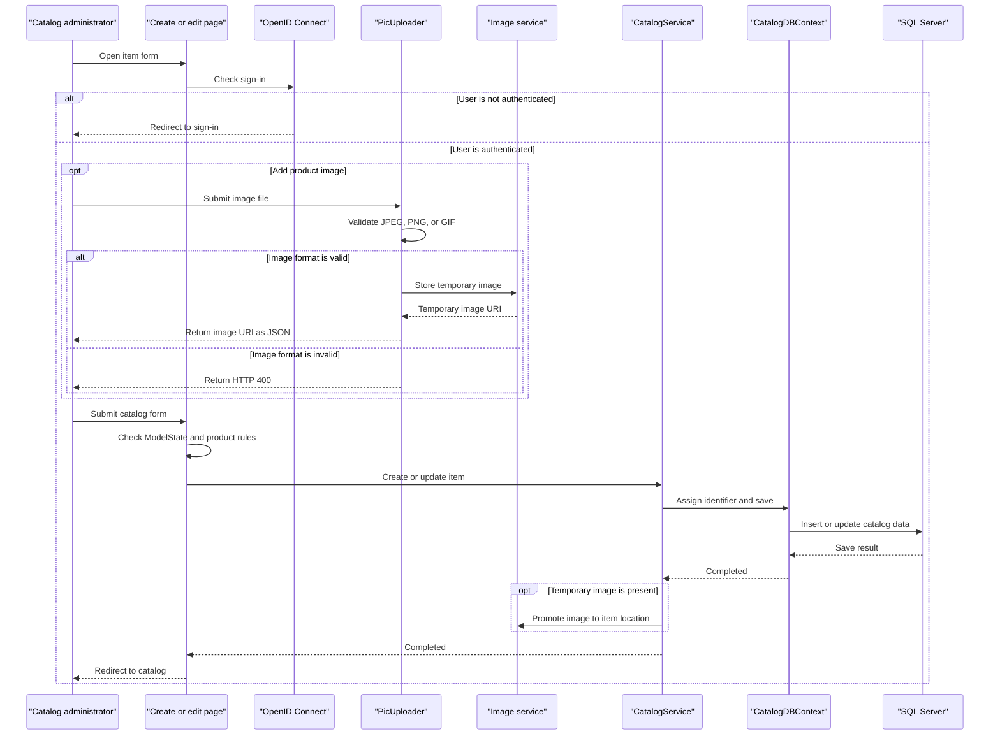

# Core Business Workflows

The application supports an online product catalog: visitors browse and inspect items, while authenticated users maintain catalog products and their images. Catalog brands and types classify each item.

## Domain Entities

| Entity | Service / Bounded Context | Description | Key Relationships |
|---|---|---|---|
| CatalogItem | Catalog management | A product available for browsing and inventory tracking | Belongs to one CatalogBrand and one CatalogType |
| CatalogBrand | Catalog management | Brand classification for products | Can be associated with many CatalogItems |
| CatalogType | Catalog management | Type/category classification for products | Can be associated with many CatalogItems |

## Service-to-Domain Mapping

| Service | Domain Context | Owned Entities | External Dependencies |
|---|---|---|---|
| eShopModernizedWebForms | Catalog management | CatalogItem, CatalogBrand, CatalogType | SQL Server for persistence; Azure Blob Storage or local files for images; Azure AD for sign-in |

All business data is owned by the single web application. There are no separate domain services or cross-context event exchanges.

## Primary Workflows

### Workflow 1: Browse catalog

1. A visitor opens `/Default` or a paginated catalog route.
2. The page reads the route’s page index and page size, or applies the default page values.
3. `CatalogService` loads ordered items and associated brand/type data through `CatalogDBContext`, or uses the configured mock service.
4. The image service resolves each item’s display URI; the page binds the results and renders pagination.

### Workflow 2: Maintain a catalog item

1. A user opens a create, edit, or delete page. The page initiates an OpenID Connect challenge if the request is unauthenticated.
2. Create and edit postbacks bind form values to a `CatalogItem` and proceed only when `ModelState.IsValid`.
3. `CatalogItem` annotations constrain price format/range and stock values; brand and type selections are associated with the item.
4. Create assigns an identifier using the HiLo SQL sequence before saving; edit marks the entity modified; delete removes the selected item.
5. Successful changes redirect to the catalog home page.

### Workflow 3: Upload a product image

1. The browser posts a file and optional item ID to `PicUploader.UploadImage`.
2. The service loads the image using `Image.FromStream` and accepts JPEG, PNG, or GIF formats.
3. The selected image service uploads or resolves the image and returns a URI; create/edit workflows associate its temporary name with a product.
4. Azure image storage copies a temporary blob to the item-specific blob name after the catalog operation.

## Cross-Service Data Flows

No inter-service aggregation or service-to-service calls were found. Catalog pages obtain entities through the local catalog service and EF6 context. Image metadata is associated with a catalog item, while image bytes live in the selected image store. If Azure storage is disabled, the mock image service resolves local images instead.

## Business Workflow Sequence

## Business Rules & Decision Logic

- Price must use a positive numeric representation with at most two decimal places and must fit the configured range.
- Available stock, restock threshold, and maximum stock are constrained to the annotated range from zero through ten million.
- New catalog item IDs are generated from a SQL HiLo sequence in database mode.
- Catalog items require a brand and type relationship; the database mapping enforces both associations.
- Only JPEG, PNG, and GIF image formats are accepted by the upload endpoint.
- Create/update postbacks save only when Web Forms `ModelState.IsValid`; deletion removes the selected item.
- EF6 `SaveChanges` provides the persistence boundary. No distributed transaction, saga, audit trail, or business-event workflow was identified.
- Page handlers initiate OpenID Connect sign-in for unauthenticated users; role-specific authorization rules were not identified.
