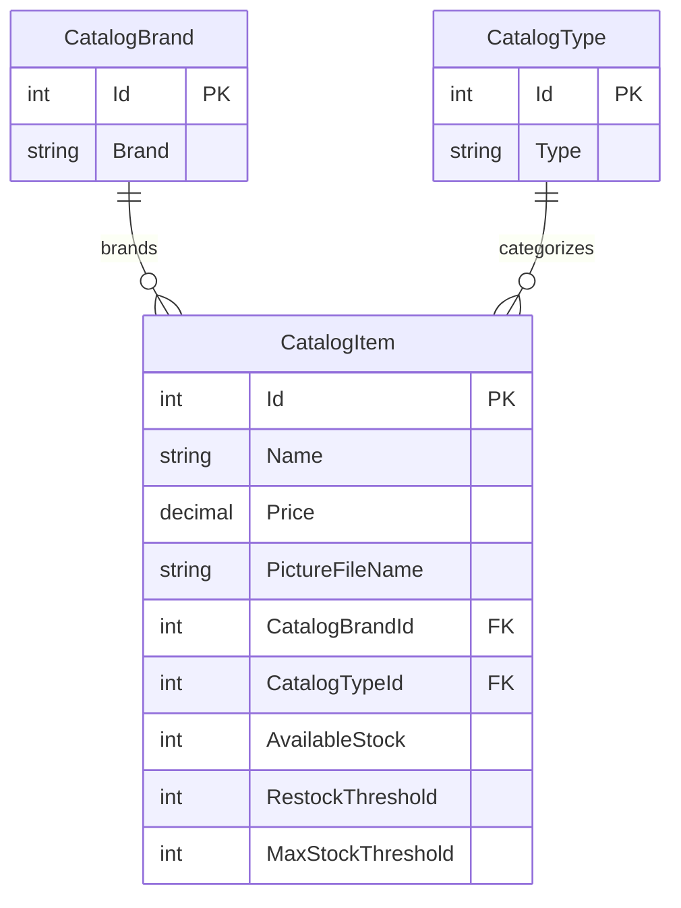

# Data Architecture & Persistence Layer

The data model is a compact catalog schema with three core entities. SQL Server persistence is implemented with Entity Framework 6; a mock catalog service is also available for local or test-like operation.

## Database Configuration

| Service/Module | DB Type | Profile | Driver | Connection | Migration Tool |
|---|---|---|---|---|---|
| eShopModernizedWebForms | SQL Server | Database-backed mode | System.Data.SqlClient | `CatalogDBContext` connection string, supplied through configuration builders | No migration framework identified; initializer runs SQL sequence scripts and imports seed CSV data |
| eShopModernizedWebForms | None | Mock mode (default setting) | — | In-memory/mock service | Not applicable |

## Data Ownership per Service

| Service | Tables Owned | ORM Framework | Caching | Notes |
|---|---|---|---|---|
| eShopModernizedWebForms | `Catalog`, `CatalogBrand`, `CatalogType` | Entity Framework 6.3.0 | No entity cache identified; Redis is used for session state | One application owns the catalog schema; the initializer provisions sequences and optional seed content |

## Entity Model

The entity classes are `Models/CatalogBrand.cs`, `Models/CatalogType.cs`, and `Models/CatalogItem.cs`; mappings and required foreign keys are configured in `Models/CatalogDBContext.cs`. `CatalogItem` has required many-to-one relationships to brand and type. `PictureUri` and `TempImageName` are transient properties and are ignored by EF mapping. The context uses EF6 transactions for `SaveChanges`; no explicit transaction scope or migration framework was identified.

## Key Repository Methods

| Service | Repository | Notable Methods | Purpose |
|---|---|---|---|
| Catalog | `CatalogService` (`Services/CatalogService.cs`) | `GetCatalogItemsPaginated`, `FindCatalogItem`, `GetCatalogBrands`, `GetCatalogTypes` | Reads ordered catalog pages and lookup entities; includes brand and type references |
| Catalog | `CatalogService` (`Services/CatalogService.cs`) | `CreateCatalogItem`, `UpdateCatalogItem`, `RemoveCatalogItem` | Persists catalog item changes through EF6 |
| Catalog | `CatalogItemHiLoGenerator` (`Models/CatalogItemHiLoGenerator.cs`) | `GetNextSequenceValue` | Retrieves the next identifier from a SQL sequence |

There is no dedicated repository interface; `CatalogService` uses `CatalogDBContext` directly.

## Caching Strategy

No catalog entity or query-result cache was identified. The application configures Redis-backed ASP.NET session state when enabled; this stores session state rather than catalog records. Mock mode uses the in-repository mock catalog service.

## Data Ownership Boundaries

All catalog entities are owned by the Web Forms application and stored in the same SQL Server database. No cross-service database access, CQRS split, or distributed data composition was found. Catalog item rows reference brand and type rows through foreign keys. Image content is stored separately in Azure Blob Storage when that option is enabled; otherwise the mock image service references files beneath the application’s `Pics` directory.

### Data Classification & Sensitivity

| Entity | Sensitive Fields | Classification (PII/PHI/PCI/None) | Controls in Place |
|---|---|---|---|
| CatalogItem | Product name, description, price, image name, stock values | None identified | No field-level encryption or masking identified; catalog content is intended for display |
| CatalogBrand | Brand name | None identified | No field-level encryption or masking identified |
| CatalogType | Type name | None identified | No field-level encryption or masking identified |

No PII, PHI, or PCI data was identified in the catalog entity model.
