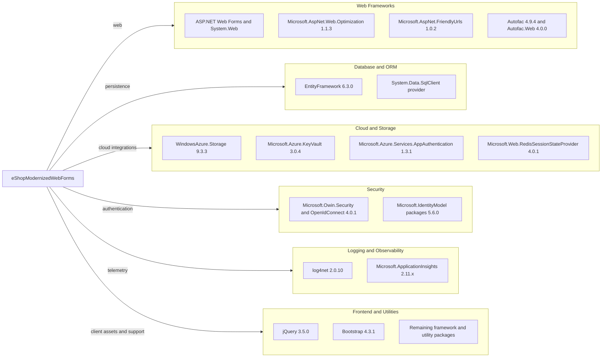

# Dependency Map

The application declares 147 NuGet package entries in `src/eShopModernizedWebForms/packages.config`; the map highlights the key runtime libraries and groups the remaining packages as supporting utilities and framework compatibility packages.

## Dependencies

### Dependency Summary

| Category | Count | Key Libraries | Notes |
|---|---:|---|---|
| Web Frameworks | 4 key packages | System.Web, Web Optimization, FriendlyUrls, Autofac | ASP.NET Web Forms on .NET Framework |
| Database / ORM | 1 key package | Entity Framework 6.3.0 | SQL Server access via configured connection factory |
| Cloud / Storage / Session | 4 key packages | Azure Storage, Key Vault, App Authentication, Redis provider | Optional services selected by configuration |
| Security | 2 key groups | OWIN OpenID Connect, IdentityModel | OIDC and token handling |
| Logging / Observability | 2 key groups | log4net, Application Insights | Application logging and telemetry |
| Frontend / Utilities | 134 supporting entries | jQuery, Bootstrap, Antlr, System.* packages | Includes framework support and transitive-style package entries from `packages.config` |

### Version & Compatibility Risks

The application targets .NET Framework 4.7.2 and uses legacy Web Forms, OWIN, and `packages.config` package management. The dependency set includes older versions of Entity Framework, Azure libraries, Application Insights, and authentication components; migration to modern .NET requires a framework and application-model transition rather than a simple package update.

### Notable Observations

- The package manifest includes many `System.*` and Microsoft.Extensions compatibility packages, increasing upgrade coordination effort.
- Redis session and Azure storage are optional runtime integrations; their packages are declared even when mock/local modes are configured.
- WindowsAzure.ServiceBus is declared, but no active application use was identified in the inspected source.

## Test Dependencies

| Framework | Version | Notes |
|---|---|---|
| None detected | — | No test-scoped dependencies are declared in the application `packages.config`. |

Total test-scope dependencies: 0

No test framework or integration-test package is declared in this project manifest.
