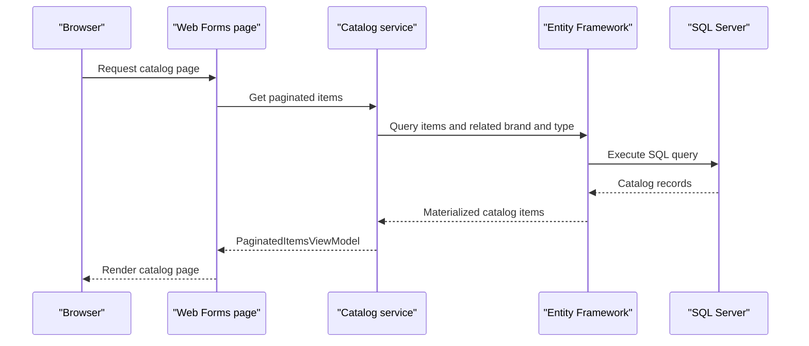

# API & Service Communication Contracts

The solution is one Web Forms application with page routes and a single ASMX image upload method; it does not expose a separately deployed REST API or communicate with other application services.

## Service Catalog

| Service | Port | Category | Purpose |
|---|---|---|---|
| eShopModernizedWebForms | Configured by IIS/container; not fixed in application files | API Layer | Serves catalog pages and accepts image uploads |

## API Endpoints Inventory

| Service | Method | Path | Request Type | Response Type |
|---|---|---|---|---|
| eShopModernizedWebForms | GET | `/Default` | None | Catalog page |
| eShopModernizedWebForms | GET | `/Default/index/{index}/size/{size}` | Route values | Paginated catalog page |
| eShopModernizedWebForms | GET / POST | `/Catalog/Create` | Web Forms fields | Page or redirect |
| eShopModernizedWebForms | GET / POST | `/Catalog/Edit/{id}` | Route id and form fields | Page or redirect |
| eShopModernizedWebForms | GET | `/Catalog/Details/{id}` | Route id | Catalog details page |
| eShopModernizedWebForms | GET / POST | `/Catalog/Delete/{id}` | Route id and confirmation | Page or redirect |
| eShopModernizedWebForms | POST | `/Catalog/PicUploader.asmx/UploadImage` | Multipart image and itemId | JSON image name and URL; 400 for invalid image |

Routes are defined in `App_Start/RouteConfig.cs`. No URL or header API versioning scheme was found.

## Management & Observability Endpoints

| Service | Endpoint | Custom Metrics |
|---|---|---|
| eShopModernizedWebForms | None identified | Application Insights request/dependency telemetry; no custom metrics endpoint |

## DTOs & Contracts

`CatalogItem`, `CatalogBrand`, and `CatalogType` are mutable service/domain classes shared between the page layer and catalog service. `PaginatedItemsViewModel<CatalogItem>` is the catalog listing response model. `PicUploader.UploadImage` returns a small JSON object containing the uploaded image URL and its path/query name. No OpenAPI, protobuf, or GraphQL schema was found.

## Communication Patterns

Page handlers synchronously call `ICatalogService` and `IImageService`; the database-backed catalog uses EF6 against SQL Server. When Azure storage is enabled, image operations call the Azure Blob Storage SDK. OWIN OpenID Connect can redirect users to Azure Active Directory. There is no message broker, service discovery, API gateway, retry policy, circuit breaker, or cross-service aggregation. Key Vault can provide optional configuration values. OWIN authentication is configured, while page-level authorization is not consistently applied; transport TLS is expected to be configured by the host rather than enforced by application routes.

## Service Technology Matrix

| Service | Web | Data Access | Discovery | Gateway | Actuator | Cache | Metrics |
|---|---|---|---|---|---|---|---|
| eShopModernizedWebForms | ASP.NET Web Forms / ASMX | EF6 / SQL Server | None | None | None | Optional Redis session provider is commented out | Application Insights |

## Service Communication Sequence

