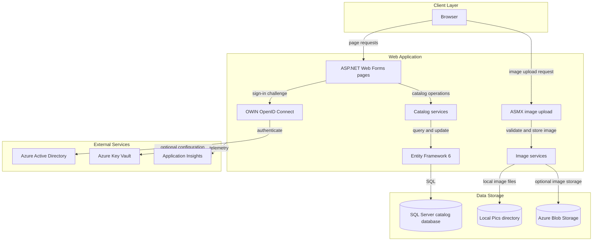
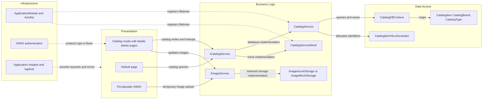

# Architecture Diagram

The solution contains a single ASP.NET Web Forms catalog application with page-based presentation, catalog services, and optional image and database integrations.

## Application Architecture

### Technology Stack Summary

| Layer | Technology | Version | Purpose |
|---|---|---|---|
| Presentation | ASP.NET Web Forms | .NET Framework 4.7.2 | Server-rendered catalog pages and CRUD forms |
| Authentication | OWIN OpenID Connect | 4.x packages | Optional Azure Active Directory sign-in |
| Dependency injection | Autofac | 4.9.4 | Web Forms services and per-request scopes |
| Business logic | Catalog and image services | Application code | Catalog operations and image handling |
| Persistence | Entity Framework | 6.3.0 | SQL Server catalog access |
| Observability | Application Insights and log4net | 2.11.x / 2.0.10 | Telemetry and application logging |

### Data Storage & External Services

The catalog can use SQL Server through Entity Framework or an in-memory mock service. Images are served from the application `Pics` directory or optionally uploaded to Azure Blob Storage. Azure Active Directory, Key Vault, and Application Insights are optional integrations controlled by configuration.

### Key Architectural Decisions

- Autofac selects the mock or database-backed catalog and local or Azure image service at application startup.
- Entity Framework maps catalog items to required catalog brand and type records.
- Application initialization configures routes, dependency injection, database initialization, image storage, and telemetry.

## Component Relationships

### Component Inventory

| Component | Layer | Type | Responsibility |
|---|---|---|---|
| Default page | Presentation | Web Forms page | Displays the paginated catalog |
| Catalog pages | Presentation | Web Forms pages | Create, edit, view, and delete catalog items |
| PicUploader | Presentation | ASMX script service | Validates and accepts catalog image uploads |
| CatalogService | Business Logic | Service | Queries and updates the SQL-backed catalog |
| CatalogServiceMock | Business Logic | Mock service | Serves and mutates in-memory catalog data |
| ImageAzureStorage | Business Logic | Image service | Stores images in Azure Blob Storage |
| ImageMockStorage | Business Logic | Image service | Resolves local catalog images |
| CatalogDBContext | Data Access | EF6 DbContext | Maps catalog entities to SQL Server |
| ApplicationModule | Infrastructure | Autofac module | Selects and registers service implementations |
