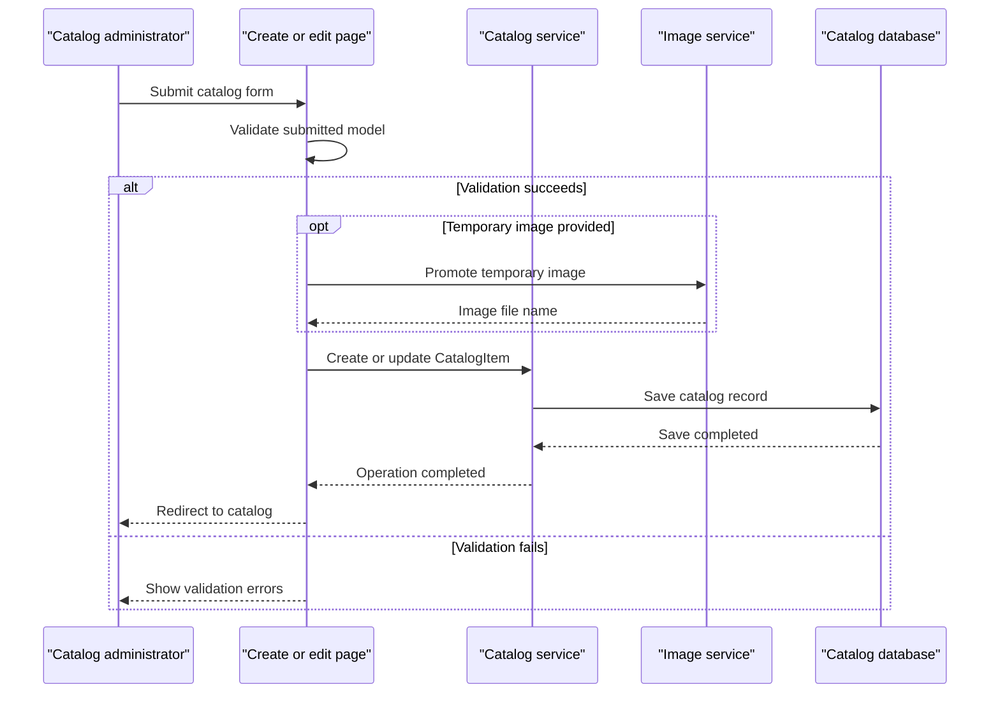

# Core Business Workflows

The application supports browsing and maintaining an e-commerce catalog of products, brands, types, prices, stock levels, and product images.

## Domain Entities

| Entity | Service / Bounded Context | Description | Key Relationships |
|---|---|---|---|
| CatalogItem | Catalog | Product displayed and maintained in the catalog | Belongs to a CatalogBrand and CatalogType |
| CatalogBrand | Catalog | Brand associated with catalog products | Can be associated with many CatalogItems |
| CatalogType | Catalog | Product category/type | Can classify many CatalogItems |

## Service-to-Domain Mapping

| Service | Domain Context | Owned Entities | External Dependencies |
|---|---|---|---|
| eShopModernizedWebForms | Catalog management | CatalogItem, CatalogBrand, CatalogType | SQL Server or mock data; local files or Azure Blob Storage for images |

There is no multi-service domain exchange. Catalog services are the source of truth for catalog records; image services manage image content separately.

## Primary Workflows

### Workflow 1: Browse the Catalog

1. A visitor opens the default page or a paginated route.
2. The page requests catalog items, brands, and types from `ICatalogService`.
3. The database implementation loads an ordered page through EF6; the mock implementation reads its in-memory list.
4. The page resolves image URLs and renders the catalog.

### Workflow 2: Create or Update a Catalog Item

1. A catalog administrator opens the create or edit form; the page issues an OpenID Connect sign-in challenge when the request is unauthenticated.
2. The form applies its model and field validators, then constructs a CatalogItem from submitted values.
3. If a temporary image is present, the page extracts its file name and the image service moves/copies the image to the catalog location.
4. The catalog service saves the item and redirects to the catalog.

### Workflow 3: Upload a Catalog Image

1. The client posts a multipart image and item identifier to the ASMX upload method.
2. The handler decodes the image and accepts JPEG, PNG, or GIF formats.
3. The configured image service returns a temporary image URL, which the handler returns as JSON.
4. The create/edit workflow can then associate the uploaded image with a catalog item.

## Cross-Service Data Flows

No application services communicate with one another. The optional Azure Blob Storage integration is a storage dependency, not a separate business service; catalog items store the selected image file name and build the image URL through the configured image service.

## Business Workflow Sequence

## Business Rules & Decision Logic

- A catalog item must reference an existing brand and type; EF mapping configures both relationships as required.
- Price and stock-related values are constrained by data annotations and the Web Forms validators.
- Item identifiers are allocated by the HiLo sequence generator in the database-backed service; the mock service assigns an incremented maximum identifier.
- Image upload content is decoded and restricted to supported image formats before storage.
- Catalog data may be seeded from built-in records or customization CSV files.
- Create and edit pages initiate OpenID Connect authentication when the current request is unauthenticated. The inspected application does not define a broader role-based authorization policy.
