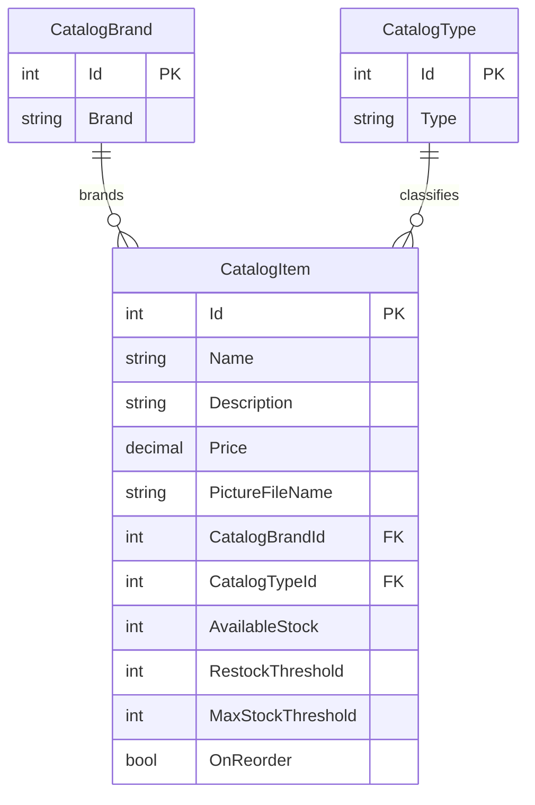

# Data Architecture & Persistence Layer

The application owns a catalog data model persisted through Entity Framework 6 to SQL Server when mock data is disabled. The model contains three entity types and stores catalog images separately in local files or optional Azure Blob Storage.

## Database Configuration

| Service/Module | DB Type | Profile | Driver | Connection | Migration Tool |
|---|---|---|---|---|---|
| eShopModernizedWebForms | SQL Server | `UseMockData=false` | System.Data.SqlClient | `CatalogDBContext` connection string supplied through Web.config builders | EF database initializer and SQL sequence scripts; no migration tool found |
| eShopModernizedWebForms | In-memory mock list | `UseMockData=true` by default | None | Process memory | Not applicable |

Catalog initialization seeds data from built-in records or optional CSV files. Sequence scripts are executed during database seeding. Database and connection-string values are externalized through configuration builders; see `configuration-inventory.md`.

## Data Ownership per Service

| Service | Tables Owned | ORM Framework | Caching | Notes |
|---|---|---|---|---|
| eShopModernizedWebForms | Catalog, CatalogBrand, CatalogType | Entity Framework 6.3.0 | No application data cache | One catalog bounded context and one database context |

## Entity Model

`CatalogDBContext` maps the entities in `Models/CatalogDBContext.cs`; catalog items require both a brand and a type. Entity files are `Models/CatalogItem.cs`, `Models/CatalogBrand.cs`, and `Models/CatalogType.cs`. Database operations use EF6 change tracking and `SaveChanges`; no explicit transaction scope was found.

## Key Repository Methods

| Service | Repository | Notable Methods | Purpose |
|---|---|---|---|
| eShopModernizedWebForms | No repository abstraction | `CatalogService.GetCatalogItemsPaginated`, `FindCatalogItem`, `GetCatalogTypes`, `GetCatalogBrands`, `CreateCatalogItem`, `UpdateCatalogItem`, `RemoveCatalogItem` | Uses `CatalogDBContext` DbSets directly for catalog queries and persistence |

## Caching Strategy

No application-level catalog cache is configured. The default mock implementation keeps catalog objects in a process-wide singleton list. An optional Redis session-state provider is present only as a commented Web.config example; it is not active by default.

## Data Ownership Boundaries

The single application owns all catalog records in one SQL Server database; there are no service-to-service database boundaries or cross-service queries. Images are stored independently from catalog rows, with local files in the default mock image path or optional Azure Blob Storage. Catalog rows reference image names and are not a separate image data store.

### Data Classification & Sensitivity

| Entity | Sensitive Fields | Classification (PII/PHI/PCI/None) | Controls in Place |
|---|---|---|---|
| CatalogItem | None identified | None | Catalog descriptions, prices, stock, and image references; no special field-level controls |
| CatalogBrand | None identified | None | Public catalog data |
| CatalogType | None identified | None | Public catalog data |
